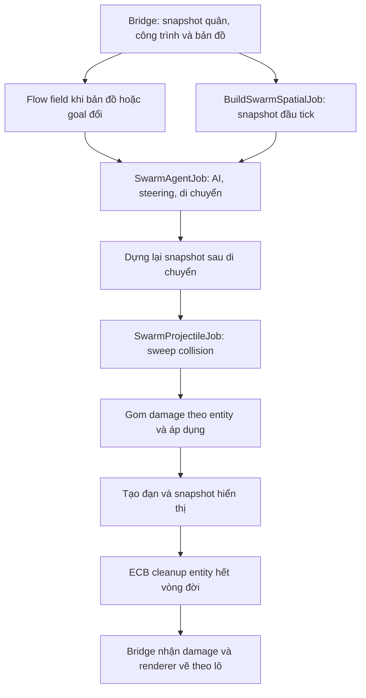

# Kiến trúc DOTS cho AI quái vật, đạn và mô phỏng Swarm

Để định hướng phát triển tiếp, đọc [Tech Overview](../../TechnicalOverview.md) và [DOTS Development Guide](DevelopmentGuide.md). Tài liệu này tập trung vào thuật toán/runtime Swarm; phần gameplay RTS nằm trong [DOTS Gameplay](../DOTSGameplay/Architecture.md).

## 1. Bối cảnh và mục tiêu

Dự án dùng Unity 6000.3.11f1, URP 2D, Tilemap và C#. Trước khi chuyển đổi, mỗi quái có `EnemyUnit`/`EnemyRangerUnit`, `AIPawn`, `Animator`, `SpriteRenderer` và collider. `AIPawn.CalculateSeperation` duyệt toàn bộ danh sách quân cho từng đối tượng; với N quái, bước này có thể thực hiện xấp xỉ N² phép so sánh mỗi frame. Quái tìm đường A* riêng, còn đạn dùng MonoBehaviour, coroutine và sự kiện Physics2D.

Module mới chuyển dữ liệu và logic quái/đạn sang ECS; chạy các vòng lặp lớn bằng Job System và Burst; dùng cấu trúc không gian để giới hạn số ứng viên va chạm. Scene `SwarmSimulation` dùng cùng runtime với trận RTS để kiểm tra tải lớn độc lập.

Phần chuyển đổi tiếp theo đã đưa logic Worker, quân người chơi, công trình, cừu và trạng thái tài nguyên sang ECS, mô tả riêng trong [DOTS Gameplay](../DOTSGameplay/Architecture.md). UI, lịch ngày/đêm và presentation prefab vẫn là MonoBehaviour. Tài liệu này tập trung vào runtime quái/đạn và Swarm.

## 2. Cấu trúc module

```text
Assets/Game/DOTS/
  Runtime/             assembly RTS.DOTS, component, system, jobs, renderer, demo
  Integration/         SwarmGameBridge, liên kết với Unit và GameManager
  Editor/              tạo asset từ animation clip, tạo scene và build demo
  Resources/DOTS/      sprite library và shader instancing
  Tests/Editor/        kiểm thử chức năng trong Unity Test Framework
```

Assembly `RTS.DOTS` không tham chiếu `Unit`, `GameManager` hoặc các lớp gameplay cũ. `SwarmGameBridge` nằm trong Assembly-CSharp, có thể truy cập cả gameplay cũ và API module mới. Việc tách này cho phép dùng Swarm trong scene riêng và mở rộng sang module sinh bản đồ sau này.

Package được ghim trong manifest: Entities 1.4.8, Unity Physics 1.4.7, Burst 1.8.29, Collections 2.6.8 và Mathematics 1.3.3. Không sử dụng API conversion cũ như `ConvertToEntity`.

## 3. Mô hình dữ liệu ECS

| Kiểu | Vai trò |
|---|---|
| `CombatBody` | Vị trí XY hiện tại/trước đó, bán kính broadphase, máu, phe, khả năng bị chọn, collider blob và ID ngoài ECS |
| `SwarmAgent` | Mục tiêu entity, vận tốc, thông số AI/đánh, cooldown, windup, trạng thái và visual ID |
| `SwarmProjectile` | Chủ sở hữu, mục tiêu, vị trí, quỹ đạo, damage, tuổi, thời gian sống và scale |
| `ProjectileParameters` | Tốc độ, kiểu bay, độ cao cung, xoay, scale và giới hạn thời gian bay lấy từ prefab |
| `TargetSnapshot` | Bản sao dữ liệu mục tiêu chỉ đọc trong một bước tính toán |
| `DamageEvent` | Yêu cầu gây damage, sinh từ job hoặc cầu nối gameplay |
| `ProjectileRequest` | Yêu cầu tạo đạn sau khi job AI hoàn thành |
| `SwarmRenderData` | Snapshot phục vụ hiển thị; không chứa GameObject/Animator |
| `ExternalDamage` | API tương thích cho body ngoài gameplay; không echo damage của `GameplayActor` về MonoBehaviour |

Phe 0 là người chơi/mục tiêu demo; phe 1 là quái; phe 2 là cừu trung lập; phe -1 là vật cản. AI quái chỉ tự tìm phe người chơi, trong khi đạn có thể tương tác với proxy cừu khi săn bằng Archer. Collider được chia sẻ bằng `BlobAssetReference<Unity.Physics.Collider>` và cache theo kích thước. System sở hữu các blob do runtime tạo và giải phóng chúng khi World bị hủy.

`Entity` chứa cả index và version. Mọi API truy vấn kiểm tra entity tồn tại và còn targetable; không lưu riêng index để dùng lại sau despawn.

Entity runtime được tạo theo archetype bằng `SwarmSimulationSystem`. Các prefab GameObject cũ cung cấp thông số authoring qua `Unit.GetDotsSettings()`, nhưng không được instantiate thành GameObject cho từng quái. Animation clip được công cụ Editor chuyển thành sprite frame library. Module không yêu cầu SubScene hay một pipeline baking prefab riêng.

## 4. Luồng thực thi và Job System

`SwarmSimulationSystem` nằm trong `FixedStepSimulationSystemGroup`. Những truy cập UnityEngine/GameObject được thực hiện ở cầu nối trên main thread; job chỉ làm việc với component và dữ liệu native.



Các job có `[BurstCompile]` và chạy qua `ScheduleParallel`. Dependencies được truyền rõ giữa các bước. Có các điểm `Complete()` tại ranh giới snapshot, damage/structural changes và xuất dữ liệu render. Đây là đánh đổi hiện tại để đảm bảo an toàn dữ liệu và hỗ trợ cầu nối MonoBehaviour; không tuyên bố toàn bộ pipeline bất đồng bộ không có đồng bộ main thread.

Lưới, bảng mục tiêu, hàng đợi sự kiện, flow field và render list được giữ bằng allocator Persistent. Capacity tăng khi cần rồi tái sử dụng. Entity Command Buffer được dùng cho cleanup; quá trình tạo entity/đạn hiện thực hiện ở ranh giới tick trên main thread. Nếu spawn thành nút thắt ở tải cao, có thể chuyển sang instantiate theo lô hoặc ECB playback theo ngân sách.

## 5. Spatial hash và tránh chồng lấn

Không gian XY được chia thành ô 1.5 world units. Khóa ô là `int2`, tránh nhầm các ô khác nhau do tự ghép khóa hash thiếu kiểm tra. Mỗi body được đưa vào các ô giao với vùng bao phủ vị trí cũ/mới và bán kính broadphase.

AI đọc hàng xóm từ các ô gần vị trí. Lực separation đẩy quân ra khi khoảng cách nhỏ hơn tổng bán kính cộng khoảng đệm. Lực này kết hợp với hướng di chuyển và được làm mượt thành vận tốc. Vị trí hàng xóm lấy từ snapshot; job không đọc một body đang bị job khác sửa.

Số ứng viên được giới hạn trong vùng quá đông để tránh quay lại chi phí N². Vì vậy đây là steering kinematic với separation mềm: đám đông rất dày có thể còn chồng lấn. Không phải bộ giải rigidbody bảo đảm tách mọi tiếp xúc, và không bảo đảm độ phức tạp tuyến tính tuyệt đối ở mọi phân bố mật độ.

## 6. Flow field và cập nhật bản đồ

Grid lưu ô đi được bằng byte. Khi mục tiêu đổi ô hoặc map thay đổi, `FlowFieldJob` dùng BFS bốn hướng để tạo integration cost, rồi chọn hướng giảm cost trong tám hướng. Đi chéo bị cấm nếu một trong hai ô cạnh góc bị chặn. Steering hướng tới tâm ô tiếp theo để quân có bán kính thực đi qua mép tường trước khi rẽ.

Nếu goal nằm trong công trình, thuật toán seed vòng walkable gần nhất ở nhiều phía. Nhiều quái dùng chung field hướng tới căn cứ, giảm việc tìm đường A* riêng cho từng đối tượng. Với mục tiêu gần và đoạn đường đã kiểm tra thông thoáng, agent có thể đi trực tiếp.

`TilemapManager.NavigationVersion` thay đổi khi walkability cập nhật hoặc lưới được tái tạo. Bridge chụp lại grid khi version đổi, có giới hạn tần suất. Vị trí mới được kiểm tra bằng các bước ngắn và vùng bán kính; khi gặp ô chặn, di chuyển được thử riêng từng trục để trượt dọc vật cản.

Giới hạn: field chính hướng về một mục tiêu dùng chung. Những mục tiêu phụ xa/vòng qua nhiều chướng ngại chưa có cache field riêng. Grid giả định ô vuông và mặt phẳng XY phù hợp với map hiện tại. Scene demo có ba layout xác định trước; chúng không phải module procedural generation. Seed tái tạo bố trí spawn ban đầu; thứ tự cập nhật hash/job và phép tính float không bảo đảm mô phỏng giống từng bit giữa mọi máy.

## 7. AI và chiến đấu

Trạng thái quái gồm Moving, Attacking, Dead và Retreating. Tìm mục tiêu chạy khoảng mỗi 0.25–0.33 giây, phân pha theo entity. Agent ưu tiên mục tiêu hiện tại còn hợp lệ, có thể tìm quân người chơi lân cận, rồi dùng Town Hall làm mục tiêu chung.

Khi vào tầm, quái dừng, đếm cooldown và windup. Quái cận chiến phát `DamageEvent`; quái tầm xa phát `ProjectileRequest`. Gameplay không phụ thuộc Animation Event của hàng nghìn Animator. Visual attack dùng cùng thông tin thời gian để chọn frame.

Damage từ nhiều nguồn được cộng theo mục tiêu trước khi sửa máu. Một projectile được đánh dấu consumed khi trúng nên không gây damage nhiều lần. Quái chết ngừng tham gia target query, phát animation chết rồi được cleanup. Khi trời sáng, bridge gửi lệnh Retreating; quái không targetable, đi ra vòng ngoài và despawn, có timeout khi không tìm được đường ra.

## 8. Va chạm Unity Physics trong Burst

Module sử dụng collider queries của `com.unity.physics`, không gọi `Physics2D` từ job. Broadphase là spatial hash của module; narrowphase là `Collider.CastCollider` của Unity Physics với sphere đạn. Không xây thêm một PhysicsWorld broadphase trùng lặp.

Đạn quét từ vị trí trước đến vị trí mới. Truy vấn được thực hiện trong hệ tọa độ tương đối với vị trí cũ/mới của mục tiêu để nhận biết mục tiêu đang chuyển động cắt qua đường đạn. Chọn hit có fraction nhỏ nhất để vật cản gần hơn có thể chặn đạn. Chủ sở hữu và cùng phe bị loại khỏi ứng viên.

Quỹ đạo cung có vị trí gameplay XY và độ cao hiển thị riêng. Chiều cao animation không làm lệch collider khỏi mặt phẳng gameplay. Tốc độ, đạn thẳng/cung, xoay và giới hạn thời gian bay được đọc từ prefab legacy: ví dụ Gnoll giữ bone projectile thẳng với tốc độ cấu hình, Archer giữ thông số arrow. Projectile mất mục tiêu hoặc hết lifetime sẽ được loại bỏ.

Nav grid xử lý quân với địa hình; separation xử lý quân với quân. Collider queries xử lý đạn với body/vật cản. Không có gravity, impulse solver, bật nảy, ragdoll hay rigidbody dynamic. Collider2D không tự tương tác với collider DOTS: bridge tạo proxy box cho quân/công trình, proxy cho tài nguyên và strips cho địa hình. Hình dạng proxy là xấp xỉ collider cũ.

## 9. Hiển thị số lượng lớn

Module dùng `Graphics.DrawMeshInstanced` với quad chung, sprite sheet và UV/color theo instance. Mỗi quái/đạn không cần một GameObject, SpriteRenderer hoặc Animator. Sprite frame được chọn từ library đã tạo từ các animation clip hiện có; vật thể ngoài camera được loại khỏi danh sách vẽ. Kích thước quad, pivot và UV được lấy từ mesh/UV thực của sprite để không phóng to phần hình đã trim; scale từ prefab/instance được giữ trong dữ liệu ECS. Atlas có xoay UV chưa nằm trong phạm vi hỗ trợ.

Shader `RTS/DOTS/SwarmSprite` dùng URP và pass unlit; giữ renderer 2D hiện có, không bắt toàn dự án chuyển sang Forward+. Đây là renderer custom sử dụng dữ liệu ECS, không phải Entities Graphics. Độ sâu Z được tính từ Y và shader alpha clip/depth write hỗ trợ thứ tự trong nhóm sprite ECS. Bộ đếm DrawCalls đếm số lần gửi `Graphics.DrawMeshInstanced`; số draw/pass thực trên GPU cần xem bằng Frame Debugger/Profiler.

Fog được bridge xuất thành texture visibility theo ô; shader đọc texture này để ẩn quái. Màu môi trường lấy từ chu kỳ ngày/đêm. Đây là mô phỏng màu ánh sáng toàn cục, không nhận đầy đủ mọi Light2D cục bộ. Việc trộn sprite ECS với sorting layer của SpriteRenderer/Tilemap cần đánh giá khi thêm nội dung nghệ thuật mới.

## 10. Cầu nối với RTS

`SwarmGameBridge` tự gắn vào GameManager khi scene gameplay tải. Unit người chơi, cừu và công trình đăng ký thành Entity có `GameplayActor` và `CombatBody`; ECS giữ vị trí/máu/hành vi, GameObject giữ presentation. Quái GameObject có sẵn hoặc được tạo sau đó được chuyển thành agent và trả GameObject về pool hoặc hủy view tạm. `EnemyWaveManager` gọi API spawn ECS và retreat; các danh sách quái GameObject cũ không còn là nguồn dữ liệu của swarm.

`GameplayActor.Target` giữ mục tiêu ECS; `Unit.DotsTarget` là snapshot cho adapter. Warrior/Archer/Tower auto-acquire, chase/cooldown/windup trong jobs hoặc nhận click attack qua command adapter. Lệnh move của người chơi hủy mục tiêu ECS. Đạn được tạo trực tiếp bằng API ECS; `Projectile.Initialize` còn chuyển các đường gọi legacy sang projectile ECS khi bridge khả dụng.

Damage được tổng hợp vào `CombatBody.Health`; với `GameplayActor`, bridge chỉ đọc snapshot để phát hiệu ứng và cập nhật UI, không trừ máu lần nữa trong Unit. Fog, minimap và cursor đọc snapshot/API module thay vì tạo collider GameObject cho từng quái. UI, Animator của các view gameplay và bridge vẫn có chi phí main thread, cần đo riêng ở kịch bản gameplay đầy đủ. Xem [luồng kinh tế/xây dựng/huấn luyện](../DOTSGameplay/Architecture.md).

## 11. Nguồn tham khảo

- [Unity Entities 1.4: ECS](https://docs.unity3d.com/Packages/com.unity.entities@1.4/manual/index.html).
- [IJobEntity và ScheduleParallel](https://docs.unity3d.com/Packages/com.unity.entities@1.4/manual/iterating-data-ijobentity.html).
- [Unity Physics và collision queries](https://docs.unity3d.com/Packages/com.unity.physics@1.4/manual/collision-queries.html).
- [Burst Compiler](https://docs.unity3d.com/Packages/com.unity.burst@1.8/manual/index.html).
- [Graphics.DrawMeshInstanced](https://docs.unity3d.com/6000.3/Documentation/ScriptReference/Graphics.DrawMeshInstanced.html).

Tài liệu giải thích thiết kế thực tế trong repo; khả năng của Unity được tham khảo từ tài liệu chính thức. Kết quả kiểm thử/benchmark được ghi riêng trong `Validation.md`.

