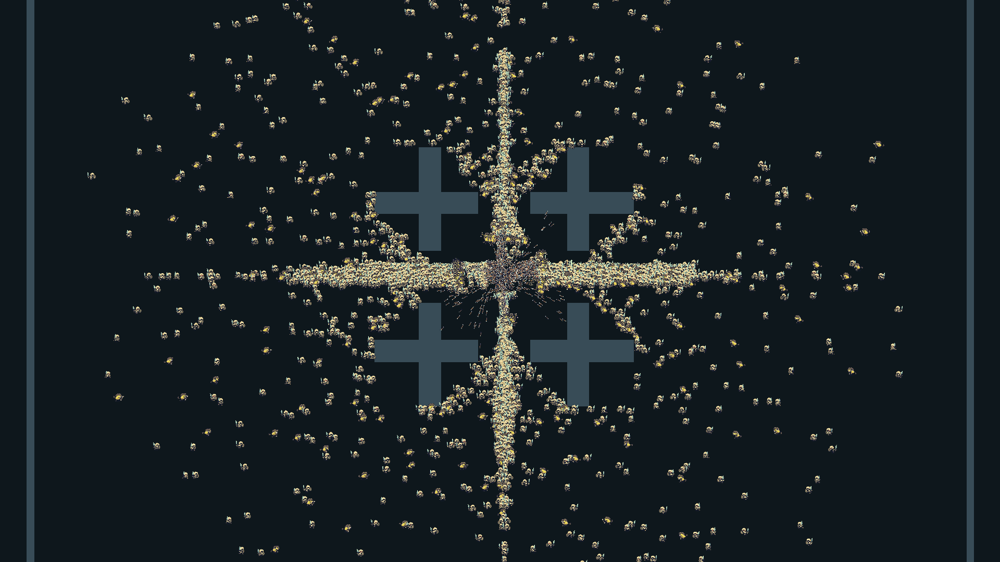
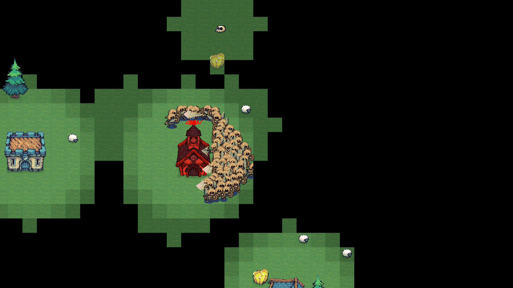

# Kiểm thử và hiệu năng DOTS

## Trạng thái kiểm chứng

Mục này lưu bằng chứng của đợt Swarm ngày 15/10/2026, trước khi mở rộng toàn bộ gameplay. Kết quả mới nhất là [32 test và 18 check tích hợp DOTS Gameplay](../DOTSGameplay/Validation.md). Không áp dụng các số đo lịch sử dưới đây như benchmark của toàn bộ code gameplay hiện tại.

Đã compile bằng Unity 6000.3.11f1 trong bản sao kiểm chứng độc lập và chạy **12/12 EditMode tests thành công**, với Burst synchronous compilation. Kết quả NUnit nằm trong `Logs/dots-tests.xml`; log compile/test nằm trong `Logs/dots-compile-verified.log` và `Logs/dots-tests.log` trên máy thực hiện.

Đã build Player Windows x64 Release với Burst AOT (`lib_burst_generated.dll`) và chạy ba bài smoke có render thực: Swarm 5.000, Swarm 10.000 và tích hợp RTS. Cả ba không ghi nhận exception, shader error hoặc cảnh báo native allocation leak trong log Player đã kiểm tra. Bản chạy nằm tại `.utmp/swarm-build/SwarmDemo.exe` trên máy triển khai.

Không coi mục tiêu 60 FPS là kết quả đã đạt chỉ từ việc dùng ECS/Jobs/Burst. Các số đo dưới đây là bài smoke offscreen ngắn, không thay thế benchmark tương tác dài và có đối chứng.

## Số đo Player đã lưu

Máy kiểm chứng: Intel Core i5-11300H, 8 logical core, NVIDIA GTX 1650, RAM khoảng 16 GB; Unity 6000.3.11f1, Windows x64, D3D11, render target 1920×1080. Mỗi bài làm nóng 5 giây rồi ghi 10 giây; camera cố định, seed Swarm 2026, scenario BaseSiege. Editor vẫn mở ở nền. Header ghi vSync=1 nhưng render request offscreen không có present như cửa sổ game.

| Bài chạy | Population ghi trong capture | Số frame | Frame median / P95 / P99 (ms) | Tick ECS median / P95 (ms) |
|---|---|---:|---|---|
| [Swarm 5.000](Evidence/swarm-5000.json) | 5.000 agent + 2.000 projectile | 2.294 | 3,365 / 7,894 / 9,141 | 3,839 / 4,763 |
| [Swarm 10.000](Evidence/swarm-10000.json) | 10.000 agent + 2.000 projectile | 1.302 | 5,274 / 12,624 / 14,305 | 6,072 / 7,909 |
| [Tích hợp RTS](Evidence/rts-integration.json) | 79 agent, 0–1 projectile trong đoạn capture | 4.447 | 1,606 / 4,852 / 13,514 | 2,564 / 3,267 |

Population được lấy mẫu trong `MonoBehaviour.Update` sau bước bổ sung population; snapshot render/cuối bài chạy có thể thấp hơn sau collision/cleanup. Agent count bao gồm khoảng thời gian animation chết. Số đo tick đã loại ID lặp giữa các frame render. Bộ nhớ Unity allocator lấy mẫu ở bài 5.000 khoảng 158,19–158,38 MiB, bài 10.000 khoảng 171,66–171,89 MiB; đây không phải RAM toàn tiến trình hoặc VRAM.

Counter GC không khả dụng trong cấu hình Release này (`gc_bytes=-1`). Không dùng dữ liệu đó để kết luận zero GC. Không quy đổi trực tiếp những percentile offscreen thành tuyên bố FPS gameplay. Chưa có benchmark so sánh MonoBehaviour với DOTS ở cùng hình ảnh/hành vi.

Ảnh dưới là render thật từ Player; render target không bao gồm HUD Screen Space Overlay:

CSV gốc và JSON tổng hợp nằm trong [Evidence](Evidence/README.md). [Kết quả NUnit](Evidence/editmode-tests.xml) lưu đủ 12 test đã chạy. Bài RTS phát sinh 287 hit trong toàn bài chạy, xác nhận cầu nối chiến đấu hoạt động; không coi bài 16 giây này là kiểm chứng đầy đủ mọi checklist ngày/đêm bên dưới.

## Bài kiểm thử chức năng

Fixture `SwarmSimulationTests` bao phủ đường vòng vật cản và góc chéo, gom damage đúng một lần, đạn nhanh không xuyên mục tiêu, vật cản chặn đạn, lọc cùng phe, mục tiêu bị hủy, chuyển damage về bridge, rút lui/despawn, reset, cấu hình đạn của quái tầm xa, lọc mục tiêu trung lập và tải 5.000 agent + 2.000 projectile.

Kiểm tra tải EditMode là kiểm tra tính hợp lệ và an toàn dữ liệu, không phải chứng nhận 60 FPS. Headless không đo GPU/rendering; các bài Player phía trên bổ sung bằng chứng render, và checklist gameplay vẫn cần được kiểm tra khi mở rộng nội dung.

## Quy trình benchmark cho khóa luận

1. Ghi phiên bản Unity/package, commit đang đo, CPU, số logical core, GPU, RAM, OS, loại build và độ phân giải.
2. Chạy cùng seed, scenario và thiết lập camera ở các mức 100, 1.000, 5.000 và 10.000 quái. Ghi số quái và đạn live thực tế.
3. Làm nóng ít nhất 5 giây sau khi đạt tải; capture 60 giây. Lặp ít nhất ba lần mỗi cấu hình.
4. Đo với rendering bật, rồi tắt để xác định phần chi phí simulation. Kiểm tra thêm bãi trống, lối hẹp và mật độ cao quanh căn cứ.
5. Báo cáo frame time median, P95/P99, thời gian ECS tick, GC và bộ nhớ. Tách thời gian warmup/import/Burst compilation khỏi mẫu steady state.
6. Đối chiếu bản MonoBehaviour và bản DOTS với hành vi, hình ảnh và tải tương đương. So sánh khác thuật toán phải ghi rõ; thay đổi N² thành spatial hash/flow field cũng đóng góp hiệu năng, không chỉ Burst.

Ngân sách mục tiêu ở Windows PC/1080p là khoảng 16.67 ms/frame cho 60 FPS ở mức 5.000 quái và 2.000 đạn. Chỉ chốt nghiệm thu khi có cấu hình máy và số đo Player phù hợp. Mốc 10.000 là stress test để tìm giới hạn.

HUD IMGUI và cập nhật chuỗi thống kê có thể cấp phát managed memory. Khi đo vòng simulation, tắt HUD và dùng Profiler marker `RTS.DOTS.Tick`; GC toàn frame bao gồm cả UI, Editor và gameplay hybrid. ECS tick có native allocation ECB và có main-thread synchronization; tài liệu không tuyên bố zero-allocation hoặc không có điểm đồng bộ.

## Kiểm tra tích hợp thủ công

- Ban đêm: quái xuất hiện, tiếp cận, đánh Town Hall/quân; damage giảm máu thực.
- Warrior/Archer/Tower tự đánh và nhận click attack lên quái ECS.
- Lệnh move hủy attack; mục tiêu chết không để lại tham chiếu lỗi.
- Ban ngày: địch rút lui và được despawn; dân vẫn thực hiện luồng trú/ra Town Hall.
- Xây/hủy công trình và tái tạo tài nguyên cập nhật walkability.
- Fog ẩn quái chưa nhìn thấy; minimap và cursor phản ánh entity.
- Reset, đổi scene và dừng Play không rò rỉ NativeContainer/collider blob.

## Giới hạn cần trình bày trong khóa luận

Separation mềm có thể còn chồng lấn ở mật độ cực cao; flow field có một goal chính; collider là xấp xỉ; ánh sáng sprite ECS là global tint. Logic actor gameplay đã được mở rộng bằng [DOTS Gameplay](../DOTSGameplay/Validation.md), nhưng presentation hybrid và bridge vẫn có chi phí riêng. Các số đo lưu tại đây thuộc bài Swarm trước đợt mở rộng, không phải benchmark toàn bộ nền kinh tế RTS. Những giới hạn này không được che bằng một benchmark ở bãi trống.

