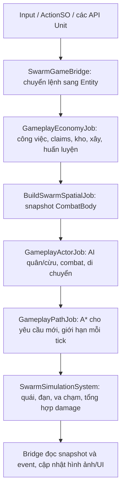

# Kiến trúc ECS cho toàn bộ thực thể gameplay

Điểm vào khi quay lại dự án: [Tech Overview](../../TechnicalOverview.md). Khi sửa hoặc thêm tính năng, xem [DOTS Development Guide](../DOTS/DevelopmentGuide.md) để chọn đúng system, command và lifecycle.

## Mục tiêu và phạm vi

Module mở rộng [DOTS / Swarm](../DOTS/Architecture.md) để dân, lính cận chiến, cung thủ, cừu, nhà chính, nhà huấn luyện, tháp và kho tài nguyên có trạng thái mô phỏng trong ECS. Cây và mỏ cũng có Entity quản lý loại tài nguyên và số chỗ khai thác. Quái và đạn tiếp tục dùng hệ thống Swarm hiện có.

Trong scene gameplay có `GameManager`, `TilemapManager` và `SwarmGameBridge`, ECS là nguồn dữ liệu của vị trí, máu, mục tiêu chiến đấu, cooldown, công việc, hàng đang mang, tiền trong kho, tiến độ xây và hàng đợi huấn luyện. Các lớp `Unit`, `WorkerUnit`, `StructureUnit` còn tồn tại để giữ prefab, giao diện chọn quân, Animator, SpriteRenderer, fog và các API gọi từ UI. Chúng đóng vai trò authoring/presentation/command adapter; vòng `UpdateBehaviour`, `AIPawn.Update` và timer công trình cũ không điều khiển những thực thể đã bind Entity.

Đây là mô phỏng ECS với presentation hybrid. Dân, quân người chơi, cừu và công trình vẫn có GameObject hiển thị tương ứng. Quái và đạn dùng renderer instancing của Swarm. Không đồng nhất việc chuyển logic sang ECS với việc loại bỏ mọi MonoBehaviour khỏi dự án.

## Dữ liệu

Code runtime nằm trong `Assets/Game/DOTS/Runtime`, assembly `RTS.DOTS`, không tham chiếu lớp gameplay thuộc `Assembly-CSharp`.

| Dữ liệu | Chủ sở hữu và nội dung |
|---|---|
| `CombatBody` | Vị trí hiện tại/trước đó, collider blob Unity Physics, faction, máu, khả năng nhận sát thương |
| `GameplayActor` | Vai trò, state/task, mục tiêu Entity, destination, di chuyển, stance, cooldown/windup, thông số đạn, chu kỳ ăn cỏ và chạy trốn |
| `GameplayWaypoint` | DynamicBuffer đường đi của từng actor |
| `GameplayWorker` | Node/depot/structure/shelter, giai đoạn công việc, loại và lượng hàng, timer khai thác |
| `GatheringProfileData` | DynamicBuffer cấu hình khai thác theo loại; sao chép từ `WorkerUnitDefinition` |
| `GameplayResource` | Loại tài nguyên, vị trí, bán kính tương tác, capacity/claims, yêu cầu giết trước khi lấy thịt |
| `GameplayDepot` | Bitmask loại có thể nhận và cờ TownHall |
| `GameplayConstruction` | Builder Entity, thời lượng, elapsed, stage và ID liên kết UI |
| `GameplayProducer` / `TrainingRequest` | Thời gian huấn luyện hiện tại và DynamicBuffer FIFO yêu cầu |
| `PlayerWallet` | Singleton số gỗ, vàng và thịt; `GameManager` chỉ đọc/chuyển lệnh và cập nhật HUD |
| `GameplayEvent` | Sự kiện nộp hàng, hoàn tất huấn luyện/xây, đổi sprite giữa kỳ và hiệu ứng đánh tài nguyên |

Các enum `GameplayState`/`GameplayTask` có giá trị tương ứng enum presentation để chuyển đổi tại bridge. Runtime không chứa tham chiếu `Unit`, `GameObject`, `Animator`, `ScriptableObject` hoặc chuỗi UI trong component. Cấu hình prefab được đọc trên main thread và sao chép sang struct unmanaged.

## Luồng một tick

`GameplaySimulationSystem` thuộc `FixedStepSimulationSystemGroup`, chạy trước `SwarmSimulationSystem`.

Các stage có điểm `Complete()` rõ ràng để chuyển quyền truy cập dữ liệu. Hệ thống dùng Burst và Job System nhưng không tuyên bố mọi stage chạy đồng thời. AI/movement và spatial snapshot chạy jobs song song; kinh tế và path request dùng job một writer. Presentation không được cập nhật Unity objects từ worker thread.

## Thuật toán và quy tắc gameplay

### Điều hướng

Quái dùng flow field chung như module Swarm. Quân người chơi, dân và cừu cần destination riêng nên dùng A* bốn hướng với Manhattan heuristic và binary min-heap. `GameplayPathJob` dùng chung vùng nhớ scratch được cấp phát khi cấu hình grid; mặc định xử lý tối đa 16 yêu cầu/tick. Con trỏ luân phiên giới hạn việc một nhóm actor chiếm toàn bộ ngân sách. Đường lưu trong `DynamicBuffer<GameplayWaypoint>`; không tính lại toàn bản đồ trên từng frame cho từng actor.

Nếu đích nằm trong công trình/tài nguyên bị chặn, job tìm ô tiếp cận gần đích trong vùng giới hạn. Khi không tới được đích, đường dẫn có thể kết thúc ở ô đã duyệt gần nhất. Movement kiểm tra bán kính trên grid, trượt theo trục khi gặp vật cản và dùng spatial hash để tạo lực separation mềm. Đây không phải bảo đảm không chồng lấn tuyệt đối trong đám đông cực dày. Khi grid thay đổi, actor đang di chuyển được yêu cầu tính lại đường.

### Chiến đấu và vật lý

Lính và cung thủ tìm mục tiêu faction quái từ spatial hash; không tự tìm cừu. Tháp đứng yên. Stance Defensive cho phép đánh mục tiêu trong tầm nhưng không đuổi theo. Lệnh di chuyển của người chơi hủy mục tiêu/công việc và tạm ngăn tự tìm địch cho tới khi hoàn tất đường đi.

Cooldown, windup và thời điểm phát damage/đạn nằm trong ECS. Animator nhận `AttackSequence` để phát hoạt ảnh; Animation Event cũ không tạo thêm đạn cho actor đã bind ECS. Worker chỉ đánh mục tiêu được giao, ví dụ cừu đang săn.

Tất cả sát thương đi qua `SwarmSimulationSystem.QueueDamage` và bộ tổng hợp damage chung. Với `GameplayActor`, hệ thống cập nhật `CombatBody.Health`, nguồn đánh và sequence. Bridge đọc số máu cuối cùng để phát flash/death; không gửi damage trở lại `TakeDamage`, tránh trừ máu hai lần. Collider blob Unity Physics thực hiện truy vấn khoảng cách/swept collision trong Burst. Module không dùng toàn bộ rigidbody solver, không có ragdoll/impulse/gravity. Collider2D còn lại phục vụ chọn đối tượng, placement và capture bản đồ, không phải nguồn tính sát thương đạn.

### Khai thác và tài nguyên

Một writer quản lý `Claims`, lượng hàng và ví, tránh mất cập nhật khi nhiều dân nộp cùng tick. Claim bị giới hạn theo capacity. Hủy lệnh, chết hoặc xóa worker giải phóng claim và builder assignment. Node bị xóa khi tái sinh tài nguyên sẽ bị worker phát hiện qua Entity handle; không đọc component trên Entity cũ.

Worker tiến đến node, chờ giết cừu nếu cần, khai thác theo profile, tìm kho phù hợp, di chuyển tới kho, nộp vào `PlayerWallet`, rồi quay lại node còn tồn tại. Khi đổi sang loại tài nguyên khác mà đang mang hàng, worker nộp hàng cũ trước; không đổi nhãn hàng đã mang. Cây/mỏ giữ hành vi nguồn vô hạn của game gốc; thịt có thể tiếp tục lấy từ xác cừu, chưa có cơ chế cạn kiệt mới.

Claim của cây/mỏ được bridge phản chiếu sang collider vật cản và làm bẩn navigation grid. Hiệu ứng cây bị đánh là presentation event; Animation Event không cộng tài nguyên.

### Xây dựng, huấn luyện và trú nhà

Công trình giữ elapsed trong `GameplayConstruction`. Chỉ tăng tiến độ khi builder hợp lệ đang ở state Building và còn được giao đúng công trình. Thiếu builder thì dừng; worker khác có thể nhận lại. Sự kiện giữa kỳ/hoàn tất đổi sprite và cập nhật action queue. Sản xuất và tấn công của tháp chờ xây xong.

Huấn luyện dùng FIFO `TrainingRequest`; mỗi completion phát một event. Bridge tạo prefab hiển thị và đăng ký Entity ngay, sau đó ra lệnh đi khỏi cửa nhà. Worker, Warrior và Archer đi qua cùng luồng này.

Khi đêm tới, API `ReturnToTownHall` chuyển worker sang ReturningToShelter. Khi đến nơi, Entity vẫn tồn tại nhưng `Targetable=0`; bridge ẩn sprite/collider. `LeaveTownHallAtDaybreak` phục hồi targetable, đặt vị trí ở cửa và gửi lệnh đi ra. Cừu dùng timer ăn cỏ và hướng chạy trốn trong ECS; cừu chết giữ Entity tài nguyên cho công việc lấy thịt.

## Tích hợp và đường sinh thực thể

- `SwarmGameBridge` tự cài vào scene có `GameManager`, cấu hình hai simulation system từ cùng Tilemap.
- `GameplayGameBridge.cs` là phần partial của bridge, giữ registry presentation, body offset, request ID và binding UI.
- `Unit.Start` đăng ký cả thực thể đặt sẵn và thực thể sinh sau đó; `AIPawn` được tắt khi bind. `Unit`/resource `OnDestroy` dọn Entity và claims.
- `EnemyWaveManager` đã gọi `SpawnEnemy` ECS. Ngoài ra một `EnemyUnit` được `Instantiate` trực tiếp trong scene gameplay cũng được chuyển thành Entity tại lifecycle đăng ký, rồi trả GameObject nguồn về pool hoặc hủy view tạm. Nếu vị trí authoring sát vật cản không đủ chỗ cho bán kính quái, bridge tìm vị trí hợp lệ gần nhất trong vùng giới hạn trước khi spawn. Nếu không tìm được, hệ thống báo lỗi và không để lại AI legacy chạy song song.
- `ProductionBuilding`, `BuildingProcess` và `ResourceSpawner` gọi `SpawnGameplay`; prefab gốc được giữ làm authoring/presentation.
- Input, UI, camera, fog, lịch ngày/đêm và lịch wave vẫn là lớp điều phối MonoBehaviour. Việc giữ các lớp này không tạo một bản sao logic actor độc lập.
- Scene mô phỏng Swarm độc lập không cấu hình gameplay system nên không chạy stage kinh tế/path của RTS.

## Giới hạn và hướng phát triển

Rendering hybrid của quân người chơi/cừu/công trình còn chi phí Animator, SpriteRenderer, collider và GameObject. Kết quả 5.000/10.000 quái trong bằng chứng Swarm trước đây không phải kết quả đo 5.000/10.000 worker hoặc toàn bộ nền kinh tế. Cần benchmark riêng trước khi viết thành kết quả khóa luận.

A* giới hạn request tạo độ trễ nhận đường khi có nhiều lệnh đồng thời. Grid được chụp từ Unity và cập nhật có nhịp, nên có thể có khoảng chờ ngắn khi vật cản thay đổi. Event spawn cần main thread tạo presentation. Chưa có networking, save/load Entity, baking/SubScene cho toàn bộ prefab hay rendering instancing cho mọi loại quân. Các mở rộng này cần tài liệu và số đo riêng.

## Nguồn tham khảo

- [Unity Entities 1.4: Dynamic buffer components](https://docs.unity3d.com/Packages/com.unity.entities@1.4/manual/components-buffer-introducing.html): lưu waypoint, cấu hình khai thác và FIFO huấn luyện.
- [Unity Entities 1.4: System update order](https://docs.unity3d.com/Packages/com.unity.entities@1.4/manual/systems-update-order.html): FixedStep group và thứ tự gameplay/combat.
- API/source package đã khóa trong `Packages/packages-lock.json`: Entities 1.4.8, Burst 1.8.29, Collections 2.6.8 và Physics 1.4.7.
- [Kiến trúc Swarm và vật lý](../DOTS/Architecture.md) mô tả broadphase, collider cast và renderer dùng chung.
