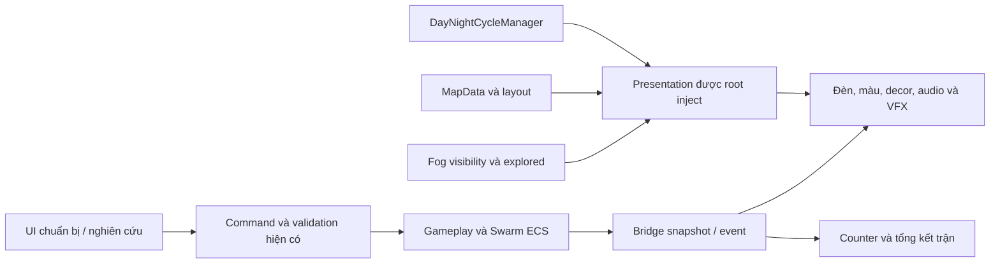

# Build plan — trải nghiệm RTS ngày, hoàng hôn và đêm

**24/11 — E6 DONE phạm vi implementation và kiểm Editor:** [report/ảnh/evidence](E6-ActionFeedback.md). Hit/dust/deposit/research, hàng mang Cargo và dấu Fortify; source authoritative, không replay snapshot, cap32pulse/128badge/256impact, giữ base profile/queue cũ/đạn đang bay.84/84 regression, GPU/fog/pause/death/pool/destroy/reload/legacy PASS. Chưa Player/performance/nghiệm thu thẩm mỹ E6; **tiếp E7**, G3/G5 vẫn mở. Các checkpoint dưới là lịch sử.

**24/11 — E5 DONE phạm vi implementation và kiểm Editor:** [report/ảnh/GPU/lifecycle](E5-DepthOcclusion.md). Route native qua cây/Hall trong3pha, nhóm96native, pool/pause/destroy/unload/reload/legacy, S7/E4 compatibility và81/81 regression PASS. Không dịch collider/pivot hoặc đổi Core/gameplay/clock. Chưa Player/performance/manual thẩm mỹ E5; tiếp E6. Dòng “tiếp E5” ngày23/11 dưới đây là lịch sử; G3/G5 vẫn mở.

Ngày lập: **23/11/2026**. Cập nhật triển khai cùng ngày: **E0 được người dùng nghiệm thu** (“E0 tôi đã test và thấy oke”), xem [checkpoint](Evidence/E0/Acceptance.md); **E1 DONE phạm vi palette/ownership và kiểm Editor**, xem [báo cáo/ảnh A/B](E1-ArtDirection.md); **E2 DONE phạm vi chức năng và Player A/B seed1 đã đo**, xem [báo cáo/giới hạn](E2-NightLighting.md); **E3 DONE phạm vi implementation/Editor**, [người dùng đã nghe chuông](Evidence/E3/AudioAcceptance.md); **E4 DONE phạm vi implementation/Editor trên3seed**, xem [report/ảnh/hash](E4-DaytimeRegions.md). Tiếp E5. Các mô tả công việc bên dưới là hợp đồng, không tự chứng nhận kết quả.

## 1. Mục tiêu và phạm vi

Xây một trận RTS sinh tồn có ba nhịp rõ ràng: **ban ngày khai thác và mở rộng, hoàng hôn chuẩn bị, ban đêm phòng thủ**. Hình ảnh phải giúp người chơi đọc tình huống và nhận ra tác dụng của đầu tư. Giữ phong cách pixel art, camera orthographic 2D và bộ asset hiện có; tham khảo Crown Siege về tương phản trên nền tối, bản sắc nhánh nâng cấp và phản hồi khi mạnh lên.

Hai đợt triển khai:

1. **Đợt A, E0–E7:** chốt UI tech tree, phối màu, ánh sáng, môi trường, chiều sâu, phản hồi và tổng kết. Chưa đổi luật kinh tế/chiến đấu để có đối chứng hình ảnh sạch.
2. **Đợt B, E8–E10:** làm rõ lợi ích mở rộng, tạo khác biệt giữa các đêm, cân bằng lại và nghiệm thu bản Release.

Giữ sáu tech theo quyết định của người dùng: Tools/Cargo, Archery/Training, Outposts/Fortify. Root/hub trong UI là phân nhóm trực quan. Đợt này không thêm node mua được, level hoặc prerequisite mới. Phản hồi nâng cấp dùng hiệu ứng hiện có trong ECS, không dựng thêm modifier trên view.

## 2. Baseline và việc còn mở

| Hạng mục | Trạng thái đã biết | Ảnh hưởng tới kế hoạch |
|---|---|---|
| Gameplay nền | ECS authoritative, manual DI, sinh map strategic v3, ba vùng và hai gateway | Mở rộng bằng command/system và adapter hiện có |
| Luồng trận | Mục tiêu năm đêm, thắng khi sang ngày 6; asset hiện tại Day 60 / Dusk 30 / Night 45 giây | Giữ timing trong đợt A; không lấy default field trong class thay giá trị asset |
| Tech tree, 23/11 | UI graph đã có; fixture API kiểm modal, zoom/drag, prerequisite và debit đã PASS trong chat | E0 còn nghiệm thu chuột/phím thật, ảnh cuối, độ phân giải và lifecycle |
| Regression, 23/11 | Tool báo 81/81 EditMode PASS, 0 fail/skip, 10,0725241 giây | Kết quả lịch sử phiên trước, chưa có artifact test mới trong thư mục này; không coi là E0 DONE |
| Hình ảnh S7 | Đã có tint vùng, tuyến đi, decor và palette đêm dễ đọc hơn | Tiếp tục trên S7, không làm lại từ scene trống |
| Balance G3 | Hall 1200 HP riêng ProceduralGame, nghiệm thu người chơi còn mở | Kế hoạch này không tự đóng G3 |
| Hiệu năng G5 | Release 1080p/Ultra đạt p95 16,67 ms ở 3/4 lượt, còn lượt vượt budget | Giữ G5 mở; phải đo lại với hình ảnh mới trước bản nộp |

Nguồn baseline: [Tech Overview](../../TechnicalOverview.md), [ResearchTreeUI](../Progression/ResearchTreeUI.md), [S7](../ProceduralGeneration/S7-Presentation.md), [G3](../Progression/G3-EconomyExpansion.md), [G5](../Progression/G5-ReleaseOnscreen.md). Tài liệu E không thay lịch sử S/G hoặc đánh dấu các gate cũ hoàn tất.

## 3. Hướng mỹ thuật và tiêu chí đọc hình

| Pha | Màu và không khí | Điểm nhấn | Điều cần giữ rõ |
|---|---|---|---|
| Day | Xanh lá dịu, nắng vàng nhẹ, nước xanh ngọc | Hoạt động khai thác, đường đi, vùng tài nguyên | Quân tách nền, đất xây khác nước/vật cản |
| Dusk | Cam đào/hổ phách, bóng tím, ánh sáng chuyển liên tục | Chuông báo, gateway nguy hiểm, đèn lần lượt bật | Hướng tiến quân và thời gian chuẩn bị |
| Night | Nền navy/tím lạnh, ánh lửa cam/vàng | TownHall, đuốc tháp, cửa sổ và giao tranh | Silhouette, vòng chọn, projectile, trạng thái bị tấn công |

Các màu là định hướng authoring, chưa là palette đã nghiệm thu. E1 chốt swatch và ảnh trước/sau bằng asset trong Unity. Glow mạnh dành cho UI hoặc sự kiện nổi bật; môi trường dùng ánh sáng tiết chế. Độ tối mỹ thuật và fog-of-war là hai dữ liệu khác nhau: nguồn sáng không tự tăng tầm nhìn hoặc tiết lộ đối tượng chưa khám phá.

Giữ camera 2D hiện tại. Chiều sâu đến từ sorting theo chân, bóng tiếp xúc, bờ nước và lớp tán/mái; không chuyển toàn game sang isometric/3D. Hiệu ứng thời gian cần chuyển mượt nhưng sprite phải còn sắc nét khi zoom.

## 4. Thứ tự và trạng thái

| Mốc | Kết quả chính | Phụ thuộc | Trạng thái |
|---|---|---|---|
| E0 | Baseline và nghiệm thu UI cây | Code hiện tại | DONE phạm vi nghiệm thu người dùng23/11; [checkpoint và giới hạn bằng chứng](Evidence/E0/Acceptance.md) |
| E1 | Palette, quy tắc hình ảnh và cấu hình presentation | E0 | DONE — [báo cáo](E1-ArtDirection.md), 81/81 regression + integration/legacy/lifecycle/ảnh Editor; triển khai riêng theo yêu cầu người dùng |
| E2 | Ban đêm có nguồn sáng và cảm giác căn cứ an toàn | E1 | DONE — [fixtures/GPU mask/lifecycle81tests/Release2cặp A/B](E2-NightLighting.md); Player đo1đèn, budget8 chỉ kiểm Editor, không đóng G5 |
| E3 | Hoàng hôn có chuyển cảnh và báo chuẩn bị | E2 | TODO |
| E4 | Ban ngày có sức sống, ba vùng có bản sắc | E3 | TODO |
| E5 | Chiều sâu, sorting và xử lý che khuất | E4 | TODO |
| E6 | Phản hồi khai thác, chiến đấu và nâng cấp | E5 | TODO |
| E7 | Tổng kết đêm/trận và nghiệm thu đợt A | E6 | TODO |
| E8 | Mở rộng và chuẩn bị phòng thủ dễ điều khiển | E7 | TODO |
| E9 | Các đêm có vai trò chiến thuật khác nhau | E8 | TODO |
| E10 | Cân bằng, hiệu năng Release và bàn giao | E9 | TODO |

Triển khai từng mốc có thể chạy và kiểm riêng. Nếu mốc chưa đạt, ghi PARTIAL cùng lý do, không chuyển thành DONE chỉ vì đã có code. Có thể bổ sung tài liệu Architecture/Usage/Validation khi module runtime mới bắt đầu hình thành.

## 5. Đợt A — hình ảnh và phản hồi

### E0 — chốt baseline và cây công nghệ

**Công việc:** kiểm scene/Play/compile/dirty hiện tại trước thao tác vì phiên trước dừng Computer Use. Chốt một baseline từ MainMenu tới ProceduralGame. Hoàn tất icon TownHall, panel chi tiết, mở/đóng T/Esc, click launcher, kéo trên nền/node, zoom quanh con trỏ, fit/reset và không rò input xuống gameplay. Đối chiếu research thật qua đủ sáu node, pause, game-over và menu → trận mới.

**Nghiệm thu:** tại 1920×1080 và 1280×720 không cắt nút/chữ; drag không mua tech, Esc không đồng thời mở pause hoặc bỏ selection; camera được khôi phục; ví debit đúng một lần; trận mới reset. Lưu rõ phép kiểm nào là API và phép nào là thao tác thật. Chụp ảnh cây hoàn chỉnh cùng ảnh Day/Dusk/Night tại các góc căn cứ, Economy, landmark, gateway trên seed 1.

**Bằng chứng:** `Evidence/E0/` gồm checkpoint, kết quả fixture/test, ảnh và cấu hình baseline. Không dùng ảnh preview thiếu icon làm ảnh nghiệm thu cuối. Không cần build mới chỉ để sửa tài liệu hoặc chạy kiểm UI nhỏ.

### E1 — palette và owner presentation

**Công việc:** chốt ba palette, độ sáng tối thiểu dễ đọc và quy tắc màu quân/địch/selection. Kiểm shader của sprite thường, renderer quái/đạn instanced và ảnh hưởng của Light2D trước chọn cách chiếu sáng. Chọn nguồn cấu hình và controller presentation nhận clock/fog/map qua DI; dùng cấu trúc đang có nếu đủ, không tạo manager song song.

**Dữ liệu:** palette theo pha, cấu hình chuyển màu, intensity, emissive, budget VFX. Cấu hình không giữ state trận. Clock hiện có là nguồn pha duy nhất; presentation không chạy đồng hồ đêm riêng. Giữ palette của SampleScene nếu thử candidate riêng; thay asset dùng chung phải được kiểm cả scene đó.

**Nghiệm thu:** có bảng swatch/ảnh trong `E1-ArtDirection.md`; người xem phân biệt được ba pha cùng một cảnh. Quân/đạn quái và gameplay sprite không lệch sáng vô lý. Timing, MapData, wallet và simulation giữ nguyên.

### E2 — ánh sáng đêm

**Công việc:** thêm cửa sổ sáng TownHall, đèn trước cửa, đuốc tháp và đèn kho xa. Dùng ánh sáng ấm trên nền lạnh, flicker nhỏ và bất đồng bộ. Thử nguồn sáng thật cho công trình quan trọng, emissive/sprite glow cho chi tiết nhỏ. Chọn phương án sau E1 thay vì mặc định mỗi object một Light2D.

**Budget thử ban đầu:** tối đa 8 nguồn sáng cục bộ có chi phí cao đang hoạt động trong camera; phần dư dùng hiệu ứng nhẹ hoặc giảm mức chi tiết. Đây là giới hạn đề xuất để thử, không phải khả năng đã đo. Không thêm light riêng cho từng worker/quái.

**Nghiệm thu:** bật/tắt đúng pha, công trình chết/destroy/pool/unload dọn đèn; không có quầng sáng tiết lộ công trình/địch ngoài fog. Đêm vẫn thấy vùng chọn, địa hình và mục tiêu bị đánh. Ảnh A/B cùng camera/seed/state và capture chi phí tăng thêm trong Player.

### E3 — hoàng hôn và báo nguy hiểm

**Trạng thái23/11: DONE phạm vi implementation và kiểm Editor**, xem [E3 report/evidence](E3-DuskWarning.md). Một signal/Dusk, countdown từ clock, gateway fog guard, pause/menu/reload/RNG PASS;81/81 regression. Capture tự nhiên Day60→Dusk30→Night và pause menu2s đã lưu; banner được hạ tránh thanh wave. Người dùng đã [xác nhận nghe chuông](Evidence/E3/AudioAcceptance.md). Chưa đo Player E3; G3/G5 giữ mở.

**Công việc:** chuyển màu liên tục, cửa sổ/đuốc sáng dần, một tiếng chuông hoặc tù và khi vào Dusk. Hiện đếm ngược theo clock thật và dấu hướng wave theo dữ liệu gateway/wave đang có. Tín hiệu âm thanh kết hợp biểu tượng/chữ để vẫn hiểu khi tắt tiếng.

**Quy tắc:** chỉ hiện chi tiết vị trí gateway đã khám phá; nếu chưa biết, dùng cảnh báo chung. Không hứa loại quái/hướng mà lịch wave chưa chốt. Không tiêu thụ RNG gameplay để làm nhấp nháy đèn hoặc âm thanh ngẫu nhiên.

**Nghiệm thu:** một lần báo mỗi chuyển pha, pause/resume không phát lặp; UI đếm ngược khớp clock; reload không nhân listener. Day 60 / Dusk 30 / Night 45 giây vẫn giữ nguyên. Có capture chuyển pha tự nhiên và kiểm reset.

### E4 — ban ngày và bản sắc vùng

**Trạng thái23/11: DONE phạm vi implementation/Editor**, xem [E4 report/ảnh/bằng chứng](E4-DaytimeRegions.md). Cụm chi tiết theo vùng, nền theo mảng, ripple/butterfly, seed presentation riêng và fog footprint guard. Hash/determinism/clearance/RNG, native khai thác/nộp/xây/đi đường trên0/1/1543, lifecycle/legacy và81/81 regression PASS. Seed1 gốc đã khôi phục, Editor sạch. Chưa Player/performance hoặc nghiệm thu thẩm mỹ E4; tiếp E5. Không đóng G3/G5.

**Công việc:** thêm biến thể cỏ/đất, hoa, bụi, đá theo cụm; gợn nước và một vài điểm có bướm/chim. Economy thiên rừng/đồng cỏ, GoldFrontier thiên đá/đất khô, Start gọn và dễ đọc. Dùng MapData/layout và seed presentation riêng để tái tạo decor.

**Quy tắc:** decor thuần hình ảnh không có collider/Unit, không chiếm pad/Reserved/Routes hay ô tương tác tài nguyên. Giữ tổng quota, terrain logic và generator version hiện tại. Không gọi UnityEngine.Random dùng chung với wave.

**Nghiệm thu:** cùng seed tái tạo decor ổn định; đổi presentation không đổi hash dữ liệu map gameplay. Seed 0/1/1543 vẫn khai thác/xây/đi đường được, site chưa khám phá không lộ. Nền ít lặp hơn và vùng đọc được từ cảnh thực; không phủ chi tiết lên mọi ô.

### E5 — chiều sâu và che khuất

**Trạng thái24/11: DONE phạm vi implementation/Editor**, xem [E5 evidence và giới hạn](E5-DepthOcclusion.md). Foot depth, contact mesh batches, upper-only coverage40%, ring tại chân, fog/point/snap;12ảnh cùng route Move qua cây/Hall và named fade1sau/0trước trong3pha. GPU probes/group96/pool/pause/component/direct-unload/new-match/legacy và81regression đạt; E2 glow còn đúng. Chưa đo Player E5 hoặc nghiệm thu thẩm mỹ. Tiếp E6, không đóng G3/G5.

**Công việc:** bóng tiếp xúc cho quân/cây/công trình, thử bóng dài hơn ở Dusk; sorting theo chân; cây/mái che quân đang chọn mờ vừa phải. Chuẩn hóa material/filter và kiểm camera zoom để tránh blur hoặc rung pixel.

**Tích hợp:** đối chiếu sorting của SpriteRenderer và renderer instanced trước sửa. Fade mái/tán không làm toàn thân công trình hoặc thông tin ngoài fog hiện lên. Áp alpha bằng dữ liệu presentation/material dùng chung hoặc property block phù hợp, không tạo material mỗi frame.

**Nghiệm thu:** quân đi trước/sau cây/công trình hợp lý, không xuyên lớp mái, vòng chọn còn đọc được; kiểm nhóm đông và scene reload/pool. Không dịch collider/pivot gameplay chỉ để sửa bóng. Có ảnh/video cùng tuyến di chuyển ở ba pha.

### E6 — phản hồi hành động và nghiên cứu

**Công việc:** hit flash nhỏ, dấu trúng đạn, bụi khai thác, phản hồi nộp kho và tín hiệu hoàn tất research. Thể hiện Cargo bằng hàng mang; Fortify thêm chi tiết gia cố hoặc sắc đạn; Archery/Outposts có thông báo khả năng vừa mở. Hiệu ứng phân biệt quân ta/địch nhưng không che projectile chính.

**Nguồn sự kiện:** đọc sequence/request/completion từ bridge/ECS có sẵn. Nếu cần event mới, bổ sung tại điểm quyết định authoritative, không dò animation rồi suy ra damage/debit. Snapshot lặp không phát lại VFX, queue đã có giữ duration cũ, đạn đang bay giữ damage cũ.

**Nghiệm thu:** một hiệu ứng cho mỗi sự kiện, không double damage/debit; nghiên cứu không sửa base profile trên prefab; VFX được pool hoặc giới hạn số lượng và dọn sạch khi đổi trận. Kiểm lúc pause, công trình chết và unlock khi đang mở/đóng cây.

### E7 — bình minh và tổng kết

**Công việc:** tín hiệu bình minh, thông báo ngắn kết thúc đêm và bảng tổng kết có thể mở lại. Chọn ít chỉ số hữu ích: tài nguyên đã nộp, chi phí, quân mất, damage TownHall, tech hoàn tất và vùng mới khám phá. Result cuối trận dùng cùng định nghĩa số liệu.

**Dữ liệu:** counter cộng từ event/counter authoritative, reset theo trận; UI đọc snapshot. Tách tiền đầu trận khỏi income, gathering khỏi deposit, damage khỏi mất HP ròng nếu có hồi máu. Không quét toàn Entity/Hierarchy trong mỗi frame để dựng báo cáo. Không cộng lại snapshot hiện tại mỗi lần mở panel.

**Nghiệm thu:** đối soát ledger một đêm bằng log/fixture có kiểm soát; không lặp reward hoặc số liệu khi pause/reopen; ảnh cho thấy ba pha khác rõ nhưng cùng thế giới. Chơi thực một trận năm đêm, không đổi balance trong đợt A. Chốt ảnh/video và số đo A/B để làm baseline đợt B.

## 6. Đợt B — chiều sâu quyết định

### E8 — mở rộng và chuẩn bị phòng thủ

**Công việc:** trước hết hoàn tất nghiệm thu G3 và trình bày rõ giá trị kho xa: preview khoảng cách/đường hợp lệ tới tài nguyên và depot, vị trí nguy hiểm, chi phí xây. Dùng đường đi thật hoặc nhãn khoảng cách lưới; không hiện ước tính giây vận chuyển khi chưa tính speed/cargo/path đầy đủ.

Thêm thao tác nhanh **Gọi dân về** và **Tập kết quân** trên nền command hiện có. UI báo số lệnh được chấp nhận/từ chối; không tự teleport, cấp tiền hoặc bỏ qua đường đi/tech gate. Khuyến nghị vị trí phòng thủ chỉ dùng vùng đã khám phá. Hành vi dân trú đêm tự động hiện có phải được đối chiếu để tránh gửi lệnh trùng hoặc phá công việc sau bình minh.

**Nghiệm thu:** A/B kho gần mỏ và chỉ căn cứ trên cùng seed/policy, ghi chi phí, thời gian nộp và tài nguyên ròng. Công trình bỏ trống không làm lệch bán kính wave hoặc gây đường đi vô nghiệm. Các lệnh nhóm xử lý được dân đang khai thác/xây, quân đang đánh và đơn vị chết giữa lúc ra lệnh. Không tune giá cùng lúc sửa lỗi command.

### E9 — các đêm có vấn đề chiến thuật khác nhau

**Công việc:** dùng các loại quái/capability đã có trước, thay tổ hợp, hướng và nhịp tiếp viện. Phác thảo để playtest: đêm 1 học phòng thủ, đêm 2 phân chia hai hướng, đêm 3 phối hợp cận chiến/đánh xa, đêm 4 thử giữ tuyến mở rộng, đêm 5 là bài tổng hợp. Đây là giả thuyết thiết kế, không là lịch đã cân bằng.

Nếu yêu cầu quái nhanh/trâu chỉ cần thông số và visual hiện có thì author candidate riêng. Nếu cần AI/capability hoặc asset mới, tách thành hạng mục mở rộng trước khi đưa vào bản chính. Wave dùng dữ liệu đã chốt để cảnh báo Dusk nhất quán; giữ quy tắc bình minh ngừng tiếp viện/retreat cho tới khi có quyết định đổi riêng.

**Nghiệm thu:** ma trận control/kinh tế/quân sự/mở rộng trên seed 0/1/1543, wave seed tái lập, ledger đúng; mỗi seed có đường chơi chủ động hợp lý và bỏ mặc không tự thắng trong bộ đối chứng. Có playtest realtime, không dùng tỷ lệ thắng harness làm tỷ lệ thắng người chơi. Thử thêm seed giữ ngoài quá trình tune như 137/901 sau shortlist.

### E10 — bản Release, hiệu năng và bàn giao

**Công việc:** chốt config, kiểm UI/lifecycle, build Windows Release onscreen và chạy lại workload G5 cùng cảnh đêm có đèn/VFX. Profile Development riêng nếu cần tìm nguyên nhân spike. Đóng vấn đề G5 còn mở khi có bằng chứng, không tự tính là xong nhờ hình ảnh đẹp hơn.

**Gate đề xuất:** regression liên quan và smoke đầy đủ PASS; kiểm toàn trận, game-over/restart, tree/pause/fog; mục tiêu p95 ≤16,67 ms ở 1080p trên máy baseline trong từng lượt chuẩn. Đây là mục tiêu, chưa đạt ở mọi lượt baseline. Báo đủ p95/p99/max và frame vượt budget. Nếu cần hạ budget đèn/VFX hoặc chất lượng, ghi rõ cấu hình được đo.

**Bàn giao:** candidate và hash, settings, raw CSV/JSON/XML nếu có, ảnh/video, hướng dẫn chạy, known issues và cập nhật tài liệu khóa luận/slide sau khi chức năng đã nghiệm thu. Build cũ trước E không được dùng thay bằng chứng cho bản mới.

## 7. Hợp đồng kiến trúc và luồng dữ liệu

- Runtime `RTS.DOTS` không tham chiếu UI, Unit, Light2D hoặc managed service presentation. Logic damage/economy/research/spawn chỉ có một owner authoritative.
- Root cấp clock/map/fog/game/bridge; consumer mới không Find/Instance/Resolve. Cấu hình art không giữ state trận, listeners phải được hủy và bind lại khi reload.
- Simulation RNG và presentation RNG độc lập. Decor/đèn không sửa MapData, collider, navigation, quota hoặc seed wave.
- Presentation cần hỗ trợ cả actor có GameObject và quái/đạn instanced. Không chuyển toàn bộ quái sang GameObject để gắn hiệu ứng.
- Ưu tiên renderer, event, pool và definition đang có. Chỉ thêm component/asset khi có trách nhiệm/caller thật, không tạo framework thời tiết, event bus hoặc DI container cho đợt này.
- Kiểm `IsDotsControlled` và command tương ứng trước sửa Unit/AIPawn. Prefab được giữ làm authoring/presentation.

## 8. Quy trình kiểm thử và đo

**Kiểm chức năng:** unit/fixture cho logic mới có state, counter hoặc command; Unity integration cho lifecycle/binding; thao tác người chơi cho click/phím/drag/readability. Không viết test chỉ so màu constant. Chạy regression phù hợp sau nhóm thay đổi; không chạy full suite lại khi chỉ sửa prose.

**Kiểm hình ảnh:** ảnh cùng seed, góc, zoom, resolution, phase và gameplay state; cặp fog bật dùng nghiệm thu thông tin, fog tắt chỉ dùng so màu và phải ghi nhãn. Lưu bản gốc PNG và ghi điều kiện, không dùng ảnh chỉnh màu hậu kỳ thay capture game.

**Kiểm hiệu năng:** Windows Release, foreground, world/HUD/fog render thật, 1920×1080, cùng quality/vSync/cap. Dùng warmup 30 giây, capture 90 giây và ba lượt seed 1 cùng một lượt military seed 1543 theo G5. Thêm capture ở thời điểm nhiều nguồn sáng và giao tranh nhất khi workload chuẩn chưa bao phủ. Ghi peak actors/enemies/projectiles/lights/particles, phần cứng, build/hash và seed.

Đề xuất gate hồi quy cho từng E2/E4/E6: p95 qua các lượt A/B tương ứng không tăng quá 10% khi cùng workload; kiểm thêm max và cụm spike, không chỉ trung bình. Ngưỡng này là mục tiêu thử ban đầu, phải đọc cùng độ biến thiên của baseline G5, không bỏ lượt chậm để đạt. Giảm budget hiệu ứng khi cần và báo mức chất lượng. Release không có GC counter thì ghi unavailable, không thay bằng 0; dùng Development để chẩn đoán riêng.

Thời gian test không phải FPS; manual tick không phải đo realtime. Đợt lập plan này không chạy lại Unity, test hoặc benchmark.

## 9. Artifact và điểm tiếp tục

Mỗi mốc có báo cáo riêng trong thư mục module này, tối thiểu ghi mục tiêu, file/config đổi, thuật toán/owner, cách chạy, kết quả thực đo, giới hạn và nguồn. Evidence đặt `Evidence/E<n>-<ngày>/`; không đưa build/cache nặng vào Docs. Cập nhật [Progress](../Progression/Progress.md) và [Docs README](../../README.md) khi trạng thái đổi.

Mẫu checkpoint: `E<n> — TODO / IN_PROGRESS / PARTIAL / DONE`, baseline code/config, đã triển khai gì, đã kiểm bằng cách nào, artifact, chưa kiểm gì, lỗi còn lại và bước tiếp. Chỉ DONE khi cả functionality và gate của mốc đạt; phần người chơi chưa xác nhận giữ riêng.

**Điểm tiếp tục:** E3 hoàng hôn/cảnh báo trên clock thật. E2 đã có ramp đèn Dusk và fade bình minh; tái sử dụng, không tạo đồng hồ riêng. Đối chiếu [E2 evidence/giới hạn](E2-NightLighting.md). E0 đã được người dùng xác nhận; không đổi lịch wave/giá tech trong đợt A.

## 10. Hạng mục mở rộng sau bản chính

Các ý tưởng sau giữ ở backlog, không là điều kiện để hoàn tất E0–E10:

- Địa điểm khám phá có phần thưởng, xe hàng/di tích tương tác. Cần thiết kế reward authoritative, fog, chống nhận lặp và sinh vị trí hợp lệ.
- Nâng cấp nhiều level, lựa chọn loại trừ và thêm node trong nhánh. Cần quyết định phạm vi mới vì người dùng đã chọn giữ sáu tech ở đợt UI này.
- Nguồn sáng ảnh hưởng tầm nhìn, nhiên liệu đèn, thời tiết ảnh hưởng combat, boss hoặc loại quân có AI mới. Đây là thay đổi gameplay riêng, không ghép lén vào polish hình ảnh.
- Save/load, meta-progression, prestige/offline income, PvP và streaming map.

## 11. Nguồn tham khảo

- [Crown Siege — Steam](https://store.steampowered.com/app/4310440/Crown_Siege/) và [thông báo nhà phát triển](https://steamcommunity.com/app/4310440/allnews/): tham khảo loop phát triển/phòng thủ, nhánh nâng cấp và phản hồi. Các đề xuất ba pha trong tài liệu này là thiết kế dành cho RTSgame2026, không khẳng định Crown Siege có cùng cơ chế ngày/đêm.
- Hai ảnh Crown Siege người dùng gửi trong chat 23/11: tham khảo bố cục graph và tương phản glow trên nền tối, không cấp quyền sao chép art.
- [Kế hoạch G0–G7](../Progression/NextPhasePlan.md), [G5](../Progression/G5-ReleaseOnscreen.md), [MatchFlow](../MatchFlow/Architecture.md), [S7 presentation](../ProceduralGeneration/S7-Presentation.md), [DOTS Development Guide](../DOTS/DevelopmentGuide.md), [DI Architecture](../DependencyInjection/Architecture.md).
- Source: `DayNightCycleManager.cs`, `DayNightCycleDefinition.cs` và asset cùng tên; `ProceduralMapPresentation.cs`, `GameSceneCompositionRoot.cs`, `ResearchTreePanel.cs`, `ResearchTreeViewport.cs`, `ResearchTreeGraphic.cs` cùng bridge/system hiện có.
