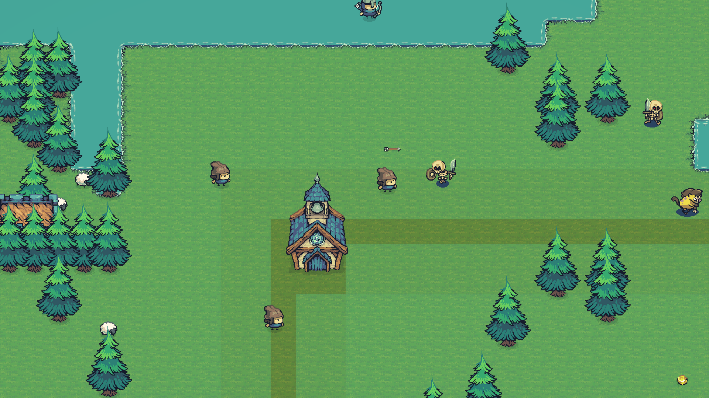
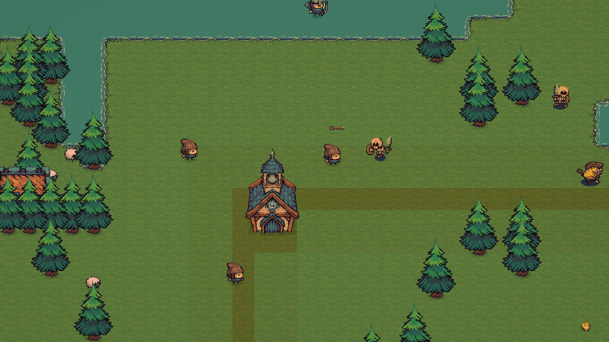
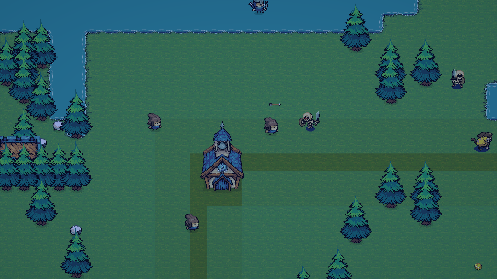

# E1 — palette và ownership presentation

**Cập nhật sau báo cáo:** E0 đã được [người dùng nghiệm thu](Evidence/E0/Acceptance.md); E2 đang triển khai theo [báo cáo ánh sáng đêm](E2-NightLighting.md). Các trạng thái E0 chờ và budget chưa có consumer bên dưới mô tả checkpoint lúc chốt E1.

Ngày **23/11/2026**. **E1 DONE trong phạm vi palette/ownership và kiểm chứng Editor**. Cấu hình ba pha riêng cho `ProceduralGame`, thống nhất ánh sáng nền của terrain, sprite và renderer instanced. E0 vẫn **PARTIAL**, người dùng để kiểm kéo chuột sau; việc triển khai E1 được yêu cầu riêng. E2 chưa triển khai.

## Mục tiêu và palette

Giữ pixel art, silhouette và màu đội của asset hiện có. Day sáng, hơi ấm; Dusk ngả hổ phách; Night lạnh và tối vừa phải. Không thay texture, sprite, filter mode, sorting, collider hoặc dữ liệu gameplay.

| Pha | Swatch color filter (sRGB) | Intensity | Exposure `log2(intensity)` | Vignette |
|---|---|---:|---:|---:|
| Day | 🟨 `#FFFAE8` — RGB(1, 0.98, 0.91) | 1.00 | 0.000 | 0.06 |
| Dusk | 🟧 `#FFC2A3` — RGB(1, 0.76, 0.64) | 0.90 | −0.152 | 0.16 |
| Night | 🟦 `#ADC2FF` — RGB(0.68, 0.76, 1) | 0.72 | −0.474 | 0.22 |

Đây là màu đầu vào grading, không phải màu cuối mọi pixel: texture, không gian màu, vignette và pipeline vẫn ảnh hưởng ảnh. Intensity hợp lệ từ **0.55–1.2**, vignette từ 0–0.4. Mức sàn là guard authoring, không phải kết quả đo độ sáng tối thiểu của màn hình hoặc chứng nhận accessibility.

Quân ta giữ chi tiết xanh lam của Tiny Swords; quái giữ sprite xương/vàng và silhouette gốc. Outline selection, damage flash, projectile và alpha fog giữ owner hiện tại; grading chỉ tác động màu ảnh world. Không suy faction từ màu pixel. UI Overlay, kể cả cây công nghệ, không bị color grading của camera. Không recolor lại node nghiên cứu trong E1.

Emissive ấm dự kiến `#FFA347` (1, 0.64, 0.28); budget authoring **8 local lights / 32 transient VFX** được lưu trong config. E1 chưa sinh light/VFX hoặc đo khả năng chịu tải; E2/E6 phải thực thi budget trước khi sử dụng.

## Shader audit và lựa chọn

Đọc trực tiếp shader/material đang chạy trong Editor trước triển khai:

| Nhóm | Đường render hiện tại | Hệ quả |
|---|---|---|
| Đất đi được | `Universal Render Pipeline/2D/Sprite-Lit-Default` | Nhận `Light2D` |
| Phần lớn dân/công trình/cây | `Universal Render Pipeline/2D/Sprite-Unlit-Default` | Không nhận local/global Light2D theo cách của Lit |
| Một số sprite, nước/foam, range | `Sprites/Default` | Không thể giả định cùng đường Light2D với đất |
| Quái/đạn | `RTS/DOTS/SwarmSprite`, `_SwarmLight` từ bridge | Tint riêng trước post processing |

Candidate đặt Global Light trắng/intensity 1 rồi dùng `ColorAdjustments.colorFilter`, `postExposure` và `Vignette` của camera cho toàn ảnh world. `EnvironmentTint` trả trắng ở candidate để quái/đạn không chịu thêm một lần tint. Shader/material của actor, highlight và instancing được giữ; không thêm vòng quét renderer hoặc cấp phát material mỗi frame.

E2 nên thử đèn/sprite glow tại công trình quan trọng trên nền này. Một Light2D mới sẽ không tự chiếu sáng tất cả sprite unlit; không thể tuyên bố đã có chiếu sáng cục bộ đồng nhất từ kết quả E1. Không đổi pipeline hay chuyển toàn bộ prefab sang Lit trong mốc này.

## Dữ liệu, thuật toán và tích hợp

Config: `Assets/Game/ProceduralGeneration/Settings/EnvironmentPresentation.asset`, kiểu `EnvironmentPresentationDefinition`. Asset chỉ có palette, khoảng chuyển và budget authoring, không có trạng thái trận hoặc timing gameplay.

`GameSceneCompositionRoot` cấp config và camera trực tiếp cho `DayNightCycleManager.InitializePresentation`. Dùng lại controller ánh sáng của clock thay vì thêm một manager/đồng hồ. Root vẫn cấp MapData/map/fog cho `ProceduralMapPresentation` như S7; không truyền map/fog vào hàm grading vì phép toán này không đọc visibility hoặc địa hình. Như vậy ownership hình ảnh môi trường được giữ trong hai consumer hiện có: clock điều khiển ánh sáng nền; map presentation điều khiển decor/tint vùng và visibility. Không có service locator mới.

Clock lấy `CurrentPhaseProgress` từ timer gameplay hiện có. Palette giữ ổn định trong 80% đầu pha, rồi chuyển sang palette kế bằng `SmoothStep` ở 20% cuối. Với `p` là tiến độ, `t = SmoothStep(0, 1, clamp01((p − 0.8) / 0.2))`; từng màu/intensity/vignette được lerp theo cùng `t`. Cuối Night nối Day, cuối Day nối Dusk; hai phía biên pha có cùng giá trị. Không tiêu thụ RNG. Pause dừng tiến độ vì không có timer presentation riêng.

`DayNightCycleDefinition` vẫn là nguồn **Day60 / Dusk30 / Night45**. Không gán candidate vào asset timing dùng chung. `SampleScene` không có injection candidate nên dùng nhánh lighting cũ. Editor scene generator gán cùng asset E1 khi tạo lại ProceduralGame, không reset giá trị palette đã author.

Volume profile và từng component override được clone cho trận, dọn khi clock bị hủy. Không sửa shared profile. Init lặp cùng config không tạo controller/profile mới; config khác, dữ liệu không hữu hạn, thiếu Light/Volume/camera post processing hoặc volume layer không hợp lệ được báo lỗi trước Ready. Kiểm enabled/active configuration ở Awake thay vì đòi `OnEnable` của Volume đã chạy trước root.

## Cách chạy và kiểm chứng

1. Mở `MainMenu` → Chơi, hoặc mở `ProceduralGame` rồi Play. Candidate đã được lưu trong reference `m_EnvironmentPresentation` của root.
2. Trong Project chọn `EnvironmentPresentation.asset` để xem ba palette. Giữ timing trong asset `DayNightCycleDefinition`.
3. Quan sát chuyển pha tự nhiên. Các ảnh dưới dùng presentation probe khi Editor pause để đối chiếu cùng trạng thái; không phải playtest ba pha tự nhiên.
4. `Tools/ValidateGameExperienceE1.cs`, class `GameExperienceE1Validation`, chạy `Run` qua `script-execute` trong trận mới đã Ready và Editor pause. Sau fixture, thoát Play để loại dữ liệu thử. `Capture` lưu ảnh qua `RenderPipeline.StandardRequest` để cập nhật volume stack; `SingleCameraRequest` có thể dùng stack của ảnh trước và không phù hợp phép so này.

Fixture kiểm binding/init lặp, clone profile/components, không sửa shared asset, liên tục ở ba biên pha, cửa sổ chuyển/NaN/clamp, exposure/override, không double-tint instance, từ chối config lỗi/rebind; đối chiếu terrain/reserved/resources/navigation/wallet/actor count/simulation tick/RNG/clock và fog chưa khám phá trước/sau. Raw response nằm trong [integration-result.json](Evidence/E1/integration-result.json).

## Ảnh đối chứng

PNG gốc **1920×1080**, Unity6000.3.11f1/URP17.3.0, seed1/strategicv3. Camera orthographic8, tâm TownHall+(1.5,1), cùng trạng thái đã pause. Fixture thêm một quái minh họa và một projectile damage0 rồi tick Swarm một lần trước khi đóng băng; snapshot có 3 agents/1 projectile, không dùng làm số đo gameplay hoặc hiệu năng. Mỗi cặp baseline/candidate dùng cùng MapData, quota, vị trí actor và state animation; baseline tạm bỏ injection palette để render nhánh S7. Camera capture không có HUD.

Fog **tắt** chỉ để so màu, được khôi phục sau capture:

| Pha | Baseline S7 | Candidate E1 |
|---|---|---|
| Day | [PNG](Evidence/E1/baseline-Day-fog-off.png) | [PNG](Evidence/E1/candidate-Day-fog-off.png) |
| Dusk | [PNG](Evidence/E1/baseline-Dusk-fog-off.png) | [PNG](Evidence/E1/candidate-Dusk-fog-off.png) |
| Night | [PNG](Evidence/E1/baseline-Night-fog-off.png) | [PNG](Evidence/E1/candidate-Night-fog-off.png) |

[Night với fog bật](Evidence/E1/candidate-Night-fog-on.png) kiểm vùng chưa khám phá tiếp tục bị che. Không dùng ảnh fog tắt để kết luận visibility gameplay. Ảnh cho thấy Night giữ rõ dân/công trình và màu quái/đạn cùng nền; đây là kiểm hình ảnh Editor, chưa có người dùng nghiệm thu độ dễ đọc trên màn hình thật.

## Kết quả và giới hạn

| Phép kiểm thực chạy sau implementation E1 | Kết quả / artifact |
|---|---|
| Fixture candidate và bất biến gameplay | PASS — [raw](Evidence/E1/integration-result.json) |
| Ảnh gốc và kiểm ba pha, sprite/quái/đạn, fog | 7 PNG phía trên, đã xem trực tiếp; [capture response](Evidence/E1/capture-result.json) |
| SampleScene legacy live | PASS — không có candidate, Day/Night light và tint đúng definition cũ; [raw](Evidence/E1/sample-scene-result.json) |
| MainMenu→game→menu→game bằng API + Editor.Step | PASS — hai trận Ready, research reset, một clock; profile và các component cũ đã destroy; [raw](Evidence/E1/lifecycle-result.json) |
| Regression EditMode lượt E1 | **81/81 PASS**, 0 fail/skip, **6.4597257 giây** — [raw tool result](Evidence/E1/editmode-tool-result.json) |

`SampleScene.unity` và `DayNightCycleDefinition.asset` không có diff. E0/manual kéo chuột, G3/manual balance và G5/Release budget vẫn mở. Thời gian test không phải số đo FPS.

Chưa có benchmark Player E1, số FPS hoặc capture tự nhiên trọn trận. E2 vẫn phải đo chi phí đèn/VFX và xử lý pool/fog; E3 làm cảnh báo hoàng hôn; E5 bổ sung sorting/che khuất. Các mức intensity, màu và budget là config authoring, không phải kết quả hiệu năng. Không thay đổi luật kinh tế, wave, giá/sáu tech, generation version hoặc render pipeline.

## Nguồn đối chiếu

- Source dự án: `EnvironmentPresentationDefinition.cs`, `DayNightCycleManager.cs`, `GameSceneCompositionRoot.cs`, `ProceduralMapEditorTools.cs`, `ProceduralMapPresentation.cs`, `SwarmGameBridge.cs`, `SwarmInstancedRenderer.cs`, `SwarmSprite.shader`, `FogOfWarAffectable.cs`.
- Source package đang cài: URP `UniversalRenderPipeline.cs` (`StandardRequest`, cập nhật volume), `UniversalAdditionalCameraData.cs`; Core `Volume.cs` (`profile`/`sharedProfile`, clone components). Không dùng tài liệu phiên bản khác để suy API.
- [Build plan E0–E10](BuildPlan.md), [S7](../ProceduralGeneration/S7-Presentation.md), [DI](../DependencyInjection/Architecture.md), [DOTS guide](../DOTS/DevelopmentGuide.md).
