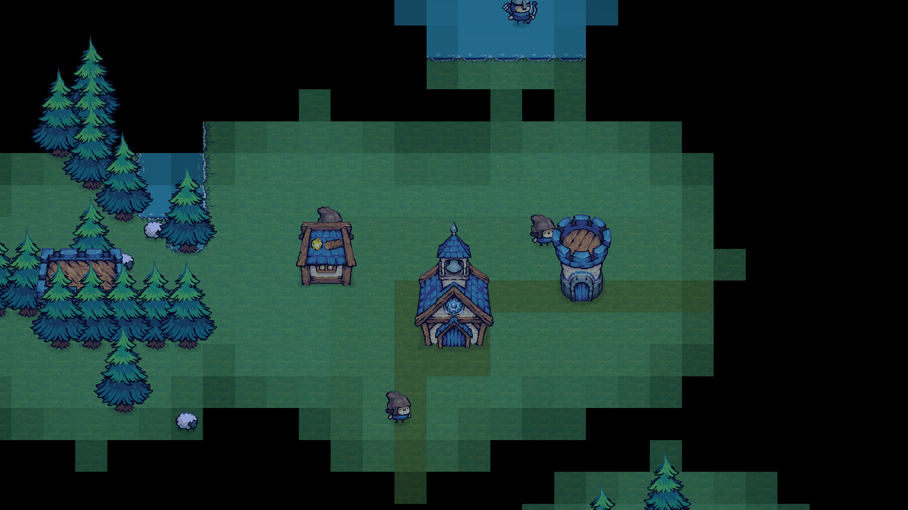
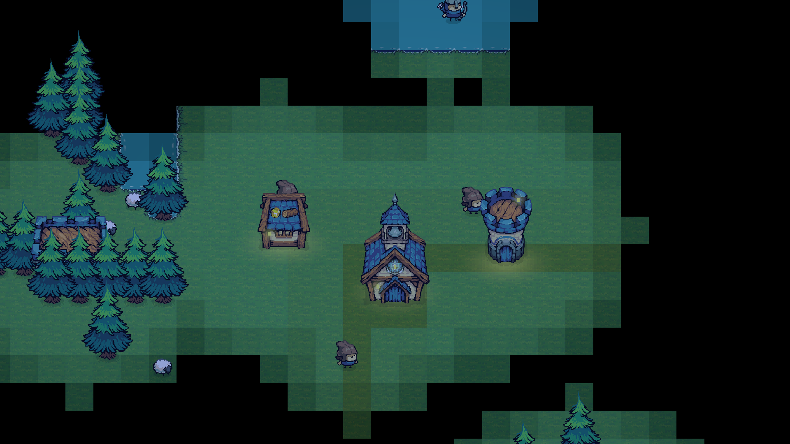

# E2 — ánh sáng đêm cho công trình

Ngày **23/11/2026**. **E2 DONE trong phạm vi chức năng, ảnh Editor và hai cặp Player A/B seed1 đã đo.** E0 đã được [người dùng nghiệm thu](Evidence/E0/Acceptance.md); E1 là baseline palette. Không đổi timing60/30/45, giá/tech, wave, quota/map hoặc render pipeline. Chưa chứng nhận tải8đèn đồng thời trong Player hoặc đóng G5.

## Mục tiêu và phạm vi

Làm căn cứ có điểm sáng ấm trên nền đêm lạnh: cửa sổ kính và đèn cửa TownHall, đuốc trên Tower, đèn trước kho có khả năng nhận tài nguyên. Môi trường dùng glow tiết chế; không gắn Light2D vào từng dân/quái, không thêm nhiên liệu hoặc tăng tầm nhìn. Barrack/ArcheryRange hiện không nhận đèn vì không thuộc ba vai trò này.

## Dữ liệu và ownership

`StructureNightLighting` nhận game, clock, fog, map, camera, `EnvironmentPresentationDefinition` và `SwarmInstancedRenderer` từ `GameSceneCompositionRoot`. Renderer được dùng như nguồn **texture visibility đã có**, không chuyển AI/state sang lighting. Component gắn runtime vào object của map presentation; không dùng `Find`, singleton hoặc service locator trong consumer.

Asset palette E1 thêm reference `NightGlowMaterial` → `Settings/NightGlow.mat` → shader `RTS/Presentation/NightGlow`. Editor scene generator gọi `ConfigureNightLighting` để giữ reference khi tạo lại scene; không ghi đè material/palette người dùng đã author. Material được giữ bằng asset reference nên không chỉ dựa vào `Shader.Find` trong Player.

Controller sở hữu một material runtime, hai texture nhỏ (halo32×32, core2×2) và hai sprite dùng chung. Mỗi công trình có một child `Night light presentation` chứa một Light2D và các sprite halo/core. Child không có `Unit` hoặc collider. Child đi cùng active/destroy của view; controller dọn resource riêng khi unload. Prefab gameplay không bị sửa.

Health/state sống, registry và construction đều là snapshot/cầu nối gameplay hiện có; ECS vẫn authoritative. Lighting không phát damage, debit, research, spawn quái hoặc navigation command.

## Thuật toán và budget

- Registry công trình được đối chiếu mỗi0.25giây bằng `GameManager.GetPlayerStructures`, không quét Hierarchy/Entity mỗi frame. HashSet dùng lại; không tạo material mỗi frame.
- Chỉ công trình người chơi còn sống, active, đã xây xong và sprite đang hiển thị được xét. Mỗi frame kiểm camera orthographic và visibility tại nguồn; nguồn Unexplored/Explored-only không bật đèn.
- Day: strength0. Dusk: `SmoothStep(0,1,CurrentPhaseProgress)`. Night: strength1 rồi giảm về0 ở cửa sổ bình minh cuối pha theo TransitionFraction của E1. Không có timer pha thứ hai.
- Flicker gồm hai sin nhỏ, tổng biên độ tối đa5%, offset từ vị trí công trình. Dùng `Time.time` để pause đóng băng flicker; không gọi `UnityEngine.Random`.
- Ưu tiên TownHall → Tower → depot. Tối đa **LocalLightBudget≤8** Light2D đang hoạt động trong vùng camera; nhóm còn lại vẫn có glow nhẹ. Culling có margin3world units để vùng sáng sát mép camera không bật/tắt đột ngột.
- Point Light2D outer radius2.5, inner0.25, intensity tối đa xấp xỉ0.4725; chỉ target sorting layer của đất Lit. Glow dùng WarmEmissive của E1; core intensity nhân1.8 trước grading. Các thông số là cấu hình thử của implementation, không phải khả năng phần cứng đã đo.
- Chỉ số `ActiveLocalLights`, `ActiveGlowGroups`, `RegisteredEmitters` và Profiler marker `RTS.StructureNightLighting` phục vụ đối chiếu. TransientVfxBudget32 của E1 dành E6, không đồng nhất với số nhóm glow tĩnh.

## Fog và shader

Audit E1 xác định sprite công trình phần lớn Unlit, còn đất là Lit. E2 thử kết hợp Light2D cho đất và glow Unlit cho chi tiết. Không giả định một local light sẽ chiếu sáng tất cả actor/renderer instanced.

Fog overlay hiện không sort trên mọi sprite công trình. Vì thế đặt glow chỉ dưới fog sẽ làm nó bị chính công trình che. Shader mới dùng visibility texture của renderer instanced và world bounds từ Fog Tilemap để nhân alpha **theo từng pixel**. Glow có thể sort trên sprite mà không phủ vào pixel ngoài vision. Không có texture thì dùng mask đen; không fallback hiển thị tất cả. Light2D bị tắt khi nguồn không Visible; ánh sáng đất nằm dưới overlay fog và không làm hiện các sprite/địch chưa thấy.

Đường vertex lấy `unity_SpriteColor` và flip theo `Core2D.hlsl` của URP đang cài, có GPU instancing variant. Kiểm ảnh đã phát hiện shader đầu chưa lấy tint SpriteRenderer; bản cuối đã sửa và có probe GPU kiểm tint ấm cùng mask. Không dùng ảnh glow trắng trung gian làm bằng chứng cuối.

## Cách chạy

Mở MainMenu→Chơi hoặc ProceduralGame→Play. Vào Dusk thấy đèn tăng dần; Night giữ sáng; cuối Night mờ theo bình minh. TownHall có đèn ngay khi đủ điều kiện, tháp/kho mới nhận khi hoàn thành và có trong registry. Không cần tạo lại prefab hoặc scene để thêm đèn E2. SampleScene tiếp tục nhánh cũ, chỉ root procedural tạo controller mới.

Test fixture: `Tools/ValidateGameExperienceE2.cs`, class `GameExperienceE2Validation.Run`, gọi qua `script-execute` trên **trận mới, Editor pause từ đầu**, root đã Ready. Fixture có tạo view/entity thử trực tiếp và thao tác native health; thoát Play sau chạy. Không chạy lại trên trận đã bị fixture khám phá map. Các prefab thử được bind tường minh để kiểm presentation, không chứng nhận bypass tech/construction là hành vi gameplay.

## Kết quả Editor thực chạy

| Kiểm tra | Kết quả |
|---|---|
| Inject/repeat init, pha và bình minh | PASS |
| Pause/flicker, disable/re-enable, camera culling | PASS |
| Map/navigation/wallet/actor count/RNG không đổi do refresh hình ảnh | PASS — trước khi thêm fixture entities |
| Trần8Light2D và glow fallback với nhiều công trình | PASS |
| Chi tiết Tower/Depot, return/reuse/native death/destroy | PASS |
| Nguồn Unexplored/Visible/Explored-only | PASS |
| Shader GPU: nửa Visible có màu, nửa khuất đen, tint SpriteRenderer áp dụng | PASS |
| Regression EditMode mới | **81/81 PASS**, fail0/skip0, **19.8600791giây**; không là FPS |

[Fixture output](Evidence/E2/integration-result.txt) · [GPU mask/tint](Evidence/E2/gpu-mask-tint-result.txt) · [Regression raw](Evidence/E2/editmode-tool-result.txt).

Menu→trận mới đã kiểm riêng E2: **7 owned IDs** (controller,2textures,2sprites,material và group Hall) đều bị hủy sau unload; trận sau Ready với đúng1controller, research reset và Init lặp không nhân đối tượng. SampleScene không có controller E2, giữ nhánh palette legacy. [Raw lifecycle](Evidence/E2/lifecycle-results.json). Source lệnh đã chạy được lưu lại trong `Tools/ValidateGameExperienceE2Lifecycle.cs`; Step một frame sau mỗi chuyển scene. Instance Editor đã kết nối lại trong đợt kiểm cuối; chỉ dùng lượt đã xác minh Ready để kết luận.

## Ảnh A/B

PNG1920×1080 gốc từ Unity, seed1/strategicv3, cùng camera orthographic8/16:9 và state đã đóng băng. Fog **bật**. Presentation probe đặt màu/strength Night mà không phát event wave; ảnh này không phải capture chuyển pha tự nhiên. Tower và StoragePit là fixture bind tại Hall+(4,1), Hall+(−4,1), không phải công trình đã xây bằng tiền trong trận.

Before tắt component E2:0local lights/0glow groups. After bật E2:3local lights/3glow groups. Không chỉnh màu ảnh hậu kỳ.

## Đo Player và giới hạn

Build Windows x64 **Succeeded**, Unity6000.3.11f1/Mono2x/BuildOptions.None, **0errors/0warnings**, **228.6971giây**,137776076bytes theo BuildReport. Đây là build mới E2, không lấy build G5 cũ thay bằng chứng. [BuildReport](Evidence/E2/build-report.json) · [Fingerprint](Evidence/E2/fingerprint.json).

Harness thêm `--e2-lighting-off`, chỉ có hiệu lực trong workload progression onscreen. Baseline và candidate dùng cùng executable, grading E1, seed1/wave seed8001, HUD/fog và policy. Flag tắt riêng E2; không đổi simulation/config giữa hai lượt. Lượt thường không có flag chạy E2 như bình thường.

`Tools/RunE2Lighting.ps1` chạy baseline1→candidate1→baseline2→candidate2, warmup30s/capture90s mỗi lượt,1920×1080 foreground. Giữ vSync/cap/quality thực và kiểm frame invalid. `Tools/SummarizeE2Lighting.mjs` kiểm điều kiện, CSV/ảnh và báo median/p95/p99/max/frame vượt16.67ms, tỷ số p95 từng cặp; mục tiêu tăng không quá10% là gate đề xuất trong plan. Không bỏ lượt chậm. Nếu Release không có GC counter thì ghi unavailable.

### Kết quả hai cặp hợp lệ

Máy: Intel Corei5-11300H, GTX1650; Windows/D3D11, Ultra, fullscreen borderless1920×1080,144Hz, vSync1, frame cap−1. Mỗi lượt có warmup30s, capture xấp xỉ90s, **0frame invalid**, HUD/fog bật, có quái/đạn/giao tranh. Workload huấn luyện được dân thứ4,26actors cuối lượt. Counter GC Release không khả dụng (`-1`), không ghi là0.

| Lượt | Frames | Median ms | P95 ms | P99 ms | Max ms | Frames>16.67ms | Peak local lights/glow groups |
|---|---:|---:|---:|---:|---:|---:|---:|
| Baseline1 | 12211 | 6.9447 | 13.8878 | 13.8960 | 27.7869 | 40 | 0/0 |
| Candidate1 | 12197 | 6.9446 | 13.8881 | 13.8961 | 20.8494 | 39 | 1/1 |
| Baseline2 | 12219 | 6.9446 | 13.8879 | 13.8960 | 20.8478 | 39 | 0/0 |
| Candidate2 | 12217 | 6.9447 | 13.8879 | 13.8960 | 27.7925 | 29 | 1/1 |

Tỷ số p95 candidate/baseline là **1.0000216** và **1.0000000** (+0.00216% và0%): cả hai cặp đạt gate đề xuất không tăng quá10%. Với vSync144Hz, frame time bị lượng tử hóa quanh6.94/13.89ms; chênh lệch rất nhỏ này không chứng minh chi phí đèn bằng0 hoặc xác định riêng GPU time. Raw log có cảnh báo driver về swap-chain timestamps và fallback clock phía CPU; không dùng kết quả làm phép đo GPU chuyên biệt. Max/spike vẫn được báo, không loại frame chậm để đạt gate.

[Summary và metadata từng lượt](Evidence/E2/player-summary.json) · [Ảnh Player thật](Evidence/E2/player-candidate-Night.png). CSV,Player.log,result.json,screenshot.png gốc giữ tại `.utmp/e2-lighting-onscreen-2026-11-23-retry2/<run>/`. Metadata `scenario` còn nhãn offscreen lịch sử của harness; điều kiện thật được kiểm bằng `onscreen=true`, `offscreenRender=false`, camera.targetTexture=null, invalid0 và ảnh1920×1080. Không coi chuỗi nhãn cũ là điều kiện đo.

Hai đợt trước chưa hợp lệ: candidate đầu có920frame invalid; baseline của retry1 có30frame invalid. Chúng không được dùng trong bảng so sánh. Toàn bộ dữ liệu vẫn giữ tại hai thư mục `.utmp/e2-lighting-onscreen-2026-11-23` và `...-retry1`; [run history](Evidence/E2/run-history.json) ghi rõ mọi lượt và SHA256 result. Counter invalid tổng hợp focus/resolution/camera-target; kết thúc foreground=true không đủ để kết luận vì sao từng frame lỗi. Sau khi người dùng xác nhận giữ Player foreground, đợt cuối chạy bằng một phiên duy nhất, chỉ poll output đã có trong capture, không thao tác Editor/mở shell mới. Không gán nguyên nhân cho một thành phần khi chưa có trace.

Workload G5 seed1 mặc định chủ yếu có TownHall; do đó Player A/B này **chỉ chứng nhận phạm vi1local light/1glow group được đo**, không tự chứng nhận tải8đèn cùng lúc. Trần8 và fallback đã kiểm bằng fixture Editor, còn capture tải lớn cần phạm vi đo riêng. G5/Release final vẫn mở: chưa chạy lại matrix3seed1+military1543 với config E2 để đóng G5. Chưa thêm âm thanh/cảnh báo Dusk E3, ambient E4, sorting E5 hoặc VFX hành động E6.

## Nguồn đối chiếu

- Source: `StructureNightLighting.cs`, `NightGlow.shader`, `EnvironmentPresentationDefinition.cs`, `GameSceneCompositionRoot.cs`, `ProceduralMapEditorTools.cs`, `SwarmSmokeAutomation.cs`, `FogOfWarManager.cs`, `FogOfWarAffectable.cs`, `SwarmGameBridge.RefreshFog`, `SwarmInstancedRenderer.cs`.
- Source package URP17.3.0 trong Library/PackageCache: `Light2D.cs`, `Light2DPoint.cs`, `Sprite-Unlit-Default.shader`, `Core2D.hlsl` (tint/flip sprite).
- [Build plan](BuildPlan.md), [E1 art direction](E1-ArtDirection.md), [G5 protocol](../Progression/G5-ReleaseOnscreen.md), [DI](../DependencyInjection/Architecture.md), [DOTS guide](../DOTS/DevelopmentGuide.md).
