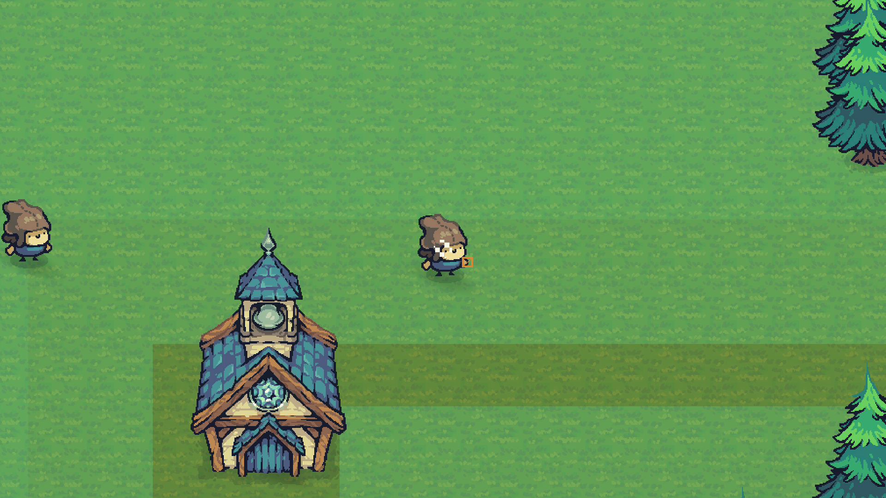
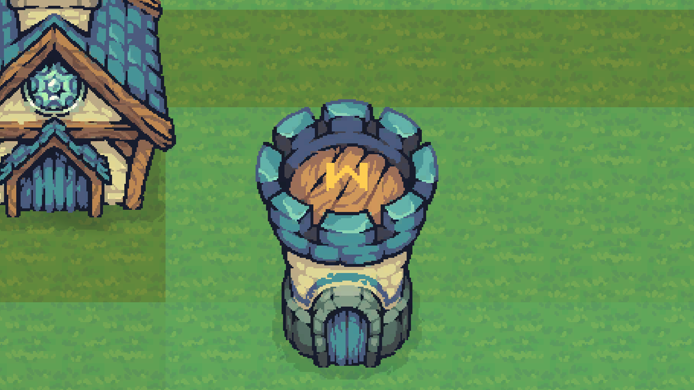
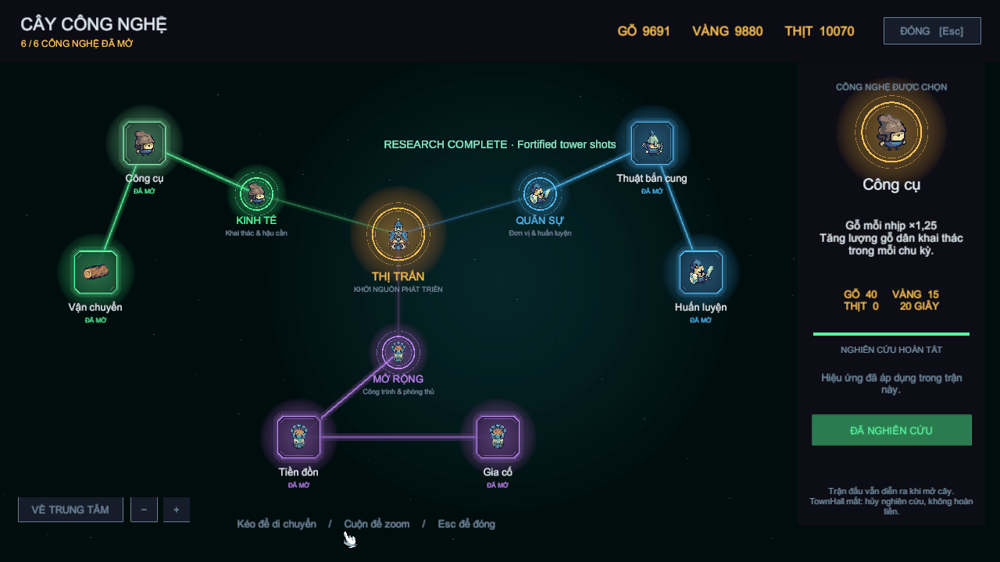
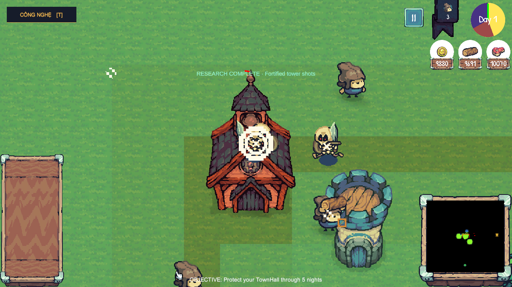

# E6 — phản hồi hành động và nghiên cứu

Ngày kiểm: **24/11/2026**. **DONE trong phạm vi implementation và Unity Editor**, theo [BuildPlan E6](BuildPlan.md#e6--phản-hồi-hành-động-và-nghiên-cứu). Chưa nghiệm thu thẩm mỹ bởi người chơi hoặc đo Windows Player E6; không đóng G3/G5. Bước kế tiếp là E7.

## Mục tiêu và phạm vi

Giúp người chơi nhận ra hit, nhịp khai thác, nộp kho và research hoàn tất bằng tín hiệu ngắn. `ActionFeedbackPresentation` chỉ đọc kết quả ECS; không áp damage, cộng tiền, debit hoặc tính lại modifier. Scene procedural được root cấp dependency; `SampleScene` giữ đường legacy.

Đã triển khai:

- Dấu impact nhỏ ở vị trí mục tiêu: trắng ở đầu, chuyển xanh cho quân ta hoặc cam đỏ cho phía địch, mờ dần trong 0,23 giây. Flash thân Unit và popup damage sẵn có tiếp tục hoạt động; E6 không gọi lại flash hoặc damage của Unit. Native enemy dùng dấu impact này, không tạo GameObject cho từng enemy.
- Bụi khai thác dạng pixel trong 0,32 giây; vòng nộp kho màu vàng trong 0,6 giây.
- Vòng research trong 0,9 giây và thông báo HUD trong 5 giây. Archery ghi rõ mở Archery Range/Archers; Outposts ghi rõ mở tháp phòng thủ. Toast dùng Canvas order 3100, trên cây công nghệ order 3000, không nhận raycast.
- Hàng đang mang là glyph thùng hàng cạnh tay, đổi màu theo wood/gold/meat. Cargo tăng kích thước glyph từ 0,23 lên 0,32 world unit; đây là dấu nhận biết upgrade, không phải mô phỏng số thùng bằng lượng hàng.
- Tower đã Fortify có dấu gia cố vàng. Công trình chết hoặc worker đã nộp hàng không giữ badge.

Không thêm tech, prefab gameplay, dependency package hoặc thay Unity/render pipeline. Glyph được tạo bằng code pixel và shader Resources; không cần asset hình ngoài.

## Dữ liệu và nguồn authoritative

| Dữ liệu | Điểm phát/đọc | Ý nghĩa |
|---|---|---|
| `GameplayEventKind.Gather` | `GameplayEconomyJob`, sau khi cập nhật `Carried` | Một nhịp khai thác thực sự hoàn tất, vị trí node |
| `Deposit` + `Position` | Cùng nhánh cộng `PlayerWallet` và xóa cargo | Giữ Amount/ResourceType/Entity cũ, thêm vị trí depot tại giao dịch |
| `ResearchComplete` | `TickResearch`, ngay khi commit `UnlockMask` | `Entity` là TownHall đã hoàn tất; `RequestId` là index catalog của tech, tra bằng `GetTechnologyId` |
| `PresentationImpact` | `SwarmSimulationSystem.ApplyDamage`, mỗi hit hợp lệ có Amount > 0 | Vị trí và faction của mục tiêu trước khi cleanup; không suy hit từ projectile animation |
| `GameplayWorker.Carried`, `ResourceType` | Snapshot read-only | Trạng thái badge hiện tại; không phát VFX theo chênh lệch snapshot |
| `IsUnlocked` + `GameplayKind.Tower` | Research service và actor snapshot | Dấu Cargo/Fortify hiện tại |

Các giá trị enum cũ giữ thứ tự; hai loại mới được nối cuối. `SwarmGameBridge` vẫn là bên duy nhất dequeue `GameplayEvent`, rồi chuyển bản sao qua `PresentationEvent`. Consumer không giành queue với xử lý training/construction/deposit hiện có. Nhánh queue cũ và damage accumulation không đổi công thức.

`PresentationImpact` dùng managed queue trên main thread, cấp trước 256 phần tử và không vượt 256. Capture mặc định tắt, chỉ consumer E6 bật. Đây là dữ liệu hiển thị trong `RTS.DOTS`, không tham chiếu `Unit`, `GameManager` hoặc lớp gameplay MonoBehaviour. Reset xóa queue; consumer destroy tắt capture và xóa phần chưa đọc.

## Luồng xử lý và thuật toán

1. Root inject bridge/game/fog/camera/research/palette/native renderer và HUD Canvas, sau khi các dependency đã initialize. Khởi tạo lại với bridge hiện tại không đăng ký listener lần hai.
2. Event gameplay được chuyển đúng một lần ở bước dequeue. Consumer chọn pulse trống; snapshot lặp chỉ cập nhật trạng thái badge. Impact được drain một lần trong presentation refresh.
3. Pool cố định theo `TransientVfxBudget` của palette, mặc định **32**, cho phép cấu hình 0–128. Mỗi slot tái sử dụng một SpriteRenderer; không Instantiate/Destroy khi phát hit. Khi đầy hoặc ngoài vùng nhìn, bỏ VFX, không trì hoãn để phát lại sau.
4. Tuổi pulse/toast dùng delta thời gian gameplay, dừng khi Time.timeScale = 0, simulation pause hoặc match terminal. Pulse tăng nhẹ kích thước, nhích lên tối đa 0,18 world unit và giảm alpha; không dịch transform/collider của actor.
5. Badge lấy từ registry của GameManager và snapshot của các actor còn sống/targetable. Tối đa **128** badge trên màn hình; slot thừa bị disable mỗi refresh. Không giữ tham chiếu worker đã trả pool hoặc Entity từ trận cũ.
6. CPU kiểm camera/current visibility trước khi phát; shader dùng fog texture/bounds của native renderer để chặn từng pixel ngoài vùng đang nhìn thấy. Explored-only không hiện pulse/badge. Sorting order 99, hình nhỏ và thời gian ngắn; không đổi projectile renderer, shader E5, material/MPB hoặc pivot của Unit.
7. Hủy component/scene gỡ listener, tắt capture, xóa buffer và hủy material, texture, 5 Sprite, pool view và toast do E6 sở hữu. Shader Resources là shared asset, không bị hủy. Trận mới khởi tạo counters, badges và thông báo trống.

Giới hạn là **tối đa một pulse cho mỗi event đã chuyển**, trong phạm vi ngân sách và visibility. Khi quá tải có thể thiếu tín hiệu hình ảnh; không có việc nhân đôi damage/debit hoặc phát bù event đã bỏ.

## Cách chạy và kiểm thử

Mở `Assets/Scenes/ProceduralGame.unity`, Play. Cho worker khai thác/nộp kho; kiểm thùng hàng cạnh tay và biến mất khi nộp. Cho quân giao chiến, quan sát dấu impact ngắn. Research sáu tech; hoàn tất khi cây đang mở hoặc đóng, kiểm thông báo và dấu Cargo/Fortify. Pause rồi resume, phá Tower/TownHall và bắt đầu trận mới để kiểm cleanup.

Fixture có thể chạy bằng `script-execute`, full class `GameExperienceE6Validation` từ `Tools/ValidateGameExperienceE6.cs`:

- `Run`: cần trận mới Ready, Play và Editor paused. Dùng tick ECS 0,1 giây, node/vị trí/cargo fixture và funds test; đẩy elapsed research tới sát completion rồi để `TickResearch` commit. **Không phải trận tự nhiên, không phải benchmark**.
- `GpuProbe`: camera/layer riêng và shader thật; kiểm faction tint, alpha và mask hai nửa ảnh.
- `Pause` → Editor step → `CheckPause`; `DestroyComponent` → step → `CheckDestroyAndMenu`; step → `NewMatch` → step → `CheckNewMatch` → `FogAndPool`; `ActiveUnload` → step → `CheckLegacy`.
- `FortifySetup` → step → `FortifyCapture`: probe hình ảnh riêng với unlock mask fixture và Tower thực, không phải bằng chứng hoàn tất nghiên cứu. Luồng hoàn tất thật nằm ở `Run`.

Các fixture chỉ sửa trạng thái Play, không lưu seed, scene hoặc prefab test vào dự án. Thoát Play sau khi chạy.

## Kết quả đã kiểm

| Hạng mục | Kết quả và bằng chứng |
|---|---|
| Regression | **84/84 EditMode PASS**, 0 fail/skip, 6,6024524 giây; gồm 3 test mới về giao dịch/event/impact. [JSON](Evidence/E6/editmode-result.json) |
| Đồng bộ lặp | Initialize lặp giữ 1 listener; 20 snapshot không phát lại, không đổi wallet/tick/RNG hoặc tăng số material. [Integration](Evidence/E6/integration.txt) |
| Khai thác/nộp | Event gather một lần; cargo badge hiện; giao dịch nộp amount 1 làm wallet +1 đúng một lần và xóa badge. [Integration](Evidence/E6/integration.txt) |
| Research | Sáu completion authoritative, xen kẽ cây mở/đóng; debit đúng cost; snapshot lặp không phát lại. Base gathering profile không đổi, queue đã có duration 500 giữ nguyên, projectile đang bay damage 17 giữ nguyên. [Integration](Evidence/E6/integration.txt) |
| Damage/ngân sách | Hit 7 làm HP −7 và 1 impact. Burst 300 hit làm HP −300; queue hình ảnh chỉ nhận 256, pool giữ 32/32, 234 pulse bị bỏ trong fixture có hiệu ứng trước đó. [Integration](Evidence/E6/integration.txt) |
| GPU | Màu ta (0,451; 0,851; 1), địch (1; 0,4; 0,22), alpha giảm đúng; nửa fog bị chặn, nửa visible hiện. [Probe](Evidence/E6/gpu-probe.txt) |
| Vòng đời | Menu pause + step giữ age/color/toast/clock; destroy component giải phóng owned IDs; new match reset; fog zero visibility ẩn cargo; pool trả/reuse đúng instance không giữ badge; direct unload sang SampleScene không giữ consumer/capture. [Lifecycle](Evidence/E6/lifecycle.txt) |
| Công trình chết | Tower được bind thật có Fortify badge; health 0 làm badge biến mất. Test EditMode kiểm TownHall chết không phát research completion. [Integration](Evidence/E6/integration.txt) |

Ảnh world dùng camera 1920×1080; ảnh HUD là Game View thực 1280×720. Các vòng trắng chồng ở ảnh stress là nhiều completion/hit được ép trong cùng fixture khi simulation pause, không phải cách research diễn ra trong trận bình thường.

## Hiệu năng và giới hạn

Chỉ xác nhận giới hạn pool 32 transient/128 badge và buffer impact 256 bằng fixture. Tái sử dụng view, không tạo material mỗi refresh đã kiểm; **chưa đo GC/frame, draw calls, p95 hoặc Windows Release E6**. Thời gian test runner ở trên không phải frame time.

Badge là glyph pixel giản lược, không thay animation hoặc model mang hàng. Fortify thể hiện bằng dấu gia cố; không đổi sắc đạn hay damage của projectile đang bay. Các glyph tự ẩn ngoài camera/fog; cap có thể bỏ hiệu ứng lúc giao chiến đông. Cần người chơi nghiệm thu độ nổi bật và đo cùng workload Release ở E10/G5, không suy test synthetic thành đạt budget Player.

Unity cuối được trả về ProceduralGame seed 1, scene sạch ngoài Play/pause/compile; xem [trạng thái cuối](Evidence/E6/final-editor-state.txt). [Fingerprint nguồn](Evidence/E6/source-fingerprint.json) là hash source/config, không phải Player build.

## Nguồn đối chiếu

- [Build plan](BuildPlan.md), [E5 ownership/depth/fog](E5-DepthOcclusion.md).
- [DOTS gameplay](../DOTSGameplay/Architecture.md), [DevelopmentGuide](../DOTS/DevelopmentGuide.md), [Research tree UI](../Progression/ResearchTreeUI.md).
- Code dự án: `GameplayEconomyJob`, `GameplayResearch.TickResearch`, `SwarmSimulationSystem.ApplyDamage`, `SwarmGameBridge.SynchronizeGameplay`, `GameSceneCompositionRoot`, `ActionFeedbackPresentation`, `E6Feedback.shader`.
- Source URP đang cài: `Packages/com.unity.render-pipelines.universal/Shaders/2D/Include/Core2D.hlsl`, đặc biệt `SetUpSpriteInstanceProperties` và `unity_SpriteColor`. Kiểm GPU thực tránh trường hợp SpriteRenderer có color/alpha nhưng shader bỏ qua chúng.
