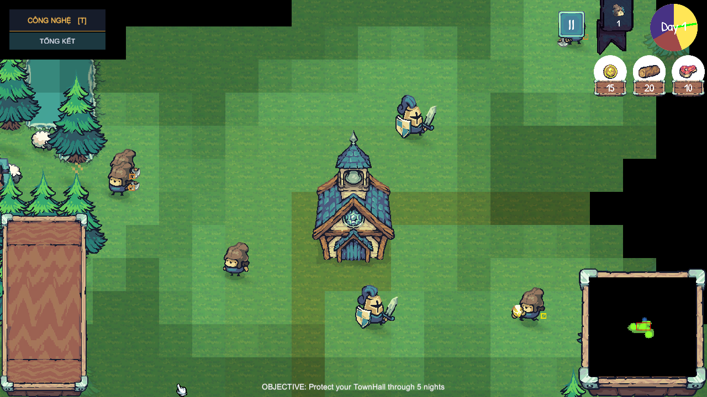
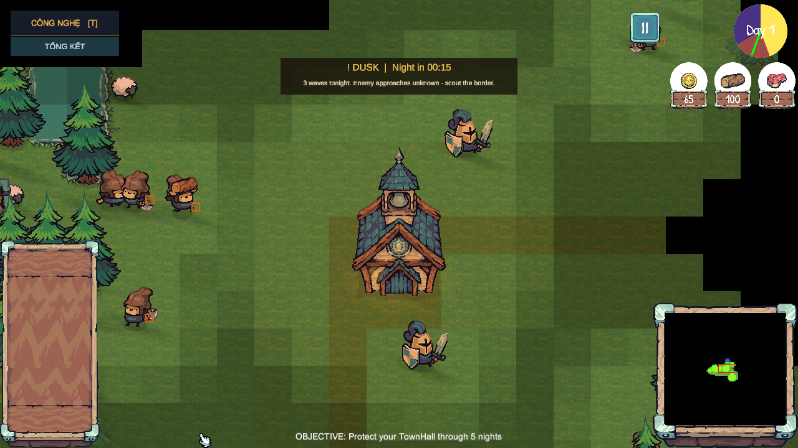
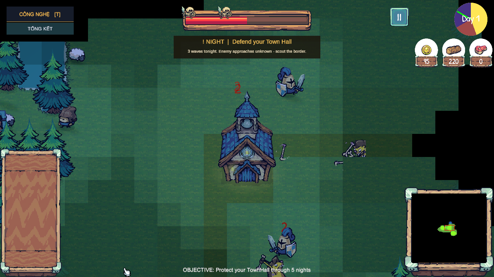
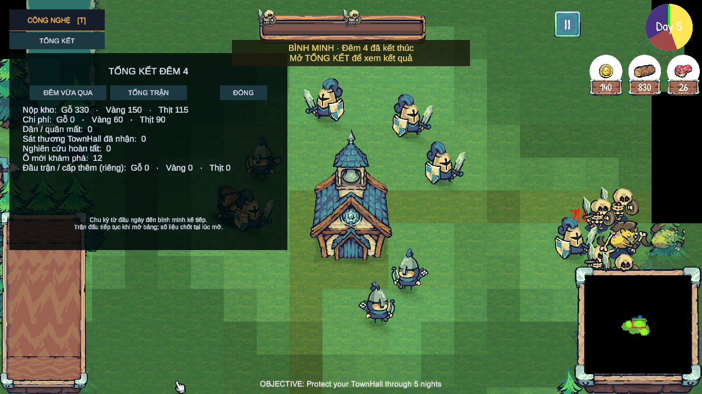
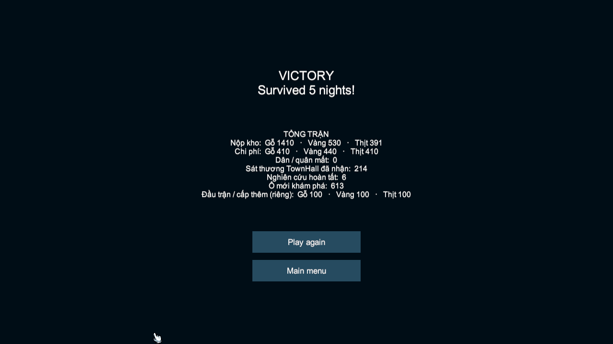

# E7 — bình minh và tổng kết đêm/trận

Ngày triển khai: **24/11/2026**. Theo [BuildPlan E7](BuildPlan.md#e7--bình-minh-và-tổng-kết). Các kết quả nghiệm thu được cập nhật ở phần kiểm chứng bên dưới; không suy số đo Editor thành đạt budget Player/G5.

**DONE phạm vi implementation và nghiệm thu kỹ thuật Editor:** 86/86 EditMode, ledger fixture/lifecycle và một lượt camera cố định thắng đủ5đêm bằng clock thật. Nghiệm thu thẩm mỹ/nghe bởi người chơi, video liên tục và benchmark Windows Player đợt A vẫn chưa thực hiện; không gọi toàn bộ gate đợt A đã đóng.

## Mục tiêu và phạm vi

Tạo tín hiệu bình minh, thông báo kết thúc đêm và bảng tổng kết có thể mở lại. Bảng đọc snapshot, không cấp reward hoặc áp lại hành động gameplay. Result cuối trận sử dụng cùng ledger và formatter. Không thay giá, HP, wave, sáu tech, timer hoặc balance của đợt A.

`DawnReportPresentation` được root tạo riêng cho ProceduralGame: nút **TỔNG KẾT** dưới launcher công nghệ, tab **ĐÊM VỪA QUA**, **TỔNG TRẬN** và nút đóng. Bảng là cửa sổ không pause trận; Image/GraphicRaycaster chặn click xuyên trong phạm vi UI, phần thế giới ngoài bảng vẫn tiếp tục. Snapshot tổng trận chốt lúc mở; mở lại để cập nhật. Banner bình minh có chime tổng hợp dài một giây, phát tối đa một lần mỗi lần kết thúc đêm hợp lệ. Tuổi banner dùng Time.deltaTime nên menu pause giữ nguyên thời gian còn lại.

Canvas tổng kết order 3200, trên cây công nghệ 3000 và toast research 3100. Canvas result được root cấu hình runtime lên 4000, nền opaque để popup phía sau không làm khó đọc kết quả. Khi terminal, report HUD được ẩn; result giữ nút chơi lại/về menu.

## Định nghĩa số liệu

| Chỉ số | Định nghĩa, điểm ghi authoritative |
|---|---|
| Nộp kho W/G/M | Chỉ số dương được Economy job đã hoàn tất cộng vào wallet. Đọc trước/sau **riêng phase single-writer Economy** ngay trong system, không lấy wallet delta giữa hai frame UI. Gathering chưa nộp không tính. |
| Chi phí W/G/M | Phần âm của `AddResources` khi command xây/train debit và debit research tại `StartResearch` đã chấp nhận. Request từ chối không tăng. |
| Đầu trận / cấp thêm | Phần dương của `AddResources`, gồm 100/100/100 đầu trận; luôn hiển thị riêng, không gọi là income. Refund/debug grant nếu gọi API này cũng nằm ở đây. |
| Dân/quân mất | Lần chuyển HP dương sang không dương qua damage resolver, faction 0, kind Worker/Soldier/Archer. Không gồm công trình, cừu, despawn/pool hoặc entity bị xóa bởi fixture. |
| Damage TownHall | Damage đã áp lên HP dương của depot TownHall faction 0, cap ở HP còn lại trước batch để loại overkill. Cộng dồn, hồi máu không trừ lại; không phải mất HP ròng. |
| Tech hoàn tất | Số lần `TickResearch` commit unlock mới. Hủy do Hall chết/terminal không hoàn tất. |
| Ô mới khám phá | Số ô fog chuyển từ chưa khám phá sang đã khám phá; không phải số biome/landmark. Refresh nhìn lại hoặc bật/tắt fog không cộng lại. Tầm nhìn căn cứ đầu trận cũng là khám phá trong chu kỳ đầu. |

Hợp đồng đối soát từng loại tài nguyên: **wallet = cấp ban đầu/cấp thêm + nộp kho − chi phí**. Đây là phân loại theo nguồn API đang có, không suy từ tổng wallet giảm/tăng mỗi frame. Chưa có category riêng cho refund hoặc từng loại spend vì UI E7 chỉ cần tổng.

Một “đêm” trong bảng là **chu kỳ từ đầu ngày đến bình minh kế tiếp**, gồm cả chuẩn bị Day/Dusk và Night, ghi rõ trong UI. Chu kỳ đầu tính từ lúc tạo trận. Bảng không tuyên bố chỉ đo 45 giây ban đêm.

## Dữ liệu, thuật toán và tích hợp

`MatchStatistics` là component trên WalletEntity trong `RTS.DOTS`. `ResourceTotals` dùng long cho W/G/M; các counter và damage không phụ thuộc queue VFX có thể rơi event. Counter được reset cùng `ResetGameplay`.

Economy job hiện chỉ credit deposit vào wallet. `GameplaySimulationSystem` lấy wallet sau `TickResearch`, chạy/complete job rồi ghi phần chênh lệch vào Deposited. Không command, research debit hoặc grant nào xen giữa hai điểm này trên main thread. **Nếu sau này Economy job có thêm debit/refund, phải đổi instrumentation tại từng giao dịch; không tiếp tục coi mọi delta của phase là deposit.** E7 giữ layout/job code Economy hiện có, không thêm ComponentLookup chỉ để thống kê.

Damage resolver gọi `RecordCombatStatistics` một lần cho mỗi target trong batch, trước khi ghi HP mới; do đó nhiều hit cùng tick vẫn chỉ ghi một lần death, còn damage được cộng đủ phần HP thực sự bị trừ. Không quét toàn bộ entity/hierarchy để dựng report mỗi frame.

`FogOfWarManager.ExploredCellCount` tăng tại `RevealAroundWorldPosition` chỉ ở cạnh false→true của m_Explored. Đây là counter của fog owner, không scan lưới từ UI.

`MatchReportService` là service match-local do root tạo sau khi fog initialize. Nó đăng ký clock OnPhaseChanged; chỉ cạnh Night→Day với CurrentDay mới chốt snapshot. LatestNight = cumulative hiện tại − cumulative ở bình minh trước. Guard CompletedNight ngăn lặp do cùng signal hoặc pause/reopen. UI đọc bản sao struct; đọc/mở bảng không ghi counter.

`MatchSession` nhận service qua `InitializeReports`. Khi outcome terminal, Freeze giữ cumulative cuối trận, format bằng `MatchReportText` giống bảng đêm/tổng trận, rồi pause như trước. Root Dispose service gỡ clock listener; presentation gỡ listener riêng và hủy root UI/chime do nó sở hữu. Scene legacy không được root cấp module E7.

## Cách chạy và kiểm thử

Mở ProceduralGame seed 1, Play. Nút TỔNG KẾT có thể mở ngay nhưng báo chưa có đêm kết thúc. Chơi qua Day60/Dusk30/Night45; ở bình minh có banner/chime, tab đêm giữ snapshot. Pause, mở/đóng bảng và mở lại để xác nhận không cộng số liệu hoặc reward. Mất Hall cuối cùng hoặc qua đêm 5: result có tổng trận cùng định nghĩa.

Fixture `Tools/ValidateGameExperienceE7.cs` chạy qua script-execute full class `GameExperienceE7Validation`:

- `Run`: fresh Ready/Editor paused. Có grant/debit fixture, node và relocation/heal, tick ECS 0,05 giây, research elapsed được đẩy sát completion, clock phase được điều khiển. Chỉ kiểm ledger/UI, **không phải bằng chứng sống qua năm đêm**.
- `CaptureReport`; `FinalizeFixture` → step → `CaptureResult`: day6 injected chỉ để kiểm terminal layout/formatter.
- `BaselineAB`: normal Editor rendering, Time.timeScale = 0, simulation pause; thế giới giữ nguyên, bốn block 5 giây A/B/B/A với một giây warmup mỗi block, A bảng đóng/B mở. Ghi frame time, GC và focus từng frame. Không đo startup hoặc Release.
- `CleanupAndMenu` → step → `Reload` → step → `CheckFresh`: ownership/reset.

`Tools/CaptureGameExperienceE7.cs` class `GameExperienceE7Natural.Start` dùng cùng helper capture từ validation (khi gửi snippet, gộp các using ở đầu). Bounded Editor callback điều khiển các command có sẵn mỗi 5 giây, còn clock/wave/ECS/presentation chạy PlayerLoop bình thường timeScale1. Không inject phase/progress, grant, HP hoặc teleport; không đổi RNG seed toàn cục. Watchdog 1100 giây wall; kết thúc thì gỡ callback, dispose query, trả runInBackground và pause Editor. Log 15 giây game một lần, ảnh ba pha ngày đầu và result cuối trận.

## Kiểm chứng và baseline

Các file raw nằm ở [Evidence/E7](Evidence/E7/Checkpoint.md). Không dùng ảnh result fixture làm bằng chứng survival.

Controlled fixture đã đối soát:

- Chu kỳ 1: grant 120/130/140 (gồm 100/100/100 đầu trận), deposit 1/0/0, spend 45/22/9, mất 1 quân, hoàn tất 1 tech và TownHall damage 12 dù có heal +3. Gathering chưa nộp vẫn có deposit = 0.
- Chu kỳ 2: chỉ spend 3 gỗ, damage 4; grant/deposit/loss/tech đều 0. Cumulative spend gỗ 48, damage 16. Không cộng lại chu kỳ 1.
- Hai mươi lượt close/open và signal Day trùng trong menu pause giữ nguyên wallet/counter/snapshot/số signal. Result fixture day6 dùng đúng cùng snapshot và formatter.
- Fog refresh lặp không tăng explored; component destroy/Dispose hai lần/menu/reload/direct unload/legacy đều qua kiểm ownership/reset. [Ledger](Evidence/E7/controlled-ledger.txt), [result fixture](Evidence/E7/result-fixture.txt), [lifecycle](Evidence/E7/lifecycle.txt).

### A/B Editor cho chi phí hiển thị bảng

[Raw CSV](Evidence/E7/editor-ab.csv), [từng block/điều kiện](Evidence/E7/editor-ab.json), [gộp theo trạng thái](Evidence/E7/editor-ab-summary.json). 1280×720, vSync1, targetFPS−1; focus=true trong mọi sample, thế giới dừng với timeScale0/simulation pause. Bốn block A/B/B/A, mỗi block5giây bỏ warmup1giây; A đóng bảng, B mở bảng. Wallet, statistics, clock progress và RNG đều giữ nguyên.

| Trạng thái | Frame giữ lại | Median ms | P95 ms | Median GC Allocated In Frame (byte, toàn Editor) |
|---|---:|---:|---:|---:|
| A — bảng đóng | 1353 | 5,7288 | 7,4003 | 13801 |
| B — bảng mở | 1341 | 5,8076 | 7,3926 | 13801 |

Đây là baseline steady rendering của UI ở Editor trong world đóng băng, không phải chi phí gameplay khi đang giao chiến, thời gian mở bảng, GPU time hoặc gate Player/G5. Lượt đầu ngay sau fixture có stable=false, đã [giữ riêng và loại](Evidence/E7/editor-ab-discarded-unsettled.json); không dùng tính kết quả. Lượt đầu chưa tách flag nên không khẳng định thành phần nào thay đổi. Lượt giữ lại có đủ stats/wallet/clock/RNG stable flags.

### Ảnh cùng thế giới trong lượt clock thật

Seed1, camera tại TownHall, orthographicSize6, Game View1280×720. Chụp ở khoảng giữa mỗi pha ngày đầu, không inject palette/progress. Actor và kinh tế tiếp tục thay đổi theo gameplay; terrain/camera giữ cùng khu căn cứ.

[Probe bình minh4](Evidence/E7/natural-dawn.txt): signal4, timeScale1, report mở và AudioSource đang phát clip Dawn chime. Đây là trạng thái phần mềm, chưa là xác nhận nghe thiết bị thật.

### Trận năm đêm và đối soát độc lập

**86/86 EditMode PASS**,0fail/skip,5,1817389giây ở [lượt cuối](Evidence/E7/editmode-result.json). Hai test E7 mới kiểm grant/deposit/spend/reset và damage/death qua heal/overkill; test deposit E6 đối chiếu thêm counter. Kết quả runner không phải frame time.

[Natural log](Evidence/E7/natural-five-nights.txt), [terminal JSON](Evidence/E7/natural-result.json), [audit45mẫu/5bình minh](Evidence/E7/ledger-audit.json), [snippet thực đã chạy](Evidence/E7/natural-runner-executed.cs.txt). Seed1, clock60/30/45, timeScale1, normal Unity PlayerLoop; camera harness khóa tại(-12,14;−3,20;−10),ortho6. Policy command tự động mỗi5giây dùng cost/queue/navigation có sẵn, không phải người chơi thao tác thủ công. Không grant ngoài100/100/100 ban đầu, không chỉnh HP/phase/timing/balance/RNG seed.

| Kết quả lượt camera cố định | Giá trị |
|---|---:|
| Outcome / completed night / dawn signals | Victory / 5 / 5 |
| Thời gian game / wall (log kết thúc) | 675,052s / 675,299s |
| TownHall HP / damage đã áp | 986/1200 / 214 |
| Nộp kho W/G/M | 1410 / 530 / 391 |
| Chi phí W/G/M | 410 / 440 / 410 |
| Ví cuối W/G/M | 1100 / 190 / 81 |
| Dân/quân mất / tech hoàn tất / ô khám phá | 0 / 6 / 613 |

Audit độc lập đọc45mẫu wallet trong log: mỗi mẫu khớp grant+deposit−spend. Tổng của5snapshot bình minh bằng cumulative cuối trận cho mọi counter, terminalTail=0; resultText đúng cùng formatter. Đây là nghiệm thu ledger/survival của một seed/policy, không chứng nhận balance mọi seed hoặc G3.

Lỗi harness được giữ minh bạch:

- [Lượt đầu camera chưa khóa](Evidence/E7/Natural-UnlockedCamera/CaptureLimitation.txt) vẫn Victory/ledgerPASS nhưng pointer sát mép làm camera pan khỏi map. Không dùng lượt đó làm baseline hình ảnh; giữ log/ảnh gốc riêng. Harness chạy lại có camera lock và guard vị trí, không sửa CameraController sản phẩm hoặc gameplay.
- Lượt camera cố định kết thúc gameplay đúng5đêm nhưng bước export JSON gặp vòng lặp `Vector3.normalized`; log `finished` giữ nguyên exception. Đã sửa helper xuất camera thành float array. `RecoverTerminalExport` xuất lại JSON/PNG từ terminal snapshot còn loaded/frozen, không chỉnh counter/HP hoặc replay trận. `natural-result.json` ghi rõ exportRecovery; thời gian lấy từ log gốc. Audit độc lập sau recovery PASS. Không diễn giải exception export thành gameplay failure hoặc giấu nó.
- Lúc triển khai đã gặp Burst exception sau thay layout Economy job. Final implementation giữ job layout và ghi counter ở commit phase; regression cuối86/86PASS. Không tuyên bố đã sửa một lỗi Burst tổng quát của Unity.

Unity cuối: [Editor](Evidence/E7/final-editor-state.txt), [RQL](Evidence/E7/final-rql-state.txt), [fingerprint nguồn](Evidence/E7/source-fingerprint.json). Không build Player E7 hoặc nâng package/Editor/pipeline. Chưa có video liên tục; bộ PNG/log/A/B Editor là baseline có phạm vi rõ ràng để tiếp E8, Player gate vẫn dành E10/G5.

## Hiệu năng, giới hạn và nguồn

UI không quét entity/hierarchy mỗi frame và chỉ format khi mở bảng/dawn/result. Ledger thêm thao tác O(1) tại commit hoặc damage target đã được resolver duyệt. Bảng chỉ giữ đêm gần nhất và cumulative, chưa có lịch sử từng đêm trong sản phẩm; log kiểm thử lưu từng đêm để đối soát.

Chưa phân loại chi phí theo build/train/research trong UI, chưa tính path/time tiết kiệm bởi kho, chưa loại ô fog nước/không đi được khỏi counter khám phá. Counter long không mở rộng giới hạn int của wallet gameplay. Chime được tổng hợp và kiểm vòng đời/phát một lần; nghe thiết bị thật vẫn cần người chơi xác nhận. Editor A/B có chi phí Editor và focus/throttle, không đóng G5; nghiệm thu người chơi/G3, Player đầy đủ và gate đợt B/E10 giữ phạm vi riêng.

Nguồn: [BuildPlan](BuildPlan.md), [E6 event/ownership](E6-ActionFeedback.md), [DOTS gameplay](../DOTSGameplay/Architecture.md), [DOTS guide](../DOTS/DevelopmentGuide.md), [MatchFlow](../MatchFlow/Architecture.md), [G01 measurement contract](../Progression/G01-MeasurementContract.md). Code đối chiếu trực tiếp: MatchStatistics, GameplaySimulationSystem, GameplayResearch, SwarmSimulationSystem.ApplyDamage, FogOfWarManager, MatchReportService, MatchSession, DawnReportPresentation và root. UI dùng TMP/UGUI có sẵn; không cài package hoặc đổi Editor/pipeline.
