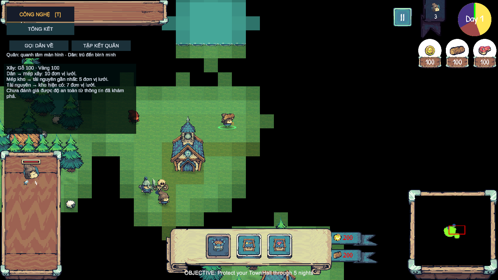

# E8 — mở rộng và chuẩn bị phòng thủ

Ngày triển khai/kiểm: **24/11/2026**. **DONE phạm vi implementation/kiểm kỹ thuật Editor; nghiệm thu người chơi G3 vẫn OPEN.** Người dùng xác nhận “Chưa thử, giữ nghiệm thu G3 mở”. Không đóng toàn bộ gate E8/G3 hoặc suy phép đo này thành balance đã nghiệm thu. Theo [BuildPlan E8](BuildPlan.md#e8--mở-rộng-và-chuẩn-bị-phòng-thủ).

## Mục tiêu và phạm vi

Làm rõ giá trị kho gần tài nguyên trước khi xây và thêm hai thao tác nhanh trên command ECS có sẵn. Không thay giá, HP TownHall1200, research gate, timing60/30/45, wave, prefab hoặc render pipeline.

- **GỌI DÂN VỀ:** toàn bộ worker trong registry quân ta, chọn TownHall hoàn chỉnh còn sống có đường lưới ngắn nhất. UI ghi Nhận/Đã về hoặc đang về/Từ chối. Trú tới bình minh, không cộng tài nguyên hay dịch chuyển ngay khi nhấn.
- **TẬP KẾT QUÂN:** Soldier/Archer tới điểm hợp lệ quanh tâm màn hình, tối đa ±2 ô mỗi trục. Chỉ xét điểm đã khám phá, kiểm clearance theo radius và đường đi trước khi nhận. Giữ movement/separation có sẵn; chưa có formation riêng. Cảnh báo/label cho biết điểm tập kết là quanh tâm màn hình, không bắt người dùng chọn một điểm ngầm khác.
- **Preview xây:** khi có PlacementProcess, hiện cost W/G và trạng thái chưa đủ tiền, đường dân→mép xây dự kiến, mép kho→tài nguyên phù hợp gần nhất đã khám phá, tài nguyên→depot hiện có còn sống/hoàn chỉnh/nhận loại hàng đó. Chỉ hiện khoảng cách **đơn vị lưới**, không dự đoán giây/chuyến hoặc giá trị thu nhập chưa đo.
- **Nguy cơ:** chỉ gắn cảnh báo gần gateway đã khám phá trong12world units; các vị trí khác ghi chưa đánh giá được độ an toàn. Không tiết lộ hướng/enemy/gateway chưa khám phá, không nói vị trí là an toàn.

Preview là tư vấn; việc đặt vẫn do `PlacementProcess`, `GameManager.CanBuild`, resource debit và `BuildingProcess` cũ quyết định. Không làm đủ tiền, không bỏ tech gate hoặc tự tạo công trình. Debug label State/Task/Stance/Selected cũ chỉ giữ ở scene legacy, không đè lên preview procedural; selection rectangle vẫn được vẽ.

## Dữ liệu và sở hữu

| Dữ liệu/thành phần | Vai trò |
|---|---|
| `GameplayLogisticsCommands` partial của GameplaySimulationSystem | Query đường read-only và command guard; dùng chính native grid/radius |
| `GroupCommandResult` | Accepted, AlreadyReturning, Unavailable, InvalidActor, InvalidTarget, Unreachable |
| `GroupCommandSummary` | Accepted/AlreadyReturning/Rejected cho lần nhấn hiện tại; không phải counter thưởng |
| `ExpansionCommandService` | Game/bridge/fog/map qua DI; snapshot registry khi gửi lệnh; query GameplayResource thuộc match |
| `ExpansionHud` | Hai nút, kết quả và preview; root cấp service/game/camera/HUD Canvas |
| `GameManager.CurrentPlacement`, `PlacementProcess.PreviewPosition/PreviewAreaValid` | Chỉ đọc tiến trình đặt đang có, không tạo một luồng xây khác |
| `WorkerUnit.m_ResumeResource/m_ResumeConstruction` | Entity của việc bị tạm ngắt để trú; đọc snapshot ECS trước command, trả command resume qua ECS khi bình minh |

Runtime `RTS.DOTS` không tham chiếu lớp gameplay MonoBehaviour. EntityQuery nguồn tài nguyên do service tạo một lần và dispose khi root kết thúc; Dispose lặp an toàn. UI chỉ hủy đối tượng do nó tạo. Trận mới không giữ result/placement hoặc suspended task của worker cũ; worker trả pool xóa suspended Entity.

## Thuật toán đường và preview

`TryLogisticsRoute` là BFS bốn hướng, clearance bằng `SwarmMath.Fits`, cùng native grid và radius với actor pathfinding. Hai managed array distance/queue cấp theo kích thước grid, tái sử dụng cho lần query sau. Query Complete dependency trước đọc, không sửa Actor/waypoint/grid/navigation version, RNG hoặc wallet. Độ phức tạp O(V+E), bộ nhớ O(V); không chạy trên mỗi actor ở mỗi frame.

Giống pathfinding hiện có, query cho phép actor bắt đầu ở ô đang bị chiếm/không đủ clearance rồi thoát qua ô lân cận hợp lệ; **không** cho route đi xuyên footprint công trình dự kiến. Khoảng cách là số cạnh lưới×cellSize tới ô approach, không gồm đoạn subcell chính xác và không phải mét/giây vận chuyển. Không dùng đường fallback “đến gần nhất” để coi unreachable là Accepted.

Khi preview, các ô footprint lấy đúng vị trí highlight đã round và chuyển CellToWorld; footprint được loại tạm khỏi phép BFS, không ghi vào grid thật. Goal dân xây dùng khoảng cách tới hình chữ nhật footprint. Goal resource/depot dùng `GameplayMath.DistanceToBody` với khoảng tiếp cận của economy. Không suy đường bằng Euclidean rồi hiển thị như path thật.

Nguồn tài nguyên được chọn theo khoảng cách thẳng gần nhất trong số nguồn phù hợp/đã khám phá; sau đó BFS xác minh. Nếu nguồn gần nhất không có đường, UI nói không có đường cho nguồn đó, **không** khẳng định mọi nguồn đều vô nghiệm hoặc tự dò một tối ưu kinh tế. Kho hiện có được so bằng đường lưới hợp lệ. Vị trí/resource/công trình preview là read-only; chưa dựng polyline trực quan.

HUD cập nhật preview tối đa mỗi0,35giây và chỉ khi đang đặt công trình. Nếu footprint chưa khám phá đầy đủ, chỉ hiện cost và thông báo chưa khám phá, không lộ distance/resource/depot. Không lấy `Fog.IsDisabled` làm lý do coi toàn map đã khám phá.

## Command và trú đêm/bình minh

Trước nhận recall/rally: đúng faction/kind, actor còn sống, speed>0, match Running, grid sẵn sàng, simulation không pause; HUD/service còn kiểm Time.timeScale và composition. TownHall đích phải còn sống, là depot TownHall hoàn chỉnh. Không nhận lệnh đã biết vô nghiệm.

Recall cùng Hall khi `ReturningToShelter` hoặc `Sheltered` trả AlreadyReturning, không `CancelWork` hoặc ghi đè việc tạm giữ. Worker adapter nhớ node/công trình của snapshot trước khi gọi Shelter; đổi sang Hall hợp lệ khác khi đang trở về vẫn giữ snapshot công việc đầu tiên. Cargo vẫn nằm trong GameplayWorker và không được tự nộp khi recall.

`GameManager` vẫn gọi ReturnToTownHall lúc Night. Guard mới khiến lệnh tự động sau nút recall không hủy/ghi đè nhiệm vụ đã tạm giữ. Đến Day:

1. Worker đã **thực sự Sheltered** dùng luồng LeaveShelter có sẵn để ra cửa Hall, Targetable trở lại. E8 không thêm teleport để về Hall; relocation vào/ra cửa là semantics shelter có sẵn và chỉ dùng khi đã vào trạng thái Sheltered.
2. Worker còn **ReturningToShelter** hủy trở về tại vị trí hiện tại; không gọi luồng ra cửa Hall. Trước đây nhánh này không được xử lý ở dawn.
3. Khôi phục command xây nếu công trình gốc còn sống/chưa xong; nếu không thì thử AssignResource với node gốc còn hợp lệ/claim capacity. Nếu mục tiêu không còn hoặc claim bị chiếm, API từ chối và worker về idle, không tạo lại mục tiêu/cấp hàng.
4. Worker đã chết hoặc được người chơi giao task khác trước dawn không bị restore ép buộc. Xóa suspended Entity khi đã xử lý hoặc trả pool.

Rally chỉ gọi `SetDestination(..., playerCommand:true)` sau guard để ngắt attack hiện tại. Attack acquisition và separation sau di chuyển do actor system hiện có xử lý. Mỗi đơn vị được kiểm lại ở lúc gửi, nên một Entity đã chết/xóa sau snapshot không được coi là Accepted.

## Cách chạy

Mở ProceduralGame seed1, Play. Di chuyển camera tới vùng **đã khám phá**, nhấn TẬP KẾT QUÂN; xem Nhận/Từ chối. Nếu tâm màn hình đang là công trình, hệ thống thử ô hợp lệ xung quanh ±2 ô; không có đường sẽ từ chối.

Nhấn GỌI DÂN VỀ khi dân đang khai thác/xây, nhấn lần nữa để kiểm AlreadyReturning. Chờ bình minh, xác nhận quay lại việc còn hợp lệ. Nếu gọi ban ngày, dân trú đến bình minh kế tiếp, ghi rõ trên HUD. Pause menu phải từ chối command.

Chọn worker, chọn action xây kho rồi di chuyển outline. Preview cost/đường phải đổi theo vị trí. Vùng chưa khám phá không có gợi ý đường; chưa đủ tiền hoặc chưa mở tech vẫn do luồng xây cũ chặn. Đặt kho gần nguồn hàng thật sự đang khai thác; kho không tự sinh income hoặc phòng thủ.

## Kiểm kỹ thuật đã thực hiện

**89/89 EditMode PASS**,0fail/skip,11,3236323giây; [JSON](Evidence/E8/editmode-result.json). Ba test mới: BFS/wall/planned footprint/read-only; recall/cargo/dead/duplicate/paused/không teleport dawn; rally reachable/blocked/death/pause/ngắt attack sau khi nhận.

[Integration](Evidence/E8/integration.txt): scene Ready/Editor paused, manual ECS ticks và fixture node/positions/reveal/health. Gọi toàn bộ worker, gọi lặp, không đổi transform/wallet/stats/tick/nav/RNG lúc gửi. Carrier giữ cargo3 và claim1, builder resume đúng Structure còn dang dở; workerhealth0/menu pause từ chối. Army đang attack nhận goal hợp lệ và xóa target, ngoài map/chưa khám phá bị từ chối. Preview lặp không đổi gameplay; footprint chưa khám phá không lộ route.

[Rally thực](Evidence/E8/rally-arrival.txt): sau fixture archer được đặt vào ô đã resolve hợp lệ, command tạo movement ECS;17tick×0,05giây từ(-15,14;−6,2) tới gần đích(-12,5;−6,5), sai số0,38201world. Phép kiểm chuyển động không gán Body/transform trực tiếp. [Shelter thực](Evidence/E8/shelter-arrival.txt): worker đi vào Sheltered qua native tick,Targetable0; duplicate không thay state; dawn ra cửa/Targetable1 và phục hồi resource task.

[Lifecycle](Evidence/E8/lifecycle.txt): hủy riêng HUD/Dispose query hai lần/menu/reload trống/no placement/no shelter; direct unload sang SampleScene không giữ root/HUD E8. Snapshot kết quả mới dùng hint mặc định; không kế thừa kết quả command trận cũ.

Ảnh Game View1280×720; [text](Evidence/E8/preview-text.txt) tương ứng fixture cuối: cost100gỗ/100vàng,10→5→7đơn vịlưới. Có spawn công trình/node và reveal để kiểm layout/đường, không phải income/natural scouting evidence. Debug labels cũ đã gỡ riêng khỏi procedural để preview đọc được; UI gameplay/selection rectangle giữ nguyên.

## A/B kho gần cùng mỏ và kho bỏ trống

Harness [PlaytestE8Logistics](../../../Tools/PlaytestE8Logistics.cs) được derive từ `Tools/PlaytestG3.cs`: giữ policy/tick/wave seed, đổi class/output/configId và thêm snapshot MatchStatistics vào log. Không ghi đè raw G3. Chạy fresh match riêng cho LogisticsHall, LogisticsDepot, EmptyDepot. Seed0 tạm trong memory, không save asset; seed1 gốc đã khôi phục.

Mapseed0/waveseed8001,Hall1200HP,dt0,05,clock60/30/45,không grant ngoài100/100/100 ban đầu, không research/train/rally phòng thủ. Cùng carrier và mỏ vàng gần landmark(-15,52962;−59,20689), kho tại(-12;−56); nhánh kho thêm builder và trả100gỗ/100vàng. Đây là intervention có chi phí nhân công, không phải so hai army khác nhau.

So cửa sổ chung **0–535giây** trước khi Hall sớm nhất bị phá:

| Policy | Chuyến nộp | Trung vị đầy hàng→nộp | Vàng nộp | Ròng gỗ/vàng sau xây |
|---|---:|---:|---:|---:|
| Hall | 4 | 19,90s | 80 | 0 / +80 |
| Kho gần mỏ | 12 | 0,70s | 240 | −100 / +140 |
| Kho bỏ trống | 0 | Không có chuyến | 0 | −100 / −100 |

Kho tăng160vàngnộp và60vàngròng, đổi100gỗ + công builder. Kho logistics hoàn tất30,15s; kho bỏ trống đặt30,05s/hoàn tất59,80s. Cả ba lượt đều thua đêm4, lần lượt536,45/537,25/537,15s,57spawn. Không kết luận kho đủ để thắng hoặc đáng xây ở mọi vị trí.

Tất cả log initial/placed/completed giữ **TownHallRange14,13**, cả kho đang xây và đã xong. Kho bỏ trống nhận0mọi tài nguyên. Carrier nộp4/12chuyến xác nhận đường khai thác–nộp ở vị trí đó không vô nghiệm; không chứng nhận mọi cách đặt công trình đều giữ toàn bản đồ liên thông.

[Tổng hợp và audit](Evidence/E8/logistics-summary.json), [raw](Evidence/E8/Logistics/). `node Tools/SummarizeE8.mjs` kiểm ba ledger terminal theo Granted+Deposited−Spent, window delivery, cost100/100 và mọi range14,13. Native MatchStatistics khớp số nộp/chi của harness. G3 kết quả cũ giữ nguyên; khác biệt nhỏ thời điểm battle giữa lượt không được coi là tune balance.

## Giới hạn và gate còn mở

- **G3 human acceptance OPEN theo người dùng.** Phản hồi “chưa thử” không phải approval nghiệm thu. Đợt A Player/G5 và manual E7 cũng vẫn mở; không tự đóng E8 đầy đủ vì có fixturePASS.
- Fixture bắt được Archer khởi tạo ở vị trí không đủ clearance trên seed1. Lệnh tới ngay vùng này bị từ chối đúng guard; để kiểm chuyển động dùng TryResolveSpawnPosition rồi đặt actor vào ô hợp lệ **chỉ trong fixture**. E8 không sửa spawn profile hoặc giả Accepted cho đơn vị kẹt. Cần theo dõi riêng nếu người chơi thấy quân không tập kết từ vị trí xuất phát; chưa chứng nhận mọi actor khởi tạo đều có đường.
- Preview BFS đồng bộ có thể duyệt toàn grid/query resource data trong lúc đặt; managed buffers tái sử dụng nhưng query ToComponentDataArray và rally candidates vẫn có allocation. **Chưa đo GC/frame, p95/draw calls hoặc Player E8.** Test runner/short tick movement không phải benchmark. Cần profile workload lớn trước khi tăng army/grid hoặc giảm refresh interval.
- Gợi ý là distance lưới và cảnh báo gateway đã biết, chưa dự đoán travel time, không tự quyết định điểm chiến thuật, không tối ưu formation hoặc bảo đảm mọi placement không chia cắt map.
- Chưa playtest tự nhiên5đêm mới cho E8; A/B là controlled simulation. E7natural trước đó không thay cho nghiệm thu E8 hoặc balance sau sửa resumption.

## Nguồn và bàn giao

[G3 logistics/radius/manual gate](../Progression/G3-EconomyExpansion.md), [BuildPlan](BuildPlan.md), [E7 ledger](E7-DawnReports.md), [DOTS guide](../DOTS/DevelopmentGuide.md), [Gameplay architecture](../DOTSGameplay/Architecture.md), [DI](../DependencyInjection/D4-Validation.md). Thuật toán đối chiếu trực tiếp `GameplayPathJob`, `SwarmMath.Fits`, `GameplayEconomyJob.FindDepot`/approach và command `Shelter/LeaveShelter/SetDestination` trong source dự án.

[Checkpoint](Evidence/E8/Checkpoint.md), [Editor cuối](Evidence/E8/final-editor-state.txt), [RQL](Evidence/E8/final-rql-state.txt), [source fingerprint](Evidence/E8/source-fingerprint.json). Unity6000.3.11f1,ProceduralGame sạchseed1 ngoàiPlay/pause/compile; không nâng Editor/pipeline hoặc commit Git. E9 là mốc kế tiếp nếu được yêu cầu; G3manual và Player/G5 tiếp tục mở.
