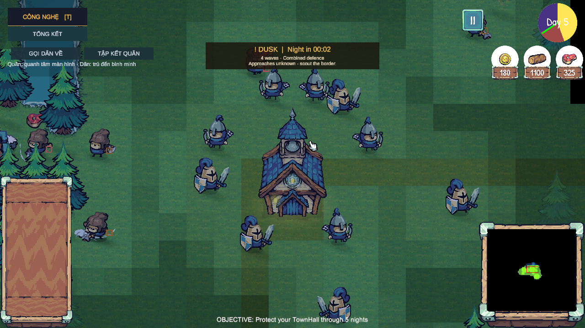
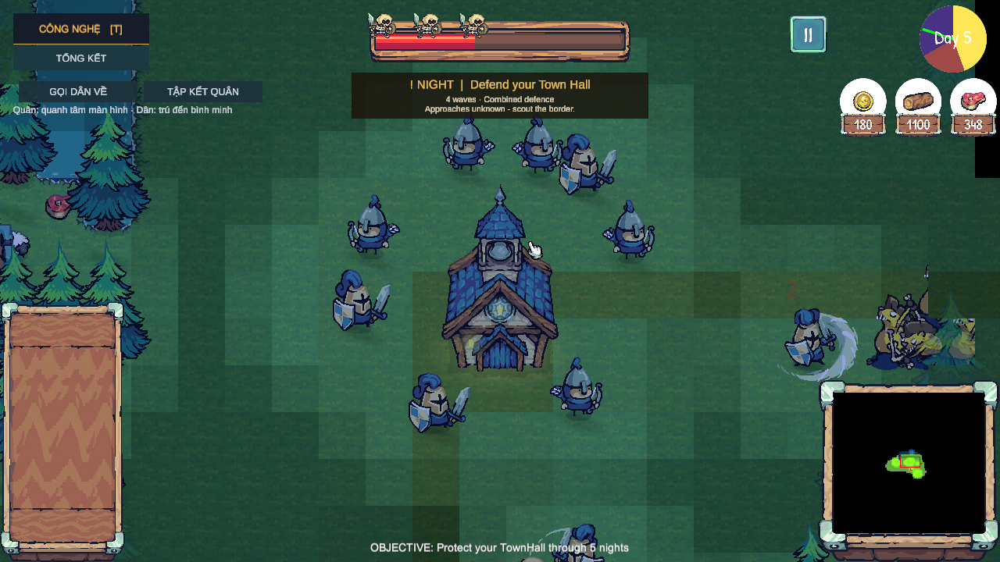
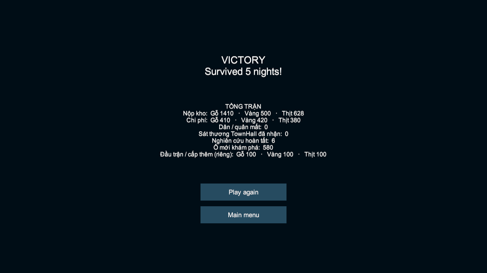

# E9 — các đêm có vai trò chiến thuật khác nhau

Ngày triển khai: **24/11/2026**. Theo [BuildPlan E9](BuildPlan.md#e9--các-đêm-có-vấn-đề-chiến-thuật-khác-nhau). Candidate riêng cho ProceduralGame; kết quả đo và gate được cập nhật ở phần kiểm chứng, không coi giả thuyết thiết kế là balance đã nghiệm thu.

**DONE implementation/kiểm kỹ thuật Editor cho candidate76-v1; PARTIAL nghiệm thu cân bằng.** Đã89/89regression, schedule/edge/legacy asserts, ma trận16lượt và realtime5đêm. Training0/1/1543 có control thua/active thắng, nhưng Economy thua trên cả holdout137/901. Không đóng G3manual hoặc G5/Player và không tuyên bố candidate cân bằng mọi seed.

## Mục tiêu và phạm vi

Thay tổ hợp, hướng và nhịp tiếp viện bằng hai prefab/capability đang có: **Skull** cận chiến và **Gnoll** đánh xa. Không tạo quái/animation/AI mới, không đổi thông số prefab, HP Hall1200, giá, sáu tech hoặc clock60/30/45. Baseline `EnemyWaveDefinition` giữ nguyên để legacy và evidence trước E9 còn đối chiếu được.

`TacticalNightPlan` là ScriptableObject riêng tại `Assets/Game/ProceduralGeneration/Resources/ProceduralNightPlan.asset`. Composition root tải cấu hình tại ranh giới composition, validate và cấp trực tiếp cho EnemyWaveManager trước Initialize; consumer/UI không tự tìm asset hoặc singleton. Không sửa scene YAML. Resources bảo đảm plan và prefab dependency được giữ khi build Player.

## Lịch candidate76-v1

| Đêm | Giả thuyết chiến thuật | Quota từng wave | Interval / nghỉ giữa wave | Quái đánh xa | Hướng |
|---|---|---|---|---|---|
| 1 | Học giữ tuyến trước cận chiến | 3,4,5 | 2,2s / 8s | 0 | Một gateway cố định của đêm |
| 2 | Chuyển/chia lực giữa hai hướng | 4,5,6 | 1,9s / 8s | 0 | Đổi gateway theo wave |
| 3 | Xử lý cận chiến có hỗ trợ đánh xa | 4,5,6 | 1,7s / 7s | Mỗi3slot, lệch theo wave | Đổi gateway theo wave |
| 4 | Thử giữ phía tuyến mở rộng | 5,5,6 | 1,6s / 6s | Mỗi4slot, lệch theo wave | Gateway gần landmark nhất theo layout |
| 5 | Bài phối hợp tổng hợp | 4,4,5,5 | 1,25s / 5s | Mỗi2slot, lệch theo wave | Xen gateway trong wave và giữa wave |

Quota theo đêm12/15/15/16/18, tổng**76**. Các lịch danh nghĩa kết thúc spawn trước44giây, trong Night45giây; overhead Tick và retry được kiểm bằng actual spawn trace. Quota vẫn là trần: dawn cắt tiếp viện nếu có failure hoặc timer chưa đủ, không spawn bù sang ban ngày.

Đêm4 **chỉ đổi hướng cấp quái theo phía landmark**, không có AI mới ưu tiên kho, không ép target vào công trình chưa khám phá. Enemy acquisition/flowfield/retreat hiện có quyết định mục tiêu thực tế. Giá trị “giữ tuyến mở rộng” vẫn là giả thuyết cần người chơi thử, không được suy từ tên đêm.

## Dữ liệu và thuật toán

Mỗi `Night` chứa Title/Briefing, Counts, SpawnInterval, Delay, RangedEvery và NightApproach. PrefabSlot trả0melee/1ranged theo `(ordinal+wave)%RangedEvery`; không dùng random animation hoặc frame order để chọn tổ hợp.

Gateway chính dùng hash integer của **WaveSeed8001 + mapseed + day**. Single giữ gateway chính; AlternatingWaves/MixedSupport cộng waveIndex; ExpansionSide lấy gateway có bình phương khoảng cách layout tới landmark nhỏ nhất; Combined thêm parity của ordinal. Với map chỉ có1gateway, các mode tự co về gateway đó; không tạo hướng giả. Tie được giải bằng thứ tự index cố định.

Không dùng `UnityEngine.Random` khi chọn roster/gateway cho candidate; thao tác UI/VFX hoặc order cấp tiền không đổi schedule. Bridge vẫn resolve position bằng native radius/grid trước spawn. Nếu hướng dự kiến không spawn được, thử các gateway kế tiếp theo thứ tự vòng; **chỉ tăng quota ordinal sau khi spawn thành công**. Failure giữ nguyên prefab/gateway/ordinal, đợi0,5giây retry. Fallback được ghi rõ thay vì tuyên bố hướng thực luôn trùng dự kiến.

Spawn position tiếp tục dùng `TryGetGatewayApproachPosition` dọc centerline route được bảo vệ và bán kính căn cứ đã chốt G3. Không tính kho xa vào bán kính, không làm quái tự xuất hiện tại landmark hoặc bên trong fog đã mở. Record Position là approach position yêu cầu trước native resolve, không được gọi là tọa độ Entity sau mọi bước collision.

`EnemyWaveManager` là owner timer/counter: WaveCountForDay, EnemyCountForWave, SpawnIntervalForDay, DelayForDay chọn candidate nếu được inject, còn null dùng công thức legacy. `GetWaveStartNormalized` và `CurrentWaveCount` dùng cùng các getter này với spawner. Dusk hiển thị role title và wave count từ plan đang chạy; marker vẫn chỉ hiện gateway đã khám phá, ghi rõ possible approach và có thể reroute khi bị chặn. Không báo tọa độ gateway chưa khám phá.

`Spawned` phát `WaveSpawnRecord` sau spawn thành công: Day/Wave/Ordinal/PrefabSlot/RequestedGateway/ActualGateway/Position. Đây là event kiểm chứng không tạo damage/tiền. Consumer trace đăng ký theo lượt và gỡ trong finally; manager không lưu danh sách sự kiện vô hạn. FailedSpawnAttempts/FallbackSpawnCount thuộc manager scene, tự reset khi scene mới.

## Tích hợp và cách chạy

Mở ProceduralGame seed1, Play từ MainMenu. Dusk ngày1→5 phải hiển thị các role khác nhau ở cùng HUD hiện có. Quan sát đêm1melee, đêm3/4/5có Gnoll projectile và hướng khác; fog/selection/đèn/VFX giữ luồng cũ. Bình minh vẫn retreat/stop reinforcement, objective vẫn5đêm. SampleScene không có root inject, nên TacticalPlan null và wave formula cũ.

Author/reproduce bằng script-execute full class `GameExperienceE9Validation` trong `Tools/ValidateGameExperienceE9.cs`:

- `Author` tạo/cập nhật **riêng** asset ProceduralNightPlan qua AssetDatabase, tham chiếu prefab đang có từ baseline. Không gọi nó để ghi đè candidate sau khi đã đóng matrix nếu chưa chủ đích mở một vòng tune mới.
- `DataChecks`: validate5đêm, roster/hướng/nominal duration, hash không đổi global RNG; invalid interval bị từ chối. [Schedule](Evidence/E9/schedule.json).
- `LiveChecks`: fresh Ready/Editor paused; inject phase/ngày và chỉ gọi wave Tick, không combat simulate. Kiểm đủ76native spawns, Dusk role, Day không spawn, RNG/economy invariant. Đây **không** là survival/balance evidence. [Live trace](Evidence/E9/live-schedule.json).
- `EdgeChecks`: fresh match, đầu đêm timer0; actual menu pause/delta0/NaN không spawn; fixture native grid all-zero làm fail, restore navigation trong finally rồi retry phải ordinal0 và chỉ startwave một lần; Day phải đặt agent Retreating.
- `CheckLegacy`: load SampleScene để kiểm TacticalPlan null. Stop Play sau fixture.

## Ma trận policy và tái lập

`Tools/PlaytestE9.cs` derive từ G3 policy harness; gọi getter schedule của manager thay vì giả công thức EnemyWaveDefinition. Không ghi đè G3/E8raw. Trace spawn và `MatchStatistics` được thêm để đối soát; giá, prefab, army cap, thứ tự tech theo policy và command logic giữ cùng harness. Manual Tick0,05giây/seed tái lập là phép thử có kiểm soát, không phải tỉ lệ thắng người chơi hoặc Player performance.

`Tools/RunE9Matrix.ps1` chạy control/economy/military/expansion trên mapseed0/1/1543, WaveSeed8001; sau đó control/economy trên holdout137/901. Mỗi lượt fresh scene, seed chỉ đổi trong memory; finally StopPlay/khôi phục seed1. `Tools/SummarizeE9.mjs` kiểm wallet=Granted+Deposited−Spent, grant chỉ100mỗi loại, trace count/không trùng ordinal và cùng requested schedule prefix cho các policy cùng seed. Nguồn/config candidate được fingerprint trước khi kết thúc matrix; không tune bằng holdout.

Policy control không gửi lệnh phát triển/khai thác/rally; các cơ chế auto trú/retreat hiện có vẫn chạy. Economy/military khác thứ tự tech và số worker/quân mục tiêu; expansion dành giá xây kho ở landmark và vẫn phát triển/phòng thủ. Các policy là gói chiến lược, không tách riêng tác động nhân quả của một tech hoặc kho.

Các harness/evidence G3/E8 cũ giữ nguyên để truy vết; không dùng công thức EnemyWaveDefinition trong chúng để giải thích schedule E9 đang active. Tái lập baseline cũ cần phiên bản/fingerprint cũ hoặc fixture baseline tắt candidate trước composition. Dùng PlaytestE9 cho cấu hình hiện tại.

## Kiểm realtime và giới hạn

`Tools/CaptureGameExperienceE9.cs` dùng normal Editor PlayerLoop/timeScale1, clock và wave manager tự Tick. Policy command định kỳ5giây có cost/queue/gate, không cấp tiền/HP/teleport/injectphase. Camera harness khóa tại Hall để tránh edge-pan. Log15giây và PNGphase/dawn/result cùng spawn trace; callback có watchdog1100wall và dọn query/listener/camera lock/background khi xong. Đây là realtime automated policy playtest, **không** giả là người chơi thao tác thủ công hoặc benchmark Release.

Các gate G3người dùng chưa thử, Player/G5 và manual thẩm mỹ/âm thanh từ E7/E8 vẫn mở. E9 không tự đóng chúng. Kể cả khi control thua và active thắng trong matrix, chưa có căn cứ nói mọi seed/policy/cách chơi hợp lý đều cân bằng. Không có fast/tank variant mới ở candidate này vì hai capability hiện có đủ để kiểm giả thuyết tổ hợp trước.

## Kết quả kiểm kỹ thuật và shortlist

**89/89 EditMode PASS**,0fail/skip,9,1491996giây: [JSON](Evidence/E9/editmode-result.json). Đây là regression hiện có; logic lịch mới còn được kiểm riêng bằng assert fixture, không gọi toàn bộ89bài là test mới của E9.

[Data](Evidence/E9/schedule.json) và [live schedule](Evidence/E9/live-schedule.json) xác nhận76spawn theo plan,0failed/0fallback ở seed1fixture, đúng roster0/0/5/4/9ranged theo đêm. Native TotalSpawned ban đầu2, cuối78; **scheduledDelta76** mới là quota E9, không cộng nhầm phần ban đầu. [Edge cases](Evidence/E9/edge-cases.txt) kiểm pause đầu spawn, deltaNaN, zero-gridfailure/retry/ordinal và dawnRetreating. [Legacy](Evidence/E9/legacy.txt) xác nhận SampleScene không nhận plan.

[Ma trận16lượt](Evidence/E9/matrix-summary.json), [raw từng lượt](Evidence/E9/Matrix/), [shortlist](Evidence/E9/shortlist.json), [fingerprint trước đo](Evidence/E9/candidate-source-fingerprint.json) và [kiểm nguồn không đổi](Evidence/E9/frozen-source-check.txt). Cùng WaveSeed8001; không tune sau kết quả holdout. Bảng là kết quả từng policy trong harness có kiểm soát, **không phải tỷ lệ thắng người chơi**.

| Mapseed | Control | Kinh tế | Quân sự | Mở rộng |
|---:|---|---|---|---|
| 0 | Thua395,75s,đêm3 | Thắng,Hall1200 | Thắng,Hall1200 | Thắng,Hall1200 |
| 1 | Thua269,35s,đêm2 | Thắng,Hall1200 | Thắng,Hall728 | Thắng,Hall1200 |
| 1543 | Thua373,15s,đêm3 | Thắng,Hall916 | Thắng,Hall946 | Thắng,Hall916 |

Các lượt thắng kết thúc675,75giây simulated và đủ76wave spawns. Mỗi seed training có control thua và đường chơi chủ động thắng; toàn bộ16ledger khớp, không duplicate spawn ordinal, mọi requested roster/gateway prefix khớp giữa policy cùng mapseed. FailedSpawnAttempts/FallbackSpawnCount=0 ở các lượt ma trận này. Tính tái lập được kiểm cho **schedule selection**, không tuyên bố toàn bộ combat/physics/Entity allocation/frame timing bitwise deterministic.

### Holdout sau shortlist — giới hạn được giữ lại

| Mapseed giữ ngoài | Control | Kinh tế |
|---:|---|---|
| 137 | Thua265,05s,đêm2 | Thua405,35s,đêm3 |
| 901 | Thua375,05s,đêm3 | Thua391,05s,đêm3 |

Đây là kết quả âm cần lưu, không loại file hoặc dùng để chỉnh ngược candidate. Chưa thử Military/Expansion hoặc policy tái bố trí quân thích ứng trên hai holdout; **không biết** liệu mọi đường chơi chủ động đều thất bại. Việc Economy thắng ở training nhưng thua cả hai holdout cho thấy lịch/địa hình/vị trí phòng thủ cần playtest thêm; chưa thể gọi candidate đã cân bằng hoặc gate nghiệm thu đầy đủ E9 đã đóng. Không tăng HallHP/cấp tiền để đổi kết quả.

## Kết quả realtime và bàn giao

### Kết quả realtime seed1

[Log](Evidence/E9/Realtime/natural-five-nights.txt), [result](Evidence/E9/Realtime/natural-result.json), [spawn trace](Evidence/E9/Realtime/spawn-trace.json), [audit độc lập](Evidence/E9/Realtime/audit.json). Trận dùng normal Unity Editor PlayerLoop,timeScale1,clock60/30/45,seed1/WaveSeed8001,camera khóa(-12,14;−3,2;−10),ortho6,GameView1280×720. Policy tự động economy-first8worker/army ring khác chi tiết policy6worker của matrix, không gọi là lặp bitwise cùng trận.

**Victory đủ5đêm**,675,071giâygame/675,371giâywall theo dòng finished; JSON đo wall trước thao tác lưuảnh nên675,284giây. Hall1200/1200HP,damage0,mất0dân/quân,6research,580ôkhámphá. NộpW/G/M1410/500/628,chi410/420/380,grant100/100/100; vícuối1100/180/348. Native schedule phát76event,0failed/0fallback.

Audit45mẫu ví,5snapshot dawn và terminal equationPASS; tổng5dawn bằng cumulative cuối (tail0mọichỉsố),roster/requestedgateway trace khớp prefixcontrolledseed1; không duplicate ordinal. Runner kết thúc không exception, không grant/HP/phase injection. Đây là realtime **automated policy** evidence, không thay manualG3/E9 hoặc Player benchmark. Hall nguyên máu ở lượt này và nhiều lượt training cũng là lý do chưa khẳng định độ khó chủ động đã đủ tốt cho người chơi.

[Dusk ngày1](Evidence/E9/Realtime/natural-Dusk.png), [dawn4](Evidence/E9/Realtime/natural-dawn.png) và các ảnh world khác nằm trong Realtime. CaptureLate chỉ đọc/ghiảnh trong callback có watchdog, không sửa gameplay. Atlas TMP tự phát sinh khi Play đã khôi phục về file sạch ban đầu; không thay font/prefab/scene để phục vụ ảnh.

[Checkpoint](Evidence/E9/Checkpoint.md), [Editor cuối](Evidence/E9/final-editor-state.txt), [RQL](Evidence/E9/final-rql-state.txt), [fingerprint cuối](Evidence/E9/source-fingerprint.json). ProceduralGame sạch,seed1,ngoàiPlay/pause/compile; chưa commitGit.

## Hiệu năng và nguồn

Roster/hash chọnO(1); gateway selection/attemptO(sốgateway), không thêm quét toàn army mỗi frame. Diagnostic event không lưu history trong manager; harness mới lưu trace của lượt. Chưa đo Windows Player E9,GC/frame,p95 hoặc night8lights/VFX; regression time không phải frame budget. Dữ liệu waveform không thay native component/job layout.

Nguồn đối chiếu: [BuildPlan](BuildPlan.md), [G3 policy/measurement limits](../Progression/G3-EconomyExpansion.md), [E8 command/resumption](E8-ExpansionCommands.md), [E7 ledger](E7-DawnReports.md), [DOTS guide](../DOTS/DevelopmentGuide.md), [DOTS architecture](../DOTS/Architecture.md), `EnemyWaveDefinition`, `EnemyWaveManager`, `ProceduralMapAuthoring.TryGetGatewayApproachPosition`, `SwarmGameBridge.SpawnEnemy` và prefab Skull/Gnoll của dự án. Không cài package, đổi Unity hoặc render pipeline.
