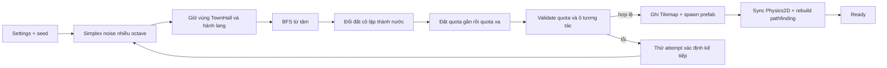

# Kiến trúc Procedural Generation

Cập nhật: **11/11/2026**. Lát cắt đầu tiên bên dưới vẫn là preset gameplay mặc định. [S4 Regions](S4-Regions.md) bổ sung preset chiến thuật v2, dữ liệu region/gateway/landmark và preview, chưa áp vào gameplay scene.

## Mục tiêu và phạm vi

Module sinh một map hữu hạn gồm cỏ và nước trước khi trận bắt đầu. Map giữ một vùng an toàn quanh `TownHall`, một hành lang thông ra biên phải, rồi đặt cây, vàng và cừu theo quota. Cùng seed và settings phải tạo cùng `MapData`.

Preset mặc định dùng map 128 × 128, 120 cây, 12 mỏ vàng và 18 cừu. Trong đó 30 cây, 3 vàng và 6 cừu nằm trong các khoảng đường đi gần căn cứ. Sáu prefab vàng là sáu biến thể hình ảnh của cùng tài nguyên `Gold`; 12 placement được chia đều hai placement cho mỗi biến thể.

Phiên bản này sinh một lần trong `Awake`. Chưa hỗ trợ sinh lại giữa trận, save/load `MapData`, nhiều căn cứ, PvP hoặc streaming.

## Cấu trúc và dữ liệu

| Phần | Trách nhiệm |
|---|---|
| `Core/MapGenerationData.cs` | Settings thuần dữ liệu, terrain/resource enum, placement, map và báo cáo validation |
| `Core/DeterministicRandom.cs` | RNG xác định và seed con theo phase |
| `Core/ProceduralMapGenerator.cs` | Sinh terrain, sửa kết nối, đặt tài nguyên và kiểm tra kết quả |
| `Integration/ProceduralMapSettings.cs` | `ScriptableObject` authoring chuyển thành settings của Core |
| `Integration/ProceduralMapAuthoring.cs` | Ghi Tilemap, instantiate prefab, đồng bộ physics và rebuild pathfinding |
| `Integration/ProceduralMapRuntime.cs` | Cờ `Active/Ready/Failed` để chặn hệ thống bắt đầu quá sớm |
| `Editor/ProceduralMapEditorTools.cs` | Tạo scene procedural từ `SampleScene` và gán asset hiện có |

`RTS.ProceduralGeneration.Core` chỉ tham chiếu `Unity.Mathematics`; nó không tham chiếu `Unit`, `GameManager`, prefab hoặc scene. Integration ở `Assembly-CSharp` nên có thể gọi `TilemapManager` và `ResourceSpawner` mà không tạo phụ thuộc ngược từ `RTS.DOTS`.

`MapData` là nguồn logic của lần sinh, gồm mảng `Terrain`, mask `Reserved`, danh sách `ResourcePlacement`, vị trí bắt đầu và `MapValidationReport`. Tilemap và GameObject là kết quả áp dụng dữ liệu này vào scene.

## Luồng xử lý



Terrain dùng `noise.snoise` với nhiều octave. Một dải đất ở biên được giữ cho preset PvE. Vùng vuông quanh tâm và hành lang rộng `2 * RequiredCorridorHalfWidth + 1` ô về phía phải được ép thành cỏ và đánh dấu `Reserved`.

BFS bốn hướng tạo distance field từ tâm. Các mảng đất không tới được từ tâm bị đổi thành nước. Distance field cũng chọn tài nguyên đầu game theo khoảng đường đi, thay vì khoảng cách thẳng.

Placement gần căn cứ được thực hiện trước. Placement xa của cây và vàng lấy mẫu quanh các tâm cụm thay đổi có giới hạn; cừu lấy mẫu trên vùng cỏ mở. Occupancy chặn overlap và không cho tài nguyên nằm trong vùng giữ chỗ. Vàng giữ footprint 3 × 3 trong Core; validator tìm ô tương tác trên vòng ngoài footprint. Cây cần một ô kề tới được; cừu phải đứng trên ô tới được.

Nếu quota hoặc đường tiếp cận không đạt, attempt bị loại. `MaxAttempts` là giới hạn hữu hạn; lỗi cuối chứa seed và nguyên nhân. Không tự hạ quota để biến một map thiếu tài nguyên thành hợp lệ.

## Tích hợp gameplay và DOTS

`ProceduralMapAuthoring` chạy với execution order `-300`, bật trạng thái generating, dọn các container tài nguyên được lưu từ scene nguồn và tắt `ResourceSpawner` cũ trước `Awake` mặc định của spawner. Khi tắt spawner, collider vùng sinh tài nguyên cũng bị tắt và object chuyển sang layer `Ignore Raycast` để không chặn click cây/quân; nếu generator thất bại, collider được bật lại trước khi khôi phục spawner cũ. `DayNightCycleManager` và `EnemyWaveManager` chỉ tick trong lúc map đang tạo, sau đó chạy khi runtime báo `Ready` hoặc khi đã chuyển về fallback.

Terrain được ghi theo batch bằng `Tilemap.SetTilesBlock`: ô cỏ chỉ nằm trong `WalkableTilemap`, ô nước chỉ nằm trong `WaterTilemap`. Với mỗi ô cỏ có nước trong tám ô lân cận, animated tile `Foam` được đặt tại cùng cell trên Foam Tilemap có sorting order thấp hơn đất; foam vì thế chỉ hiện quanh cạnh và góc bờ nước. Sau khi instantiate tài nguyên, integration gọi `Physics2D.SyncTransforms()` rồi `TilemapManager.ReinitializePathfinding()`. Các prefab gameplay hiện có tiếp tục tự đăng ký qua bridge/lifecycle hiện hành; module không tạo logic AI MonoBehaviour mới và không tạo Entity cho từng tile.

Scene `ProceduralGame` được tạo bằng Editor menu thay vì lưu một scene chỉnh tay. Công cụ sao chép `SampleScene`, gán RuleTile cỏ, tile nước, cây, cừu và sáu prefab `GoldStone1..6`, rồi thêm scene vào Build Settings.

## Kiểm thử và đo hiệu năng

EditMode tests kiểm tra tính xác định, quota/kết nối trên nhiều seed, phân bổ sáu biến thể vàng và cấu hình quota sai. Công cụ .NET độc lập liên kết trực tiếp ba file Core để quét seed không cần mở scene:

```powershell
dotnet run --project Tools/ProceduralGenerationSeedCheck/ProceduralGenerationSeedCheck.csproj -- 1000
```

Kết quả thực tế nằm trong [Validation](Validation.md). Thời gian của công cụ chỉ là thời gian Core trên .NET, chưa gồm Tilemap, prefab, Physics2D, DOTS bridge hoặc rendering.

## Giới hạn

- Repair hiện loại đất cô lập và mở hành lang cố định về biên phải; chưa tối ưu nhiều hướng tiến quân hoặc hình dạng chiến thuật.
- Placement cụm là lấy mẫu có thiên hướng quanh tâm cụm, chưa phải Bridson Poisson disk hoàn chỉnh.
- Core dùng footprint lưới cố định, chưa đọc collider/offset riêng của từng prefab vàng.
- Trạng thái readiness mới chặn ngày/đêm, wave và spawner cũ. Việc kiểm tra fog, minimap, camera, khai thác/xây/huấn luyện và vòng đời Entity cần chạy trong Unity.
- Các quota và khoảng cách hiện là preset thử nghiệm, chưa phải kết quả cân bằng gameplay.

## Nguồn tham khảo

- Amit Patel, [Making maps with noise functions](https://www.redblobgames.com/maps/terrain-from-noise/).
- Unity, [`Unity.Mathematics.noise`](https://docs.unity3d.com/Packages/com.unity.mathematics@1.3/api/Unity.Mathematics.noise.html).
- Unity 6.3, [`Tilemap.SetTilesBlock`](https://docs.unity3d.com/6000.3/Documentation/ScriptReference/Tilemaps.Tilemap.SetTilesBlock.html).
- Robert Bridson, [Fast Poisson Disk Sampling in Arbitrary Dimensions](https://www.cs.ubc.ca/~rbridson/docs/bridson-siggraph07-poissondisk.pdf). Implementation hiện chỉ dùng ý tưởng khoảng cách/cụm đơn giản như phần giới hạn đã nêu.
- Phân tích lựa chọn thuật toán và các hướng không dùng nằm trong [Research](Research.md).
