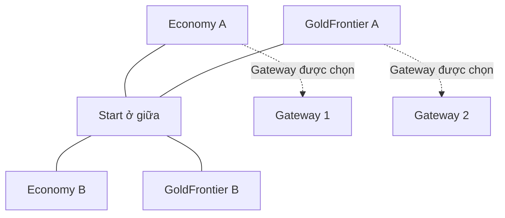

# Kế hoạch bố cục căn cứ trung tâm và bốn vùng ngoài

Ngày lập **24/11/2026**. Kế hoạch dưới đây là hợp đồng triển khai. **Đã triển khai candidate FR0–FR7; trạng thái nghiệm thu và bằng chứng mới nằm trong [báo cáo implementation](FourFrontiers-Implementation.md).** Giữ nguyên tiêu chí gốc, không suy DONE kỹ thuật thành nghiệm thu người chơi.

## 1 Mục tiêu và phạm vi

Tạo lựa chọn mở rộng ở bốn phía của căn cứ thay vì tập trung tài nguyên ngoài khởi đầu vào hai vùng. Giữ map **128 × 128**, tổng **120 cây / 12 vàng / 18 cừu**, quota khởi đầu **30 / 3 / 6**, chu kỳ ngày đêm, sáu tech và luật khai thác hiện có. Đây là mục tiêu thiết kế cần kiểm bằng preview và playtest, chưa phải kết quả cân bằng.

Thiết kế chốt cho bản đầu:

- Một Start ở giữa, bốn vùng ngoài xen kẽ **Economy A / GoldFrontier A / Economy B / GoldFrontier B** theo vòng quanh căn cứ. Có hai vùng cùng một role; ID của vùng không đồng nghĩa role.
- Tâm vùng ở bốn phía có xoay và jitter xác định theo seed; ràng buộc khoảng cách tới biên, căn cứ và vùng khác. Giữ noise làm địa hình ngoài các phần bắt buộc, tránh biến toàn map thành bốn đĩa tròn giống nhau.
- Bốn kết nối Start → vùng ngoài. Đường được carve và Reserved, bề rộng hiện tại 5 ô; pad Start và một pad landmark vẫn được bảo vệ.
- **Giữ hai gateway**, chọn một thuộc nhánh Economy và một thuộc nhánh GoldFrontier, liên kết tường minh bằng region ID. Chỉ hai nhánh được chọn mới nối tiếp ra biên. Bốn vùng mở rộng không đồng nghĩa bốn cửa quái.
- Giữ **một landmark** ở một vùng GoldFrontier. Vùng GoldFrontier còn lại vẫn phải có vàng và đường tới được. Không thêm landmark tương tác hoặc luật thưởng mới trong đợt này.
- Thêm preset riêng dự kiến `FourFrontiers`, generator version dự kiến **4**. Giữ `LegacyMainland` v1 và `StrategicRegions` v3 để so dữ liệu; không âm thầm đổi cùng seed của preset cũ.

Sơ đồ chỉ mô tả quan hệ. Preview sẽ hiển thị vị trí bốn phía thực tế, các vùng theo tâm gần nhất, hướng xoay, đường và phần terrain noise. Không yêu cầu map đối xứng tuyệt đối.

## 2 Các phụ thuộc đã thấy trong source

| Phần | Giả định hiện tại cần xử lý |
|---|---|
| `Core/StrategicLayout.cs` | Mảng 3 Regions, 2 Connections, 2 Gateways; cast index sang role; lookup gateway bằng `connection.To - 1`; FromSnapshot chỉ nhận 3/2/2 |
| `Core/StrategicResources.cs` | Chỉ số 1 là Economy, 2 là GoldFrontier; budget và validator cố định theo hai index này |
| `Core/MapGenerationData.cs` | Generator version và điều kiện cấu hình strategic; phải dispatch đúng preset, không áp quy tắc v4 lên v3 |
| `ProceduralMapGenerator.cs` | Chọn layout, đặt tài nguyên, validation và RNG; thêm nhánh mới không làm đổi thứ tự RNG preset cũ |
| `ProceduralMapPresentation.cs` và `.Daytime.cs` | Tint, decor và glyph dùng `region == 1/2`; cần lấy `Regions[id].Role` |
| Preview / editor scene generator / settings asset | Palette theo index; cần preview role lẫn ID và asset mới, chưa đổi gameplay trước gate preview |
| `ProceduralMapAuthoring.cs` / wave | Duyệt tuyến và gateway hiện có; tách số vùng khỏi số gateway, giữ lựa chọn điểm spawn trên tuyến theo bán kính đã định |
| `SaveValidator.cs` / `MapSnapshotRestore.cs` | RegionIds < 3, Regions.Length == 3, Connections.Length == 2 và restore qua FromSnapshot cố định |
| Save capture / fingerprint / SL4 bootstrap | Capture topology, map version/settings, hash content và preload; phải nhận preset mới mà không regenerate map đã lưu |
| Expansion / fog / minimap / báo cáo | Rà toàn bộ consumers của Regions, RegionIds, Routes, Gateways, Landmark, kể cả partial files; không giả định tìm kiếm ban đầu đã đầy đủ |

Không sửa mô phỏng actor, AI hoặc spawner ECS trong giai đoạn Core/preview. Khi cần tích hợp runtime, đọc `DOTS/DevelopmentGuide.md`, kiến trúc DOTSGameplay và DI; tiếp tục dùng bridge/command/system hiện có.

## 3 Phân bổ tài nguyên

Giữ quota khởi đầu theo khoảng BFS từ Start. Phần ngoài khởi đầu vẫn giữ tỷ lệ role cũ: **68 cây / 9 cừu cho nhóm Economy**, **22 cây / 9 vàng / 3 cừu cho nhóm GoldFrontier**. Sau đó chia budget của từng role cho hai vùng cụ thể.

Ví dụ một cấu hình phân bổ hợp lệ:

| Nhóm placement | Cây | Vàng | Cừu |
|---|---:|---:|---:|
| Khởi đầu theo BFS | 30 | 3 | 6 |
| Economy A | 34 | 0 | 5 |
| Economy B | 34 | 0 | 4 |
| GoldFrontier A có landmark | 11 | 5 | 2 |
| GoldFrontier B | 11 | 4 | 1 |
| **Tổng** | **120** | **12** | **18** |

- Ba mỏ cạnh landmark nằm trong budget của vùng chứa landmark và trong tổng 12 vàng. Không cộng thêm sau khi chia quota.
- Phần dư chia nguyên theo thứ tự xác định hoặc seed con riêng; ghi chính sách rõ ràng, tổng luôn đúng. Với role có landmark, ưu tiên đủ ba mỏ landmark trước khi phân bổ phần còn lại.
- Validator cấu hình v4 yêu cầu đủ budget cho bốn vùng có mục tiêu tài nguyên: ít nhất một cây ngoài khởi đầu cho mỗi Economy, ít nhất một mỏ cho GoldFrontier không landmark và ba mỏ cho landmark. Cấu hình không đáp ứng phải báo lỗi trước khi sinh, không tạo một vùng rỗng rồi gọi là thành công.
- Preset mặc định chia vàng 5/4; cấu hình tùy chỉnh không chia đôi máy móc nếu điều đó làm thiếu quota landmark. Ví dụ bốn vàng ngoài khởi đầu phải có thể chia 3/1.
- Placement theo region ID sau khi có budget; tránh nước, Reserved, footprint và khoảng cách không hợp lệ như hiện tại. Không chuyển thành random có trọng số mà không kiểm được tổng từng vùng.
- Quota khởi đầu có thể nằm qua ranh giới nhãn vùng; không dùng tổng node theo RegionIds để suy rằng budget ngoài khởi đầu sai. Phải phân biệt `IsStartingResource` khi thống kê.

## 4 Các mốc triển khai và tiêu chí nghiệm thu

Bảng dưới đây giữ tiêu chí gốc của từng mốc. Trạng thái thực thi hiện tại xem [implementation/evidence](FourFrontiers-Implementation.md); DONE Core không đồng nghĩa DONE gameplay hoặc Save/Load toàn trận.

| Mốc | Công việc | Điều kiện đạt |
|---|---|---|
| FR0 | Chốt hợp đồng ID/role, gateway, landmark, budget, version và danh sách consumers; lưu baseline v3 | Có inventory và hash MapData cũ trên seed0/1/1543; xác nhận luật mới không sửa timing, economy hoặc tech |
| FR1 | Thêm preset v4; layout 5 vùng, 4 kết nối; gateway mapping tường minh; Reserved và pad | Cùng seed/settings tái lập; role hợp lệ, ID trong bounds; đủ khoảng cách; đúng 2 gateway và không mở cửa biên ngoài khai báo |
| FR2 | Budget từng role/từng vùng; landmark gold; placement và validation cuối | Tổng 120/12/18, quota khởi đầu30/3/6 và budget từng vùng đúng; cả 4 vùng có tài nguyên bắt buộc và có đường tương tác |
| FR3 | Preview có nhãn vùng/role/budget, ảnh seed so sánh; kiểm hình học và phân bố | Quét tối thiểu1.000seed v4; giữ mọi seed lỗi; ảnh0/1/1543 và vài seed có retry; v1/v3 regression không đổi dữ liệu. Có quyết định bố cục đạt trước khi áp gameplay |
| FR4 | Presentation theo role, minimap/fog/Expansion; asset riêng; root/nav/wave tích hợp | Hai grid nhận cùng terrain/collider; khai thác/nộp/xây ở bốn phía; hai gateway không bị lookup sai; wave count/timing/selection có kiểm đối chiếu |
| FR5 | DTO/topology validation/restore, generator và content compatibility, SL4 cold process | Capture→load→recapture v4 khớp canonical trong phạm vi SL4; đủ5vùng/4connections/2gateways; không regenerate, nhân resource hoặc grant100; save không tương thích bị từ chối trước đổi scene |
| FR6 | Xử lý hết lượt thử cho người chơi, bản đồ dự phòng cùng preset được kiểm chứng, thông báo và metadata | Fault injection exhausted-budget không làm chạy trận nửa sẵn sàng; fallback được validate và đủ quota, hoặc UI lỗi có thử lại/về menu; không dựa vào log Console duy nhất |
| FR7 | Build Windows, lifecycle, đo scene→Ready và nghiệm thu người chơi; cập nhật tài liệu | Có evidence/raw/config/hash, reload không leak hoặc double spawn; Player smoke ở bốn vùng và load; giới hạn gameplay/balance ghi rõ |

FR3 là mốc bản xem trước để đánh giá bố cục. Chỉ sau khi đạt FR4–FR7 mới coi candidate thay thế gameplay hiện tại. Khi chờ nhận xét preview vẫn có thể tiếp tục công việc độc lập như inventory Save/Load và test fixtures; không tự coi việc chưa có phản hồi là nghiệm thu.

## 5 Validation của bố cục mới

- BFS terrain sau carve để bỏ đất cô lập và tạo distance field như cũ.
- Sau resource placement, kiểm đường từ Start tới từng ô tương tác với footprint tài nguyên thực trong Core.
- Kiểm clearance tới tâm/pad hoặc điểm tiếp cận đại diện của **cả bốn vùng**, không chỉ hai gateway và landmark. Tâm kiểm phải có chính sách giữ trống rõ ràng, không cho tài nguyên chiếm rồi bắt validator tìm tới tâm bị chặn.
- Kiểm pad Start, pad landmark, lối thoát, bốn tuyến Reserved và hai cửa biên hợp lệ. Hai nhánh không được chọn làm gateway không tự mở ra biên.
- Kiểm quota từng vùng và toàn map; kiểm region index khác role, hai vùng có cùng role vẫn được nhận diện đúng.
- Không chấp nhận chỉ tăng MaxAttempts hoặc hạ quota để che một layout khó đặt tài nguyên. Nếu tỷ lệ retry tăng, chỉnh hình học/quỹ đất hoặc placement rồi chạy lại cùng tập seed.
- Tách kiểm cấu trúc với cân bằng: map có đường không tự chứng minh bốn hướng đều có lợi ích kinh tế tương đương. Ghi khoảng đường vận chuyển, tài nguyên tới được, vùng đã khám phá và thời gian tiếp cận để đánh giá sau.

## 6 Save Load và phiên bản

Generator version v4 dùng cho preset mới; định danh role vẫn là Start/Economy/GoldFrontier, các vùng trùng role có ID khác nhau. Restore dùng arrays có độ dài được kiểm theo preset/version được hỗ trợ; kiểm đủ connection endpoints, region IDs, gateway ownership và landmark ownership. Không chỉ thay điều kiện `== 3` thành `>= 3` rồi nhận mọi topology tùy ý.

Giữ cấu trúc DTO hiện có nếu đủ biểu diễn dữ liệu mới. Chỉ nâng schemaVersion nếu thực sự đổi hợp đồng file, còn thay generator version/content fingerprint phải được ghi rõ. Inventory FR0 quyết định các field cần thiết cho fallback provenance, không thêm migration ngầm.

Save v3 có thể bị content fingerprint hiện tại từ chối khi code/config đổi. Giữ implementation v3 để regression **không có nghĩa hứa đọc được mọi save cũ**. Bản đầu ưu tiên từ chối rõ ràng trước teardown; không xóa hoặc ghi đè file cũ, không tự chuyển thành v4. Nếu cần hỗ trợ save cũ xuyên content version, phải có yêu cầu và ma trận compatibility riêng.

Đợt này chỉ mở rộng SL4 đã có cho topology mới: first-day/idle-work và cold-process. Active cargo/build/train/research/projectile, giữa đêm, rollback toàn trận và Continue UI vẫn thuộc SL5–SL9. Không đánh dấu các mốc đó hoàn thành từ việc tải được map năm vùng.

## 7 Khi hết lượt thử

Hiện tại hết MaxAttempts có thể làm composition bị chặn; chưa có fallback hoàn chỉnh cho người chơi. Kế hoạch không coi “test exhausted-budget PASS” là “trải nghiệm lỗi đã tốt”.

FR6 chuẩn bị một MapData v4 dự phòng đã kiểm chứng, cùng kích thước/quota/catalog và hai gateway, áp qua pipeline Ready bình thường. Khi dùng dự phòng phải:

1. Phân biệt requested seed và seed/dữ liệu thực tế đã dùng trong provenance/log; Save/Load lưu map thực tế, không regenerate requested seed.
2. Kiểm compatibility và validation của map dự phòng ở build/runtime; không dùng file phụ hỏng để vượt lỗi.
3. Giới hạn tổng công việc; không lồng thêm vòng thử vô hạn. Lỗi cấu hình/catalog không được giả thành seed xấu rồi lặp fallback.
4. Nếu cả dự phòng không dùng được, hiển thị lỗi có hành động thử lại/về menu và giữ simulation bị chặn. Không hứa luôn tiếp tục trận trong mọi lỗi asset hoặc filesystem.

Tạo bộ test riêng: ép generator hết lượt, fallback hợp lệ, fallback hỏng/khác version, quit/retry/menu trong failure state. Chỉ đánh dấu bảo vệ UX hoàn tất sau khi thao tác thực trong Player đạt.

## 8 Ma trận kiểm thử và đo lường

| Nhóm | Các ca bắt buộc |
|---|---|
| Determinism và regression | v4 seed0/1/1543, seed âm/int.MinValue; sinh lặp so toàn MapData; v1/v3 giữ hash baseline khi không đổi settings |
| Seed sweep | Ít nhất1.000seed v4; log success/failure/accepted attempt và lý do; sinh lại so dữ liệu; không loại seed lỗi khỏi thống kê |
| Quota | Chẵn/lẻ, 3/1 gold tối thiểu hợp lệ, budget thiếu bị reject; mỗi vùng có tài nguyên bắt buộc; variant Gold đúng và landmark không cộng thừa |
| Topology | Cây chắn tuyến, gold đè nước/Reserved, nối chéo, vùng thứ tư cô lập, hành lang hẹp, pad bị chiếm, gateway trỏ sai vùng, cửa biên lạ |
| Presentation và fog | Hai vùng cùng role có tint/decor/glyph đúng; unknown không lộ tài nguyên/gateway/landmark; unload/reload không giữ renderer cũ |
| Gameplay | Dân đi và nộp từ cả4vùng, đặt depot, xây/train và nhóm lệnh hiện có; native/legacy scene không double logic; wave đúng2gateway |
| Save Load | v4 cold-process0/1/1543, terrain sửa khác kết quả seed, resource tombstone, allocator/refs, mutation arrays sau restore; sai version/refs/budget bị từ chối đúng phạm vi |
| Failure UX | Hết8attempt, fallback thành công/hỏng, request lặp, retry/menu/thoát; không tick simulation trước Ready |
| Player và hiệu năng | Core, Tilemap, prefab, physics/nav, root composition và scene→Ready tách riêng; cùng máy/build/config so v3/v4; allocation/memory nếu counter có thật |

Theo dõi thêm diện tích từng vùng, mật độ tài nguyên và khoảng BFS tới các vùng để phát hiện vùng quá nhỏ/rỗng. Đo trên nhiều seed, báo số mẫu/median/p95/max và retry histogram; không lấy một ảnh đẹp hoặc một seed nhanh làm bằng chứng tổng thể. Không công bố budget thời gian mới trước baseline FR0/FR3.

## 9 Ước lượng và thứ tự thực hiện

Ước lượng sơ bộ **2–4 ngày làm việc** cho Core, preview, tích hợp cơ bản và hồi quy; chưa phải cam kết. Save compatibility, failure UX và nghiệm thu Player có thể làm tăng thời gian. Sau FR0 cập nhật ước lượng theo inventory; sau FR3 cập nhật lại theo retry và kết quả preview.

Thứ tự: **FR0 → FR1 → FR2 → FR3 → FR4 → FR5 → FR6 → FR7**. Ưu tiên đưa preview năm vùng ra xem trước; không đổi scene gameplay mặc định khi chỉ mới hoàn thành hình bố cục.

## 10 Tài liệu và bằng chứng bàn giao

- Cập nhật Architecture/Usage/Validation của ProceduralGeneration, ảnh preview và tài liệu giải thích có hình sau khi implementation được kiểm chứng.
- Cập nhật SaveLoad Architecture/Validation/Progress về phạm vi v4; giữ phân biệt trạng thái planned/implemented/measured.
- Raw seed sweep, tests, source/settings/player hashes, ảnh4vùng, cold-process reports và failure UX lưu trong thư mục evidence có ngày, không ghi giả kết quả vào kế hoạch.
- Liên kết từ Docs README; không sửa báo cáo giữa kỳ đang được người dùng chấp nhận thành “đã có bốn vùng ngoài” trước khi thực hiện.

Nguồn nội bộ: [tổng quan](../../TechnicalOverview.md), [kiến trúc procedural](Architecture.md), [nguồn nghiên cứu](Research.md), [S5 budget/topology](S5-ResourcesTopology.md), [S6 tích hợp](S6-FinalValidation.md), [SaveLoad progress](../SaveLoad/Progress.md), [SL4 report](../SaveLoad/SL4-Report.md), [DOTS DevelopmentGuide](../DOTS/DevelopmentGuide.md). Source đã rà được liệt kê ở mục2; đây là thiết kế riêng cho RTSgame2026, không tuyên bố sao chép generator của game khác.
