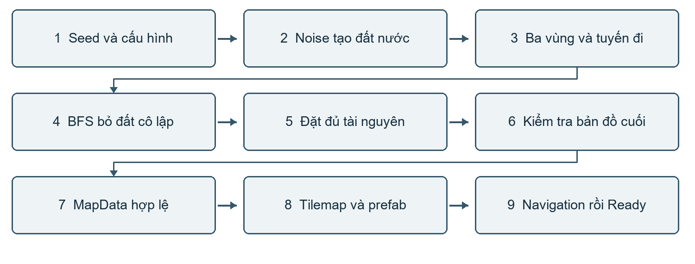
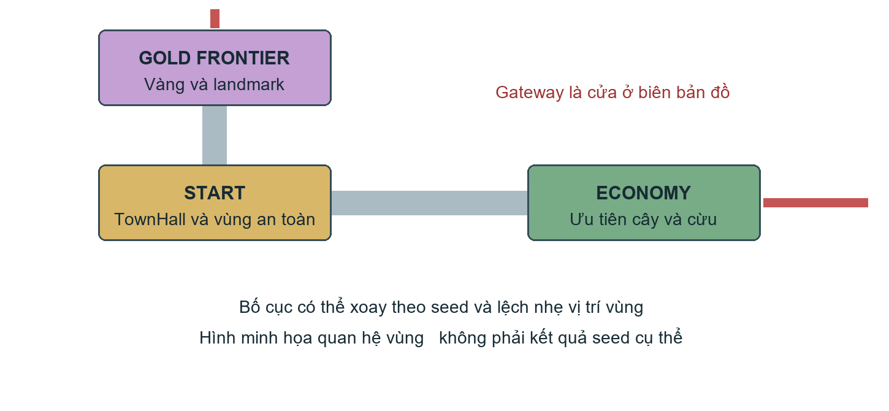
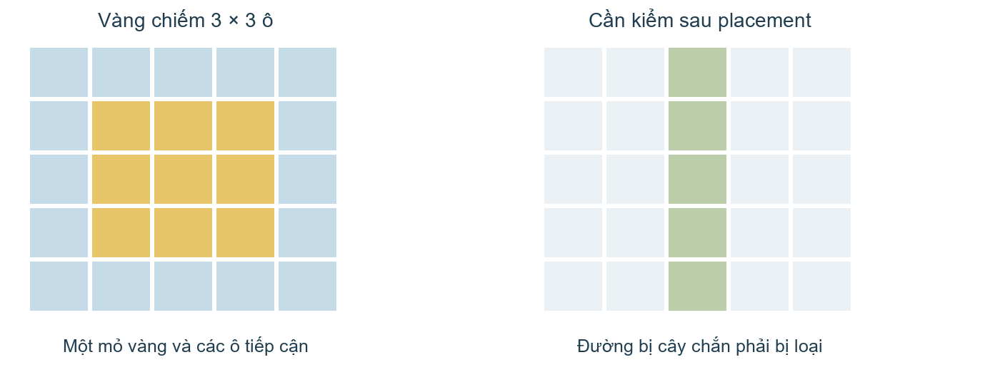
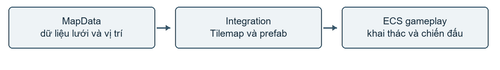
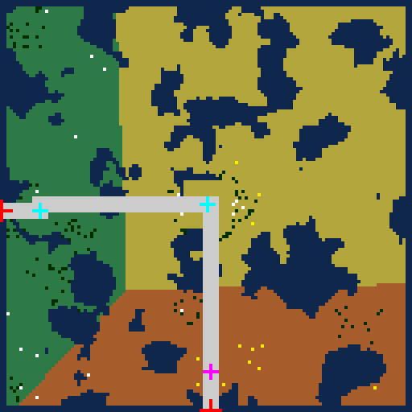

# Cách sinh bản đồ procedural trong RTSgame2026

**Bản có minh họa tile chi tiết:** đọc [IllustratedGuide](IllustratedGuide.md) hoặc [Word](../../../Outputs/Midterm/Giai_thich_Procedural_Generation_Minh_hoa_tile.docx). Hình có seed dùng dữ liệu Core thật; fixture giải thích footprint/clearance được ghi nhãn riêng. Phần cuối phân biệt 0 A.D. đã có trong nghiên cứu ban đầu và Factorio mới bổ sung để đối chiếu.

Cập nhật 24/11/2026. Đối chiếu Core strategic v3, Integration hiện tại và Save/Load SL4.

Tài liệu giải thích cách game tạo một bản đồ mới có đất, nước, vùng chiến thuật, tài nguyên và đường đi hợp lệ. Người đọc có thể theo dõi từ ý tưởng đến mã nguồn mà không cần biết trước về Unity DOTS. Phạm vi là preset StrategicRegions v3; LegacyMainland là nhánh cũ để đối chiếu.

## 1  Một bản đồ được tạo như thế nào

Có thể hình dung hệ thống như người lập quy hoạch: trước hết tạo địa hình tự nhiên, sau đó dành chỗ cho căn cứ và đường chính, đặt tài nguyên rồi kiểm tra người chơi có thật sự đi tới được hay không. Ngẫu nhiên được kiểm soát bởi luật chơi.

Ba hàng trong hình là ba giai đoạn nối tiếp: tạo dữ liệu thô, hoàn thiện và kiểm tra dữ liệu, rồi đưa dữ liệu vào Unity. Nếu bước 6 không đạt, hệ thống quay về bước 2 với attempt kế tiếp; chưa đưa map lỗi vào scene.

- Seed là con số đầu vào cho bộ sinh số giả ngẫu nhiên. Cùng seed, cấu hình và phiên bản thuật toán cho cùng MapData trong phạm vi môi trường đã kiểm.
- Preset tham chiếu có lưới 128 × 128 cell. Một cell là một ô lưới. Terrain cho biết ô là cỏ hay nước; Reserved là mặt nạ giữ chỗ; placement là bản ghi vị trí tài nguyên.
- MapData là bản thiết kế logic. Tilemap và prefab là cách Unity biểu diễn bản thiết kế đó; không tạo một Entity cho từng ô đất.

## 2  Tạo đất nước và bố trí ba vùng

Bước đầu dùng noise.snoise của Unity.Mathematics, tức Simplex noise. Hàm này tạo giá trị biến thiên liên tục giữa các ô, nhờ đó đất và nước kết thành mảng thay vì rải ô ngẫu nhiên rời rạc. Đề cương nêu Perlin Noise hoặc Cellular Automata; thuật toán thực tế được triển khai là Simplex noise nhiều octave.

Mỗi octave là một lớp chi tiết. Lớp sau có tần số cao hơn và biên độ nhỏ hơn. Với preset tham chiếu: 4 lớp, NoiseScale 34, Persistence 0,5, Lacunarity 2. Sau khi lấy trung bình có trọng số, ô có giá trị từ −0,22 trở lên thành cỏ; thấp hơn thành nước. Tăng ngưỡng nước thường làm giảm diện tích đất trước bước sửa map.

Noise chỉ tạo hình dạng nền. StrategicLayout tiếp tục chọn một trong bốn hướng xoay, đặt hai vùng ngoài theo hai hướng vuông góc và lệch nhẹ vị trí. Mỗi ô nhận nhãn của tâm vùng gần nhất; đây là cách phân vùng đơn giản, chưa phải một bộ sinh Voronoi đầy đủ.

- Start chứa TownHall và khoảng trống đầu trận. Economy ưu tiên gỗ, thịt; GoldFrontier ưu tiên vàng và landmark Old Watchpost ở phần hiển thị.
- Hai nhánh nối từ Start ra vùng ngoài rồi tới gateway ở biên. Đường được vẽ theo chữ L, rộng 5 ô khi half-width bằng 2; các đoạn đường và pad được giữ chỗ để tài nguyên không mọc đè lên.
- Biên strategic có dải nước dày 2 ô trước khi mở gateway. Noise vẫn có thể tạo đường phụ bên trong; hai gateway không có nghĩa toàn bản đồ chỉ tồn tại đúng hai đường đi độc quyền.

## 3  Đặt tài nguyên theo nhu cầu chơi

BFS là phép duyệt lan từ căn cứ sang bốn ô kề. Nó đánh dấu đất đi tới được và cho biết số bước đường đi tới từng ô. Đất cô lập bị đổi thành nước. Khoảng BFS giúp ưu tiên tài nguyên khởi đầu theo đường đi thay vì chỉ đo đường thẳng xuyên qua hồ.

Hệ thống đặt tài nguyên gần căn cứ trước, sau đó mới phân bổ phần còn lại theo vai trò vùng. Quota là số đối tượng cần đặt, không phải số đơn vị gỗ/vàng/thịt người chơi sẽ nhận. Bảng dưới là preset 120 cây, 12 mỏ vàng và 18 cừu.

|Nhóm|Cây|Mỏ vàng|Cừu|
|---|---:|---:|---:|
|Khởi đầu|30|3|6|
|Economy ngoài khởi đầu|68|0|9|
|GoldFrontier ngoài khởi đầu|22|9|3|
|Tổng|120|12|18|

75% cây và cừu ngoài khởi đầu vào Economy, làm tròn lên; toàn bộ vàng ngoài khởi đầu vào GoldFrontier. Quota khởi đầu được chọn theo khoảng BFS, không buộc mọi node gần căn cứ phải mang nhãn Start. Ba mỏ quanh landmark nằm trong tổng 12 mỏ, không phải ba mỏ cộng thêm.

- Cây chặn 1 ô; mỏ vàng chiếm 3 × 3 ô và cần ô tương tác trên vòng ngoài. Cừu không chặn đường trong phép kiểm topology nhưng vẫn kiểm vị trí và chồng lấn placement.
- Cây và vàng xa căn cứ được lấy mẫu quanh tâm cụm; cừu lấy mẫu trên vùng mở. Sáu VariantId vàng chỉ chọn sáu hình ảnh của cùng loại Gold, không tạo sáu tài nguyên khác nhau.

## 4  Kiểm tra bản đồ trước khi cho chơi

Một map trông có vẻ thông thoáng vẫn có thể không chơi được: mỏ vàng chắn kín hành lang, lối chỉ nối chéo góc hoặc tài nguyên nằm trên đất nhưng không có ô nào cho dân đứng khai thác. Vì vậy hệ thống kiểm lại trên terrain cộng footprint tài nguyên sau cùng.

- Kiểm đủ quota và footprint nằm trên đất, không trùng tài nguyên khác hoặc Reserved.
- Chạy BFS bốn hướng với vật cản cuối để bảo đảm có đường tới ô tương tác của từng tài nguyên. Hai ô chạm góc không được coi là có lối nối trực tiếp.
- Kiểm khoảng trống cho tác nhân: co vùng đi được bằng footprint 3 × 3, tương đương cần thêm 1 ô trống quanh tâm, rồi duyệt tới gateway và landmark.
- Kiểm pad đầu trận và pad landmark còn trống; thử footprint công trình 5 × 5 và đường thoát ở vòng bán kính 3. Footprint Core là quy ước lưới, cần được đối chiếu collider thật ở Integration.
- Kiểm cả hai gateway tới được và không xuất hiện cửa biên đi tới được ngoài vùng gateway đã đăng ký.
Ví dụ dễ hình dung: BFS giống vết mực lan từ TownHall. Ô nước và ô bị cây/vàng chặn không nhận mực. Nếu mực không tới được vòng ngoài của một mỏ, map bị từ chối dù mỏ đó nằm rất gần căn cứ trên màn hình.

## Vì sao cần attempt và seed riêng

Không phải bố trí ngẫu nhiên nào cũng đủ chỗ. Khi validation thất bại, generator thử attempt tiếp theo; mặc định tối đa 8 lần. Mỗi nhóm terrain, layout và resource dùng seed con được suy ra từ seed gốc, mã phase và attempt. Vì thế có thể tái hiện đúng lần thử lỗi mà không phụ thuộc số lần gọi random của UI.

Mỗi lần đặt tài nguyên cũng có giới hạn số phép thử, mặc định 12.000 cho một lời gọi PlaceQuota. Hệ thống không lặp vô hạn và không tự giảm quota để báo thành công. Hết attempt thì trả lỗi; authoring ghi lỗi và xử lý nhánh thất bại theo scene, không xác nhận procedural Ready thành công.

Khoảng cách tài nguyên khởi đầu được chọn trên terrain trước placement. Validator cuối bảo đảm vẫn tiếp cận được, nhưng không cam kết mọi khoảng cách sau khi có vật cản giữ nguyên giới hạn ban đầu. Cân bằng nhịp kinh tế vẫn cần chơi thử.

## 5  Đưa MapData vào Unity và gameplay

ProceduralMapAuthoring kiểm cấu hình, chạy generator rồi ghi terrain theo batch vào Tilemap: cỏ vào lớp đi được, nước vào lớp nước. Foam được đặt quanh vùng bờ. Authoring tạo các prefab cây, vàng, cừu theo placement và vô hiệu spawner cũ để tránh sinh trùng.

Sau đó Physics2D.SyncTransforms cập nhật collider; TilemapManager.ReinitializePathfinding dựng lại dữ liệu tìm đường. GameSceneCompositionRoot nối dependency, đăng ký thực thể/tài nguyên qua bridge và chỉ hoàn tất composition khi các thành phần sẵn sàng. Đồng hồ và wave được chặn trong lúc sinh, tránh quái xuất hiện khi map chưa chuẩn bị xong.

Core chỉ tính dữ liệu, không điều khiển nông dân hoặc chiến đấu. Integration chuyển cell sang tọa độ world và tạo đối tượng phù hợp. ECS giữ trạng thái gameplay; các GameObject có thể chỉ làm phần hiển thị. Renderer trang trí không được thay thế dữ liệu terrain hay collider logic.

EnemyWaveManager dùng gateway và tuyến tiếp cận, nhưng điểm spawn thực tế được chọn trên tuyến ở bán kính khởi đầu đã định để giữ thời gian tiếp cận. Không diễn giải gateway ở mép map thành việc mọi quái đều sinh ngay tại mép.

## New Game và Load Game khác nhau ở đâu

New Game chạy seed → generator → MapData → scene. Trong nhánh Load Game của SL4, authoring đọc terrain, Reserved, topology, origin và cell size đã lưu; không gọi generator và không SpawnResources lần nữa. Bridge tạo lại đối tượng theo ID rồi nối tham chiếu ở lượt hai. Tài nguyên đã mất không mọc lại chỉ vì seed vẫn giữ nguyên.

Seed mô tả bản đồ ban đầu, không mô tả đầy đủ trận đang chơi. Sau khai thác, xây dựng hoặc thay đổi terrain, phải lưu trạng thái thực tế. SL4 đã kiểm tải map và thực thể trong process mới ở lát cắt đầu ngày; cargo/công việc/research/đạn đang chạy và giữa đêm vẫn bị từ chối đến các mốc sau.

## Lớp hình ảnh được tách khỏi luật chơi

Màu vùng, cỏ/hoa, landmark, ánh sáng đêm và sắp xếp chiều sâu đọc map để hiển thị. Presentation có stream seed riêng và không sửa quota, đường đi hoặc Reserved. Một nguồn sáng trang trí không tự mở fog hoặc tăng tầm nhìn gameplay.

## 6  Cách xem và kiểm chứng trong dự án

Trong preview: xanh dương là nước; vùng Start/Economy/GoldFrontier có màu phân biệt; đỏ là gateway, tím là landmark, đường sáng là route và các chấm biểu diễn tài nguyên. Đây là ảnh dữ liệu Core ở mốc S5, không phải ảnh gameplay hoặc hình ảnh thẩm mỹ mới nhất.

- Mở RTS → Procedural Generation → Preview Regions, chọn StrategicRegions, nhập seed 0, 1 hoặc 1543 rồi sinh preview. Cửa sổ dùng dữ liệu sao chép; không cần sinh lại scene đang chỉnh để xem thử.
- Muốn chơi, mở ProceduralGame hoặc vào từ MainMenu. Kiểm asset thật được gán ở ProceduralMapAuthoring; scene generator dùng StrategicProceduralMapSettings.asset. DefaultProceduralMapSettings.asset là asset riêng, không được dùng để kết luận preset của scene hiện tại.
- Khi báo lỗi, ghi seed, attempt, preset, generator version, cấu hình, log và ảnh. Cùng seed nhưng khác settings hoặc thuật toán có thể sinh map khác. Việc seed mới có được chọn tự động hay không thuộc luồng khởi tạo trận, không phải cam kết của generator.
Bằng chứng hiện có: S5 quét 1.000 strategic + 1.000 legacy, mỗi seed sinh lại và so dữ liệu, không ghi nhận lỗi; S6 kiểm tích hợp navigation/wave/kinh tế; bộ kiểm SL4 có 18/18 procedural tests đạt. Đây là kết quả đã lưu, không phải phép chạy mới trong phiên soạn tài liệu.

Chưa kết luận mọi seed/cấu hình đều hợp lệ hoặc sinh map không gây khựng. Đo hiệu năng cần tách thời gian Core, ghi Tilemap, tạo prefab, đồng bộ physics/navigation và scene đến Ready. Số đo Core .NET không thay cho thời gian tải bản đồ trong Player. Chưa có streaming/vô hạn, nhiều biome phức tạp hoặc bảo đảm cân bằng chỉ từ validation.

## Mã nguồn và tài liệu để đọc tiếp

- Assets/Game/ProceduralGeneration/Core: ProceduralMapGenerator, DeterministicRandom, StrategicLayout, StrategicResources.
- Assets/Game/ProceduralGeneration/Integration: ProceduralMapAuthoring và ProceduralMapSettings.
- Docs/Modules/ProceduralGeneration: S4, S5, S6, S7; Docs/Modules/SaveLoad/SL4-Report.md.
