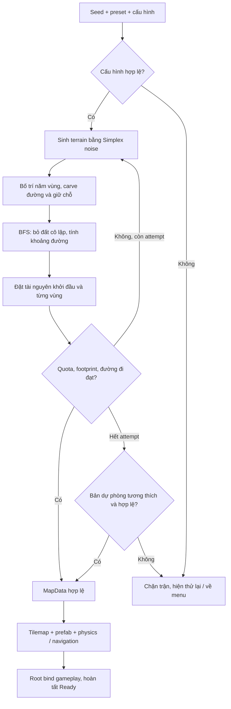
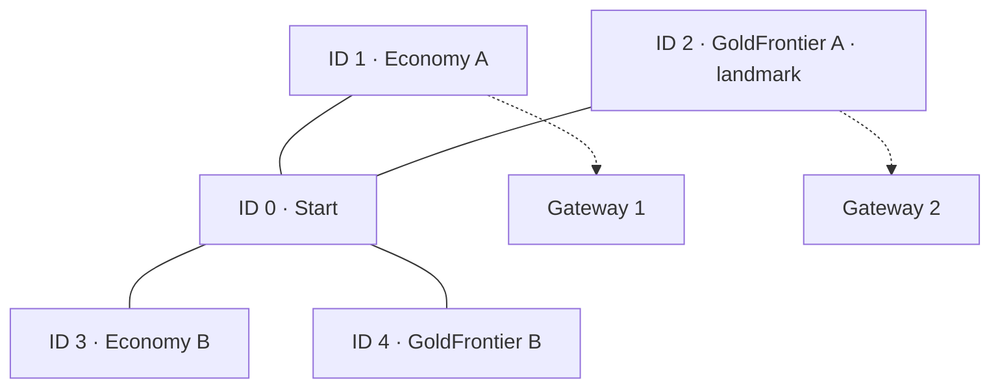

# Cách sinh bản đồ procedural trong RTSgame2026

Cập nhật **25/11/2026**, theo implementation **FourFrontiers v4** đang dùng trong `ProceduralGame`. Tài liệu giải thích từ ý tưởng đến dữ liệu và mã nguồn; [bản có hình](IllustratedGuide.md) giúp đối chiếu trực quan. Các kết quả kiểm chứng dẫn lại đợt FR0–FR7 ngày 24/11, không phải một lượt chạy test mới khi viết tài liệu.

## 1. Hệ thống cần tạo ra điều gì?

Game cần một bản đồ vừa có hình dạng thay đổi giữa các seed, vừa đủ điều kiện cho người chơi bắt đầu trận. Nếu chỉ rải đất, nước và tài nguyên ngẫu nhiên, TownHall có thể nằm giữa hồ, mỏ vàng có thể bị cô lập hoặc cây có thể chặn kín lối ra.

Generator vì thế làm hai việc nối tiếp: tạo nền tự nhiên bằng noise, rồi áp luật bố trí và kiểm đường đi. Kết quả hợp lệ được lưu thành `MapData`; Unity dùng dữ liệu đó để vẽ bản đồ và tạo thực thể.

Preset hiện tại giữ lưới **128 × 128 ô**, **120 cây, 12 mỏ vàng, 18 cừu**. Căn cứ ở giữa, bốn vùng mở rộng ở bốn phía, nhưng chỉ có **hai gateway** cho tuyến tiếp cận của quái.

Nhánh dự phòng do Integration xử lý sau khi Core báo hết lượt thử. Nó không phải một vòng sinh ngẫu nhiên không giới hạn.

## 2. Những dữ liệu cần phân biệt

| Tên | Có thể hiểu là | Ví dụ |
|---|---|---|
| `Seed` | Đầu vào để tái lập bộ số giả ngẫu nhiên | Seed 1 |
| `Preset` và generator version | Bộ luật và phiên bản sinh map | `FourFrontiers`, v4 |
| `Attempt` | Lần thử trong cùng một yêu cầu sinh | Attempt 0 là lần đầu, 1 là lần thứ hai |
| `Terrain` | Ô nào là cỏ, ô nào là nước | Cỏ đi được trước khi thêm vật cản |
| `Reserved` | Những ô đã dành cho căn cứ, pad và đường chính | Tài nguyên không được chiếm |
| `RegionIds` | Mỗi ô thuộc vùng có ID nào | ID 3 vẫn có role Economy |
| `Routes` | Những ô thuộc các tuyến được carve | Dùng bảo vệ và hiển thị đường |
| `ResourcePlacement` | Bản ghi một cây, mỏ hoặc cừu | Loại, vị trí, variant, cờ khởi đầu |
| `MapData` | Bản thiết kế logic hoàn chỉnh | Terrain, topology, placements và validation |

Một ô cỏ vẫn có thể không đi được trong trận nếu bị công trình hoặc collider tài nguyên chặn. `Reserved` cũng không đồng nghĩa chỉ vùng đó mới đi được: nó giữ chỗ, không cấm người chơi đi trên những bãi cỏ khác.

Cùng seed chỉ tái lập được map khi **cấu hình, preset, phiên bản và môi trường tính toán phù hợp**. Trong kiểm chứng đã lưu, dữ liệu noise giữa .NET và Unity có thể khác; không lấy hash của hai runtime khác nhau để kết luận mất tính xác định.

## 3. Tạo đất và nước bằng noise

Core dùng `Unity.Mathematics.noise.snoise`, tức **Simplex noise**. Noise tạo các giá trị biến thiên liên tục theo vị trí: hai ô gần nhau thường có giá trị gần nhau, nên đất và nước kết thành mảng. Rút thăm cỏ/nước độc lập từng ô sẽ tạo bề mặt vụn và khó đi lại hơn.

Generator chồng **4 octave**, có thể hiểu là bốn lớp chi tiết. Lớp đầu tạo hình lớn; các lớp sau có tần số cao hơn và ảnh hưởng nhỏ hơn. Cấu hình hiện tại:

| Tham số | Giá trị | Vai trò |
|---|---:|---|
| `NoiseScale` | 34 | Tỷ lệ lấy mẫu theo tọa độ ô |
| `Octaves` | 4 | Số lớp noise |
| `Persistence` | 0,5 | Mỗi lớp sau giảm biên độ còn một nửa |
| `Lacunarity` | 2 | Mỗi lớp sau tăng tần số gấp đôi |
| `WaterThreshold` | −0,22 | Ngưỡng phân loại nước và cỏ |

Giá trị noise được cộng có trọng số rồi chia cho tổng trọng số. Ô có kết quả **từ −0,22 trở lên là cỏ**, thấp hơn là nước. Đây là phép phân loại địa hình 2D, chưa phải độ cao hoặc nhiều loại biome.

Noise chỉ tạo nền ban đầu. Các vị trí bắt buộc sẽ được carve thành đất ở bước tiếp theo, nên map cuối không phải ảnh noise thuần túy. Thuật toán hiện tại cũng không phải Cellular Automata hoặc WFC.

Đối chiếu: [`GenerateAttempt`](../../../Assets/Game/ProceduralGeneration/Core/ProceduralMapGenerator.cs).

## 4. Quy hoạch căn cứ giữa và bốn vùng ngoài

`StrategicLayout` đặt Start tại tâm lưới. Nó chọn một trong bốn hướng xoay, bố trí bốn tâm ngoài theo bốn hướng vuông góc và thêm jitter xác định theo seed trong khoảng ±2 ô.

| ID | Role | Ý nghĩa trong bản đầu |
|---:|---|---|
| 0 | Start | Căn cứ và vùng khởi đầu |
| 1 | Economy | Vùng kinh tế A, có gateway |
| 2 | GoldFrontier | Vùng vàng A, có landmark và gateway |
| 3 | Economy | Vùng kinh tế B |
| 4 | GoldFrontier | Vùng vàng B |

**ID nhận diện một vùng cụ thể; role mô tả vai trò của vùng.** Có hai vùng Economy và hai vùng GoldFrontier. Màu/decor/minimap phải đọc role, không được mặc định chỉ ID 1 mới là Economy hoặc chỉ ID 2 mới là GoldFrontier.

Bốn vùng ngoài xen kẽ Economy / GoldFrontier quanh căn cứ. Với seed khác, hướng thế giới của từng ID có thể xoay; “Economy A” không luôn ở phía bắc.

Sơ đồ thể hiện quan hệ kết nối, không phải tọa độ thật. [Preview seed 1](Evidence/FourFrontiers/preview-1.png) cho thấy vị trí thực tế.

### Nhãn vùng và vùng được carve khác nhau

Mỗi ô nhận ID của **tâm gần nhất theo khoảng cách bình phương**. Nhãn này áp cho cả lưới, kể cả ô nước. Bán kính vùng ngoài mặc định 8 ô xác định phần đất bắt buộc quanh tâm; nó không giới hạn toàn bộ diện tích được mang ID đó.

Vì vậy một Economy có thể chứa tài nguyên nằm xa đĩa bán kính 8, miễn placement còn đúng ID và các luật kiểm tra. Đây là phân vùng theo tâm gần nhất, không phải chia map thành năm hình tròn rời nhau.

### Carve đường và giữ chỗ

Generator ép đất quanh tâm và nối bốn tuyến `Start → vùng ngoài` theo đường chữ L. Half-width bằng 2 làm tuyến rộng **2 × 2 + 1 = 5 ô**. Các ô tuyến được đánh dấu `Routes` và `Reserved`.

Start có pad vuông bán kính 7, tức 15 × 15 ô. Cả bốn tâm ngoài có pad 5 × 5 để giữ điểm tiếp cận trống; landmark ở tâm vùng 2 cũng có pad 5 × 5. Đĩa đất ngoài pad không được mặc định giữ trống toàn bộ.

Biên map được ép thành nước dày 2 ô, sau đó chỉ hai tuyến thuộc vùng 1 và 2 được nối tiếp ra gateway ở biên. **Bốn vùng mở rộng không tạo thành bốn cửa quái.** Noise vẫn có thể tạo các đường phụ bên trong map.

Đối chiếu: [`StrategicLayout.Create`](../../../Assets/Game/ProceduralGeneration/Core/StrategicLayout.cs).

## 5. Dùng BFS để biết đường nào đi tới được

Sau khi carve, Core chạy **BFS bốn hướng** từ Start: mỗi bước chỉ đi lên, xuống, trái hoặc phải qua ô cỏ. Có thể hình dung đổ mực từ căn cứ; nước không nhận mực và hai ô chỉ chạm góc không nối trực tiếp với nhau.

Các ô đất không được BFS thăm tới bị đổi thành nước. Một lần BFS tiếp theo tạo distance field, trong đó mỗi ô ghi số bước ngắn nhất từ Start trên terrain đã sửa.

Khoảng này dùng chọn tài nguyên khởi đầu. Chẳng hạn một mỏ cách TownHall 10 ô theo đường thẳng nhưng phải đi vòng hồ 25 bước sẽ không được xem là mỏ ở khoảng BFS 12–22.

| Nhóm khởi đầu | Khoảng BFS cho tâm placement |
|---|---:|
| Cừu | 6–12 bước |
| Cây | 8–16 bước |
| Vàng | 12–22 bước |

Khoảng BFS trên được tính **trước placement**. Sau khi tài nguyên trở thành vật cản, validator kiểm lại khả năng tiếp cận; nó không cam kết khoảng đường cuối vẫn nằm trong đúng giới hạn ban đầu.

## 6. Đặt đúng quota tài nguyên

Quota là **số đối tượng**, không phải lượng gỗ/vàng/thịt sẽ được nộp vào ví. Generator không dùng random có trọng số để hy vọng số lượng cuối gần đúng: mỗi nhóm có budget cụ thể và phải đạt đủ.

### Tài nguyên khởi đầu được ưu tiên trước

V4 đặt **6 cừu → 30 cây → 3 mỏ vàng** quanh căn cứ theo các khoảng BFS ở trên. Cừu được đặt trước vì vùng ứng viên gần căn cứ nhỏ, trong khi bốn tuyến Reserved đã chiếm một phần diện tích. Nếu đặt cây/vàng trước, có thể không còn đủ chỗ cho cừu.

`IsStartingResource` đánh dấu nhóm này. Một placement khởi đầu có thể nằm qua ranh giới nhãn vùng; không đếm tất cả tài nguyên theo `RegionIds` rồi dùng số đó thay cho quota khởi đầu.

### Phần còn lại được chia theo role, rồi theo vùng

Ngoài khởi đầu còn 90 cây, 9 vàng và 12 cừu. Nhóm Economy nhận 75% cây và cừu, làm tròn lên: **68 cây, 9 cừu**. Nhóm GoldFrontier nhận **22 cây, 9 vàng, 3 cừu**. Sau đó chia cho hai vùng cùng role, phần dư ưu tiên vùng có ID nhỏ hơn.

| Nhóm placement | Cây | Mỏ vàng | Cừu |
|---|---:|---:|---:|
| Khởi đầu theo BFS | 30 | 3 | 6 |
| ID 1 · Economy A, ngoài khởi đầu | 34 | 0 | 5 |
| ID 2 · GoldFrontier A, ngoài khởi đầu | 11 | 5 | 2 |
| ID 3 · Economy B, ngoài khởi đầu | 34 | 0 | 4 |
| ID 4 · GoldFrontier B, ngoài khởi đầu | 11 | 4 | 1 |
| **Tổng** | **120** | **12** | **18** |

Ba mỏ cạnh landmark **nằm trong 5 mỏ của vùng 2**, không cộng thêm vào tổng. Với cấu hình tùy chỉnh chỉ còn 4 vàng ngoài khởi đầu, budget chia **3/1** để vừa giữ ba mỏ landmark vừa có một mỏ ở GoldFrontier còn lại. Cấu hình không đủ tài nguyên bắt buộc bị từ chối trước khi sinh.

### Một ứng viên placement phải qua những gì?

Ứng viên phải đúng vùng và khoảng BFS, nằm trên đất, không chiếm Reserved và không chồng footprint đã đặt. Cây/vàng ngoài khởi đầu được lấy mẫu quanh các tâm cụm thay đổi; cừu lấy mẫu trên lưới.

Các lời gọi `PlaceQuota` ngoài khởi đầu của v4 còn kiểm khoảng trống thêm một vòng quanh footprint. Vòng tương tác được phép đi trên Reserved, nhưng footprint tài nguyên không được đè lên đó. Ba vị trí vàng landmark được đặt riêng trước, rồi vẫn phải qua validator cuối. Kiểm trống lúc chọn vị trí chưa thay được phép kiểm đường đi toàn map.

Sáu `VariantId` vàng chọn sáu hình `GoldStone1..6` của cùng loại Gold. Trong quota 12 mỏ đã kiểm, mỗi variant xuất hiện hai lần.

Đối chiếu: [`FourFrontiersBudget` và `PlaceFourFrontiersResources`](../../../Assets/Game/ProceduralGeneration/Core/StrategicResources.cs).

## 7. Kiểm map sau khi tài nguyên đã đặt xong

Terrain thông trước placement chưa chắc còn thông sau placement. Validator dựng lại mặt nạ vật cản: cây chặn một ô; vàng chặn 3 × 3; cừu không chặn đường trong phép kiểm topology tĩnh.

| Phép kiểm | Lỗi muốn phát hiện |
|---|---|
| Quota toàn map và budget từng vùng | Đủ tổng vàng nhưng dồn hết vào một GoldFrontier |
| Footprint, terrain, Reserved, overlap | Mỏ đè nước hoặc cây mọc trên đường được giữ chỗ |
| BFS với vật cản cuối | Tài nguyên ở trên đất nhưng dân không tới được ô tương tác |
| Clearance 3 × 3 | Lối nối được với một điểm nhưng quá hẹp cho phép kiểm khoảng trống |
| Cả bốn tâm vùng ngoài | Một vùng có tài nguyên nhưng điểm tiếp cận bị cô lập |
| Pad Start, pad landmark và lối thoát | Công trình có chỗ đứng nhưng không còn đường ra |
| Hai gateway và biên map | Gateway bị chặn hoặc xuất hiện cửa biên ngoài khai báo |

Cây cần một ô tương tác trên vòng kề; mỏ vàng cần ô trên vòng ngoài footprint; cừu cần đứng trên ô đi tới được. Không yêu cầu đi xuyên vào tâm mỏ đang bị chặn.

Để kiểm clearance, Core chỉ giữ các ô có thêm một ô trống xung quanh, rồi BFS trên mặt nạ đã co. Cửa biên có xử lý bounds riêng. Đây là kiểm lưới bảo thủ, **không phải kết luận mọi prefab có collider thật giống hình vuông 3 × 3**. Integration phải đối chiếu collider, offset và bán kính actor thực tế.

Ví dụ: thêm một hàng cây bít ngang tuyến có thể khiến một mỏ vẫn nằm trên cỏ nhưng không còn ô khai thác nào tới được. Validator phải loại attempt đó, thay vì chỉ kiểm “mỏ nằm trên đất”.

## 8. Nếu lần sinh không đạt thì sao?

Mặc định generator thử tối đa **8 attempt**, đánh số 0–7. Seed con của terrain, layout và resource được suy từ seed gốc, mã phase và attempt; các stream tách biệt để random của UI không làm thay đổi map.

Một lời gọi `PlaceQuota` có tối đa 12.000 phép thử ứng viên. Hệ thống không tăng lượt vô hạn hoặc tự hạ quota để báo thành công. Nếu hết tám attempt, Core trả lỗi; Integration mới xét bản dự phòng v4 đã bake.

Bản dự phòng chứa **MapData cuối**, không phải chỉ một seed để chạy generator thêm lần nữa. Nó phải tương thích cấu hình và qua validation trước khi dùng. Lỗi authoring/catalog hoặc cấu hình không được che bằng một map dự phòng không phù hợp. Nếu dự phòng cũng không dùng được, simulation bị chặn và giao diện cho thử lại, về menu hoặc thoát.

Ví dụ đã kiểm: người chơi yêu cầu seed 1543 nhưng dùng dự phòng seed 1. Metadata lưu `RequestedSeed=1543`, `Seed=1`, `UsedFallback=true`; thông báo cho biết đã dùng map dự phòng. Save/Load phải giữ map thực tế này, không âm thầm sinh lại seed 1543.

Đối chiếu: [`ProceduralMapAuthoring`](../../../Assets/Game/ProceduralGeneration/Integration/ProceduralMapAuthoring.cs), [`FourFrontiersFallback`](../../../Assets/Game/ProceduralGeneration/Integration/FourFrontiersFallback.cs).

## 9. Từ MapData đến trận chơi

`ProceduralMapAuthoring` ghi cỏ/nước vào Tilemap theo batch, đặt foam quanh bờ và tạo prefab cây/vàng/cừu theo placement. Spawner cũ bị vô hiệu để tránh sinh thêm một bộ tài nguyên nữa.

Tiếp theo, `Physics2D.SyncTransforms()` cập nhật collider và `TilemapManager.ReinitializePathfinding()` dựng lại dữ liệu tìm đường. Root cấp dependency cho các thành phần, bridge chụp grid có cả terrain và vật cản rồi cấp cùng dữ liệu cho navigation gameplay và Swarm. Sau bước bind thực thể mới hoàn tất composition và mở gameplay.

Core không điều khiển AI hoặc di chuyển dân. **ECS là nguồn trạng thái gameplay**; GameObject/prefab có thể chỉ làm authoring và presentation. Không tạo Entity cho từng ô đất. Màu vùng, decor và minimap đọc role; fog vẫn kiểm phần đã khám phá, không vì có metadata vùng mà tiết lộ tài nguyên cho người chơi.

`EnemyWaveManager` dùng hai gateway và tuyến được bảo vệ để chọn hướng tiếp cận. Điểm spawn thật còn được chọn trên tuyến theo bán kính khởi đầu đã định, nên gateway ở mép map không có nghĩa mọi quái đều sinh đúng tại mép. Đợt v4 giữ nguyên lịch ngày/đêm, wave plan và luật kinh tế.

### New Game khác Load Game

| Tạo trận mới | Load Game trong phạm vi SL4 |
|---|---|
| Seed/settings → generator hoặc fallback → MapData | Đọc final terrain, topology và placements đã lưu |
| Tạo tài nguyên từ placement | Khôi phục đối tượng theo SaveIdentity, nối tham chiếu qua hai lượt |
| Áp luật khởi tạo trận mới | Không regenerate, không nhân tài nguyên hoặc cấp lại starting grant |

Seed không mô tả đầy đủ trận đang chơi: tài nguyên có thể đã mất, công trình mới đã xuất hiện hoặc terrain đã đổi. Save schema **2** giữ snapshot và provenance; save schema cũ bị từ chối, không có migration ngầm. SL4 hiện chỉ tải lát cắt **đầu ngày 1, không có công việc đang chạy**; active cargo/build/train/research/projectile và các pha sau vẫn thuộc SL5–SL9.

## 10. Xem thử, kiểm chứng và giới hạn

Trong Editor, mở **RTS → Procedural Generation → Preview Regions**, chọn **FourFrontiers**, nhập seed rồi sinh preview. Nó không thay scene đang chỉnh. Muốn chơi dùng `MainMenu → Chơi`; asset được gán cho authoring là `FourFrontiersMapSettings.asset`.

| Preset | Version | Giữ để làm gì? |
|---|---:|---|
| `LegacyMainland` | 1 | Đường sinh cũ và regression |
| `StrategicRegions` | 3 | Bản ba vùng và baseline lịch sử |
| `FourFrontiers` | 4 | Bản năm vùng hiện tại của ProceduralGame |

Bằng chứng FR0–FR7 đã lưu gồm 1.000 seed v4 trên Unity và .NET, sinh lặp để so dữ liệu; sáu baseline v1/v3 không đổi; 165 EditMode tests, 14 lượt Player, 18 check legacy; cold-process SL4 ở seed 0/1/1543. Người dùng đã đồng ý bố cục và nghiệm thu gameplay trong phạm vi ghi tại [báo cáo triển khai](FourFrontiers-Implementation.md).

Đo hiệu năng phải tách Core, Tilemap, tạo prefab, physics/navigation, root bind và `LoadScene→Ready`. Bản Windows đóng gói cuối đã đo ba seed: v4 median khoảng **716,94 ms**, v3 **663,15 ms** từ gọi LoadScene tới Ready. Đó là sample trên một máy trong cấu hình đã ghi, không phải FPS, thời gian khởi động ứng dụng hoặc cam kết mọi seed. [Raw config và từng sample](Evidence/FourFrontiers/player-measurements.json).

Validator chứng minh những điều kiện cấu trúc đã kiểm, chưa tự chứng minh bốn hướng có lợi ích kinh tế tương đương. Khoảng vận chuyển, vị trí depot và áp lực wave vẫn ảnh hưởng lựa chọn mở rộng. Chưa có streaming/vô hạn hoặc nhiều biome phức tạp; Save/Load toàn trận cũng chưa hoàn tất.

## Mã nguồn và tài liệu đọc tiếp

| Muốn hiểu phần nào | Nguồn trong dự án |
|---|---|
| Toàn bộ pipeline, BFS, placement | [ProceduralMapGenerator.cs](../../../Assets/Game/ProceduralGeneration/Core/ProceduralMapGenerator.cs) |
| Seed con và RNG | [DeterministicRandom.cs](../../../Assets/Game/ProceduralGeneration/Core/DeterministicRandom.cs) |
| Tâm vùng, ID/role, tuyến, gateway, Reserved | [StrategicLayout.cs](../../../Assets/Game/ProceduralGeneration/Core/StrategicLayout.cs) |
| Chia budget và kiểm topology cuối | [StrategicResources.cs](../../../Assets/Game/ProceduralGeneration/Core/StrategicResources.cs) |
| Settings và MapData | [MapGenerationData.cs](../../../Assets/Game/ProceduralGeneration/Core/MapGenerationData.cs) |
| Tích hợp và kiểm chứng v4 | [FourFrontiers implementation](FourFrontiers-Implementation.md) |
| Chủ sở hữu dữ liệu ECS | [DOTS Development Guide](../DOTS/DevelopmentGuide.md) |
| Nguồn nghiên cứu thuật toán | [Research](Research.md) |

Các hình/Word giải thích strategic v3 được giữ làm tư liệu lịch sử; không dùng chúng thay cho bố cục v4. Bản [IllustratedGuide](IllustratedGuide.md) hiện tại ghi rõ hình nào là dữ liệu Core, hình nào là fixture hoặc ảnh gameplay.
