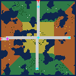
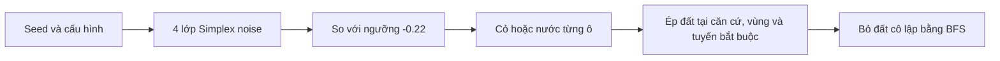
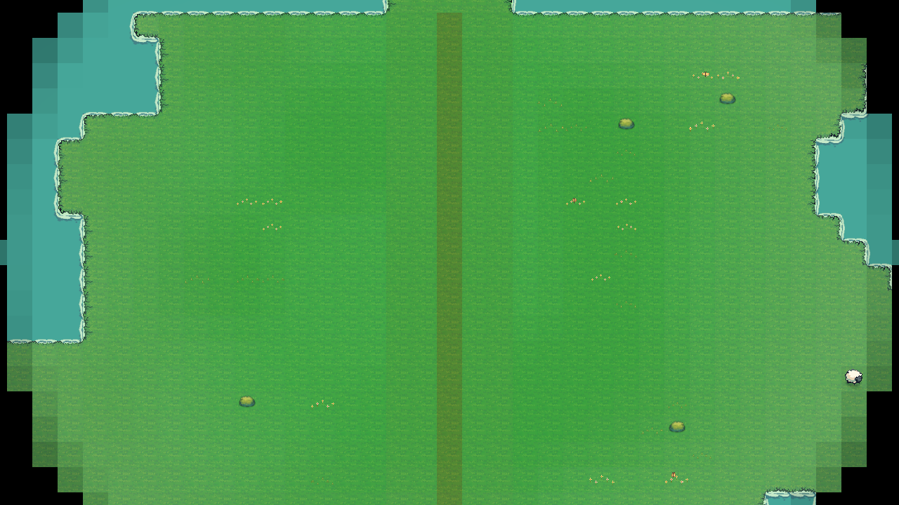
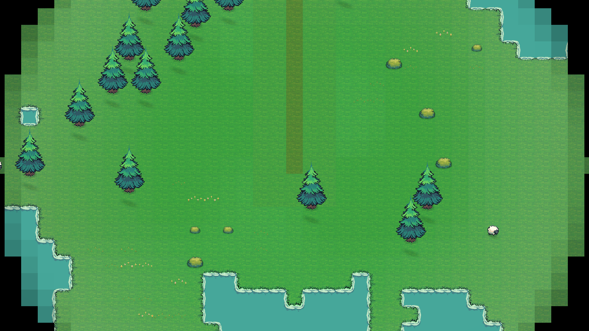
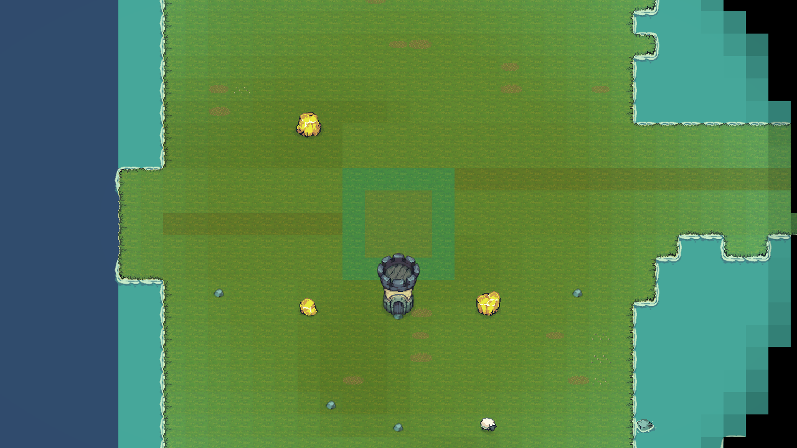
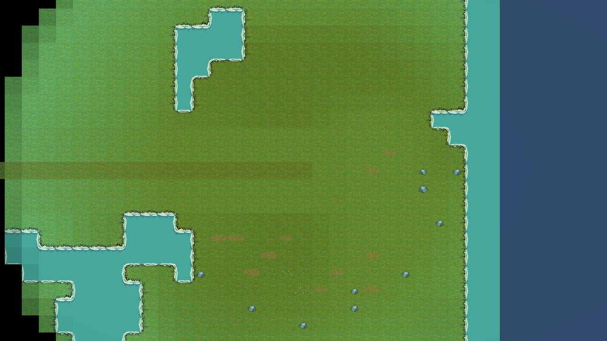
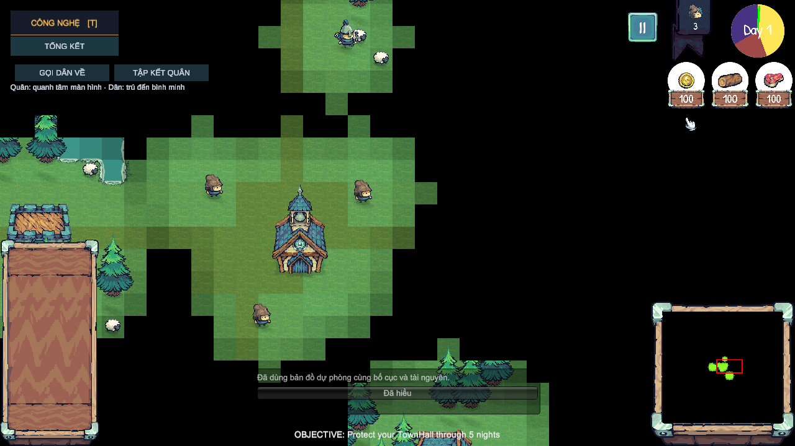
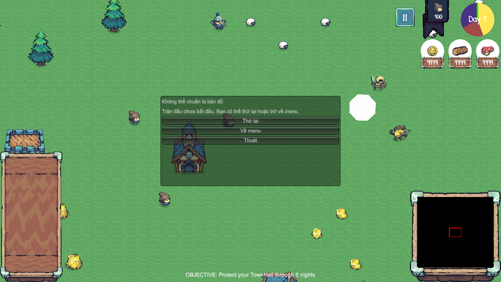
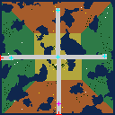
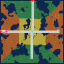

# Hiểu procedural generator qua hình — FourFrontiers v4

Cập nhật **25/11/2026**. Đây là bản giải thích có hình cho **năm vùng hiện tại** của `ProceduralGame`. Đọc [HowItWorks](HowItWorks.md) nếu cần luồng đầy đủ và liên hệ mã nguồn. Hình và kết quả bên dưới lấy từ evidence FR0–FR7 đã lưu ngày 24/11; lần viết tài liệu này không chạy lại generator hoặc benchmark.

## 1. Đọc một bản đồ hoàn chỉnh trước



**Hình 1 — MapData thật: FourFrontiers v4, seed 1, accepted attempt 1.** Attempt 1 là lần thử thứ hai, không phải generator version 1. Preview bỏ qua sprite, collider và fog để nhìn rõ các lớp dữ liệu.

| Dấu/màu trong preview | Ý nghĩa |
|---|---|
| Xanh dương | Nước |
| Vàng nâu ở giữa | Nhãn vùng Start |
| Xanh lá ở hai phía đối diện | Hai vùng có role Economy |
| Cam/nâu ở hai phía còn lại | Hai vùng có role GoldFrontier |
| Dải sáng | Tuyến được carve và bảo vệ |
| Dấu đỏ ở biên | Hai gateway |
| Dấu tím | Landmark, chỉ có một |
| Dấu cyan | Tâm vùng; có thể bị ký hiệu landmark/gateway ghi đè |
| Chấm xanh đậm / vàng / trắng | Cây / mỏ vàng / cừu |

Màu vùng là chú giải; terrain gameplay vẫn chỉ phân loại cỏ hoặc nước. Những đường ranh theo tâm gần nhất không phải tường ngăn người chơi. Dữ liệu đối chiếu: [Unity sweep, sample seed 1](Evidence/FourFrontiers/unity-sweep-0-100.json).

## 2. Từ một con số seed tới hình địa hình



Seed không trực tiếp chứa danh sách cây hay hồ. Nó khởi tạo các stream số giả ngẫu nhiên cho terrain, layout và resource; mỗi attempt có seed con riêng.

Noise tạo các mảng liền, sau đó ngưỡng quyết định ô là nước hay cỏ. Carve sửa phần bắt buộc để căn cứ và tuyến không phụ thuộc hoàn toàn vào hình noise. Cuối cùng BFS lan theo bốn hướng từ Start; đất không tới được bị đổi thành nước.

BFS giống đổ mực trên ô cỏ. Mực không đi xuyên nước và không nhảy chéo qua hai góc chạm nhau. Cùng phép duyệt tạo khoảng đường dùng chọn tài nguyên khởi đầu.

## 3. Năm vùng nằm ở đâu trong seed 1?

Trong lưới Core, X tăng sang phải, Y tăng lên trên. Tọa độ dưới đây là **cell**, chưa phải tọa độ world của Unity.

| ID | Role | Tâm `(X, Y)` | Hướng trong seed 1 | Có tuyến tới biên? |
|---:|---|---|---|---|
| 0 | Start | (64, 64) | Giữa | Qua nhánh 1 và 2 |
| 1 | Economy A | (64, 116) | Bắc | Có, gateway (64, 127) |
| 2 | GoldFrontier A | (12, 62) | Tây | Có, gateway (0, 62) |
| 3 | Economy B | (62, 12) | Nam | Không mở thêm gateway |
| 4 | GoldFrontier B | (116, 64) | Đông | Không mở thêm gateway |

```text
                         G1 tại biên bắc
                               |
                        1 · Economy A
                               |
G2 tại biên tây — 2 · Gold A — 0 · Start — 4 · Gold B
                    landmark   |
                        3 · Economy B
```

Sơ đồ chữ chỉ thể hiện quan hệ và hướng; không thể hiện độ dài hoặc chi tiết chữ L. Với seed khác, cả bố cục có thể xoay và tâm lệch nhẹ. Hai gateway liên kết bằng region ID, không tra từ số lượng vùng.

Mỗi ô nhận ID của tâm gần nhất. Bán kính 8 chỉ xác định đĩa đất bắt buộc quanh tâm ngoài, không giới hạn toàn bộ diện tích vùng. Bởi vậy tài nguyên của vùng có thể rải rộng hơn khu vực sát tâm.

## 4. Đường sáng và ô Reserved bảo vệ điều gì?

Bốn tuyến chữ L nối Start với bốn tâm ngoài. Half-width 2 tạo bề rộng 5 ô. Chỉ hai tuyến của vùng 1 và 2 được kéo tiếp tới biên; hai vùng còn lại vẫn có đường tới căn cứ nhưng không tự mở cửa quái mới.

```text
Ví dụ cắt ngang một tuyến được carve, không phải ảnh một seed:

    ô thường | R R R R R | ô thường
               rộng 5 ô

R: terrain được ép thành cỏ, có Reserved và Routes.
```

Reserved chặn **placement tài nguyên**, không chặn người đi. Start giữ pad 15 × 15; bốn tâm ngoài giữ pad 5 × 5. Pad landmark nằm ở tâm vùng 2. Các khoảng này giúp giữ chỗ căn cứ, điểm tiếp cận và vùng đặt công trình; không phải kích thước sprite.

Biên có dải nước 2 ô trước khi carve gateway. Validator cuối còn kiểm mọi cửa biên đi tới được đều nằm trong vùng cửa đã đăng ký.

## 5. Tài nguyên được chia cụ thể ra sao?

V4 đặt tài nguyên khởi đầu theo thứ tự **cừu → cây → vàng**. Sáu cừu được ưu tiên vì miền BFS gần căn cứ nhỏ và đã bị bốn tuyến Reserved chia bớt diện tích. Sau đó mới chia phần ngoài khởi đầu:

| Nhóm placement | Cây | Vàng | Cừu |
|---|---:|---:|---:|
| Khởi đầu, chọn theo BFS | 30 | 3 | 6 |
| Economy A, ID 1 | 34 | 0 | 5 |
| GoldFrontier A, ID 2 | 11 | 5 | 2 |
| Economy B, ID 3 | 34 | 0 | 4 |
| GoldFrontier B, ID 4 | 11 | 4 | 1 |
| **Tổng** | **120** | **12** | **18** |

Các hàng vùng chỉ đếm placement **ngoài khởi đầu**. Một tài nguyên có cờ khởi đầu vẫn có thể nằm qua ranh giới ID vùng, nên đếm mọi chấm trong một vùng trên preview có thể cho số khác hàng budget đó.

Ba mỏ cạnh landmark được tính trong năm mỏ của vùng 2. Chúng không được cộng thêm sau tổng 12. Nếu cấu hình tùy chỉnh chỉ có bốn vàng ngoài khởi đầu, generator chia 3/1; không chia 2/2 rồi làm thiếu cụm landmark.

## 6. Vì sao phải kiểm lại sau placement?

Đặt được tài nguyên trên đất chưa chứng minh dân khai thác được. Cây và vàng còn làm thay đổi đường đi.

```text
Fixture minh họa một mỏ vàng, không phải collider thật:

    . i i i i i .
    . i G G G i .
    . i G G G i .
    . i G G G i .
    . i i i i i .

G: footprint vàng 3 × 3 bị chặn trong kiểm topology.
i: vòng ô tương tác; cần ít nhất một ô tới được từ Start.
.: những ô xung quanh, không mặc định đều đi được.
```

Cây dùng footprint một ô; cừu không chặn đường trong topology tĩnh. Các lời gọi placement ngoài khởi đầu của v4 kiểm thêm vòng trống; footprint không được đè Reserved, còn vòng tương tác có thể đi trên Reserved. Ba mỏ landmark được đặt riêng trước và vẫn qua kiểm cuối.

Validator kiểm đủ tổng và budget từng vùng, không overlap, đường tới từng tài nguyên, cả bốn tâm ngoài, pad, lối thoát và hai gateway. Clearance 3 × 3 loại lối quá hẹp bằng cách yêu cầu thêm một ô trống quanh tâm. Các phép kiểm này dùng lưới; collider và bán kính actor thật tiếp tục được đối chiếu ở Integration.

Map có đường tới tài nguyên chưa tự chứng minh vùng đó có hiệu quả kinh tế cao. Dân còn phải mang hàng về kho; quãng vận chuyển là lý do cần xây depot khi mở rộng.

## 7. Từ preview tới hình ảnh thật trong Unity

Các ảnh sau là **ảnh camera Unity của v4**, seed 1. Helper đã reveal từng vùng rồi áp màu fog để kiểm tint/decor; đây là fixture quan sát, không phải bằng chứng người chơi tự khám phá hết map.

| Economy A, ID 1 | Economy B, ID 3 |
|---|---|
|  |  |

Cả hai cùng role Economy nên cùng nhóm tint/decor. Chúng không cần có hình địa hình hoặc cách rải cây giống hệt nhau. Cây còn có thể nằm ngoài khung camera chụp quanh tâm.

| GoldFrontier A, ID 2 | GoldFrontier B, ID 4 |
|---|---|
|  |  |

Chỉ vùng 2 có landmark Old Watchpost ở lớp hiển thị; vùng 4 vẫn có vàng và đường tiếp cận. Những ảnh chụp quanh tâm không phải ảnh kiểm đếm tất cả tài nguyên của cả vùng.

Authoring ghi Tilemap và tạo prefab từ MapData; physics/navigation được cập nhật trước khi root bind gameplay. ECS điều khiển khai thác, vận chuyển, xây và chiến đấu. Presentation đọc role để vẽ và đọc fog để quyết định phần đã biết; nó không tự sửa quota hoặc mở tầm nhìn.

## 8. Không đạt validation thì xử lý ra sao?

Generator tối đa tám attempt, đánh số 0–7. Không đủ quota hoặc đường không hợp lệ thì thử attempt tiếp theo; không hạ quota để lấy một bản đồ thiếu tài nguyên.

Nếu hết lượt, Integration xét final map dự phòng cùng preset/cấu hình. Dự phòng phải được kiểm lại trước khi áp. Nếu cấu hình sai hoặc dự phòng không dùng được, trận bị chặn và hiện thử lại/về menu/thoát.



**Hình 2 — Fixture dùng fallback.** Ví dụ yêu cầu seed 1543 nhưng dùng map dự phòng seed 1: hệ thống lưu cả requested seed và actual seed. Dữ liệu thật được lưu/restore, không sinh lại requested seed khi load.



**Hình 3 — Fixture lỗi trong Editor.** View authoring có thể còn xuất hiện phía sau panel; simulation vẫn bị chặn. Ảnh này không chứng nhận một lượt click lỗi hiếm của người chơi trong Player; các handler retry/menu đã có kiểm riêng theo [báo cáo FR6](FourFrontiers-Implementation.md).

## 9. So ba seed và phân biệt tạo trận với tải trận

| Seed 0 | Seed 1 | Seed 1543 |
|---|---|---|
|  |  |  |

Đổi seed làm đổi noise, hướng/jitter và placement; các ràng buộc năm vùng, hai gateway và tổng quota vẫn giữ. Accepted attempt có thể khác nhau giữa seed và giữa các phiên bản; không lấy số attempt từ tài liệu v3 gán sang v4.

**New Game** chạy generator hoặc dùng fallback đã validate. **Load Game SL4** áp final terrain/topology và khôi phục đối tượng theo ID, không regenerate hoặc mọc lại tài nguyên đã mất. Schema 2 lưu thêm provenance fallback; save schema cũ bị từ chối. SL4 vẫn chỉ nhận đầu ngày 1 và không có công việc đang chạy.

Muốn tự xem: **RTS → Procedural Generation → Preview Regions → FourFrontiers → nhập seed → Sinh preview**. Muốn chơi: `MainMenu → Chơi`, với `FourFrontiersMapSettings.asset` được gán trong authoring.

## 10. Những gì đã kiểm và tài liệu lịch sử

Đợt FR0–FR7 đã lưu 1.000 seed v4 trên cả Unity và .NET, 165 EditMode tests, 14 lượt Player và 18 check SampleScene; có cold-process SL4 và xác nhận nghiệm thu của người dùng. Đây là bằng chứng trong phạm vi cấu hình và workload đã ghi, không bảo đảm mọi seed/cấu hình hoặc mọi hướng mở rộng đều cân bằng. Xem [implementation/evidence](FourFrontiers-Implementation.md) để đọc raw và số đo.

[Bản Word minh họa ngày 24/11](../../../Outputs/Midterm/Giai_thich_Procedural_Generation_Minh_hoa_tile.docx) cùng các hình trong `Outputs/Midterm/VisualGuide` mô tả **StrategicRegions v3**, có ba vùng. Chúng được giữ làm tư liệu lịch sử, chưa được xuất lại theo v4 trong lần sửa Markdown này. Báo cáo giữa kỳ cũng giữ nguyên.

Nguồn đối chiếu chính là [HowItWorks](HowItWorks.md), [Core generator](../../../Assets/Game/ProceduralGeneration/Core/ProceduralMapGenerator.cs), [StrategicLayout](../../../Assets/Game/ProceduralGeneration/Core/StrategicLayout.cs), [StrategicResources](../../../Assets/Game/ProceduralGeneration/Core/StrategicResources.cs) và [Authoring](../../../Assets/Game/ProceduralGeneration/Integration/ProceduralMapAuthoring.cs). Nguồn nghiên cứu thuật toán và đối chiếu game nằm ở [Research](Research.md); không coi việc tham khảo một game là bằng chứng sao chép generator của game đó.
