# Cách sinh bản đồ procedural qua hình minh họa bằng tile trong game

Ngày cập nhật 24/11/2026. Core strategic v3.

Tài liệu dành cho người muốn hiểu game tạo bản đồ ra sao. Các hình dùng tile và sprite Tiny Swords đang có trong RTSgame2026, kèm lớp màu chú giải. Dữ liệu seed 0, 1, 1543 được xuất bằng chính Core generator strategic v3 của project.

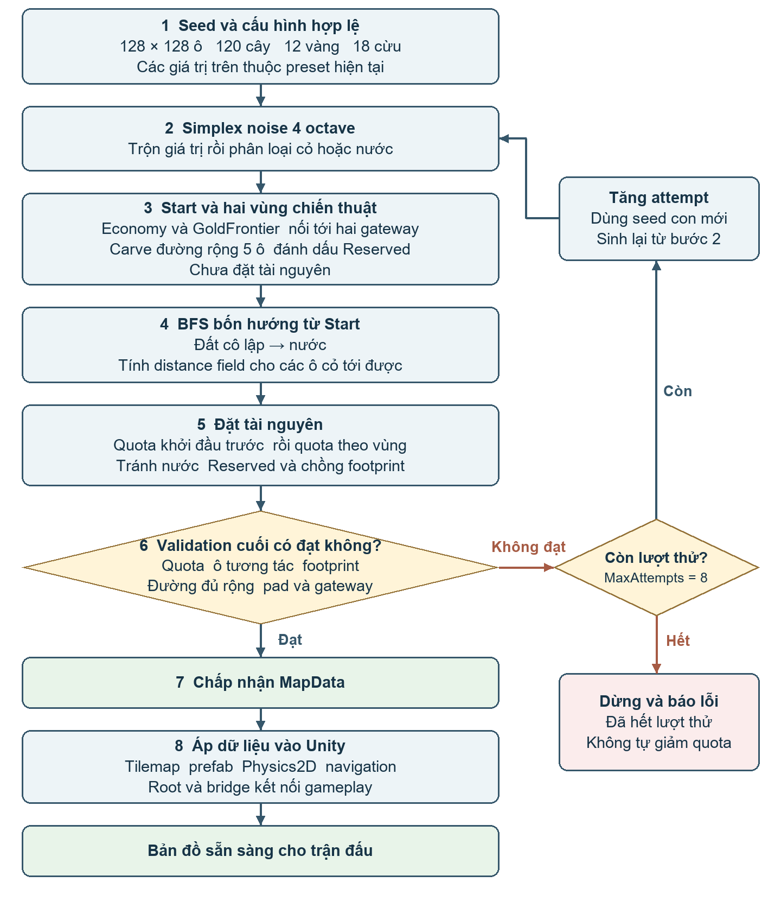

Đọc từ trên xuống. Kiểm tra lúc đặt từng tài nguyên chỉ xét vị trí hợp lệ; validation cuối kiểm khả năng đi lại của toàn bản đồ sau placement. Cấu hình sai bị từ chối trước khi sinh; chỉ MapData hợp lệ mới được áp vào scene.

## 1  Những vật liệu dùng để tạo bản đồ

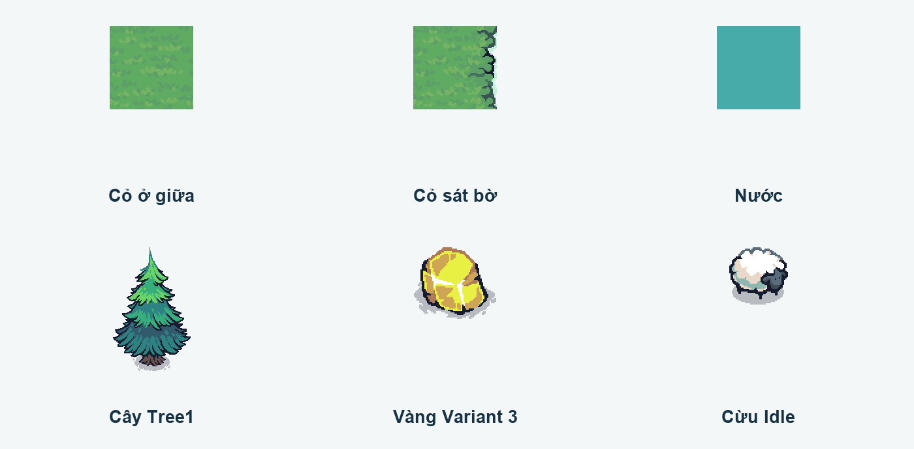

- Cỏ là ô đi được; nước là ô không đi được. Hình bờ cỏ đổi theo các ô lân cận bằng RuleTile hiện có. Tile không tự tạo ra luật sinh địa hình.
- Cây, mỏ vàng và cừu là đối tượng được đặt sau khi có terrain. Sprite là hình ảnh; footprint là diện tích logic dùng kiểm chồng lấn và đường đi.
Các hình tái dựng chỉ thể hiện các lớp cần giải thích, không có fog, hoạt ảnh foam, ánh sáng hoặc sorting đầy đủ như khi chạy Unity. Hình có nhãn “ví dụ” là fixture minh họa; hình có seed dùng dữ liệu Core thật. Báo cáo giữa kỳ đã được giữ nguyên.

Luồng tổng quát: seed và cấu hình → noise → vùng và tuyến → BFS → tài nguyên → validation → Tilemap/prefab/navigation → trận sẵn sàng.

## 2  Từ noise đến tile cỏ và nước

Seed là số đầu vào cho bộ sinh giả ngẫu nhiên. Với cùng cấu hình và phiên bản thuật toán, nó cho phép tái lập MapData. Trong ví dụ seed 0, attempt được chấp nhận là 0; lưới có 128 × 128 ô.

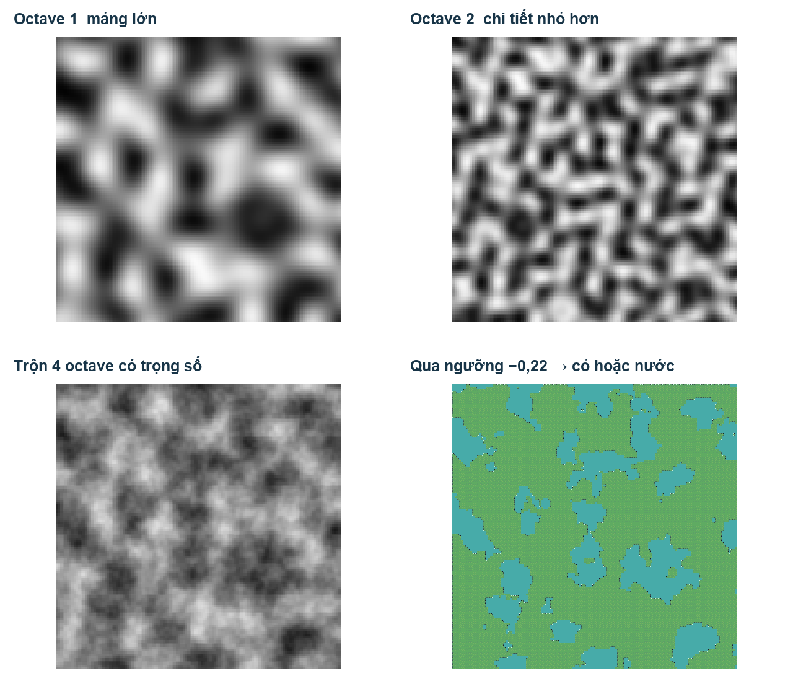

Ô sáng/tối ở ba hình đầu biểu diễn giá trị noise, chưa phải độ cao gameplay. Hai hình trên cho thấy hai lớp đầu; hình dưới trái là hỗn hợp đủ bốn octave. Lớp sau có tần số cao hơn và ảnh hưởng nhỏ hơn.

- Core dùng noise.snoise của Unity.Mathematics, tức Simplex noise. Cấu hình đang minh họa: 4 octave, NoiseScale 34, Persistence 0,5 và Lacunarity 2.
- Giá trị trung bình có trọng số từ −0,22 trở lên được chọn thành cỏ; thấp hơn thành nước. Vì các giá trị lân cận liên tục, bản đồ tạo thành mảng thay vì các ô ngẫu nhiên rời rạc.
Noise chỉ tạo hình địa hình nền. Nếu dừng ở bước này, căn cứ có thể nằm trong nước hoặc đất bị chia cắt. Các bước tiếp theo sửa và kiểm tra để tạo điều kiện chơi được.

## 3  Dành chỗ cho căn cứ vùng mở rộng và đường chính

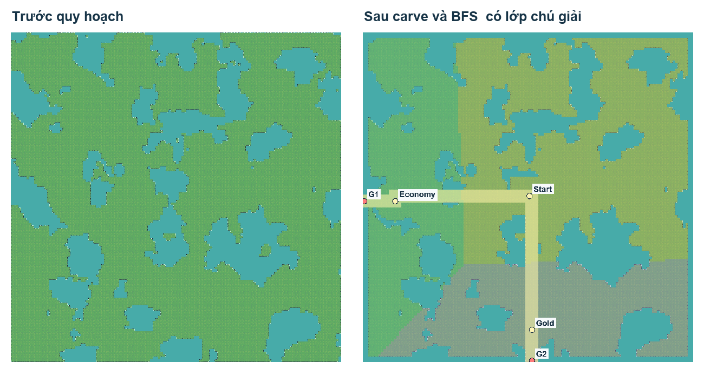

StrategicLayout chọn một trong bốn hướng xoay, đặt hai vùng ngoài theo hai hướng vuông góc và thêm độ lệch nhỏ. Mỗi ô nhận nhãn của tâm vùng gần nhất. Màu trên hình là chú giải vai trò; terrain gameplay vẫn chỉ là cỏ hoặc nước.

- Start: TownHall ở trung tâm, có vùng giữ trống. Economy: ưu tiên cây và cừu. GoldFrontier: vùng nhiều vàng và có landmark.
- Hai tuyến chữ L nối Start tới vùng ngoài rồi ra hai gateway G1/G2 ở biên. Half-width bằng 2 tạo đường rộng 5 ô. Bản đồ có thể còn nhánh nối tự nhiên bên trong.
- Strategic tạo dải nước biên dày 2 ô trước khi mở gateway. Noise và quy hoạch được phối hợp; không đơn thuần rải tài nguyên lên một hình noise có sẵn.

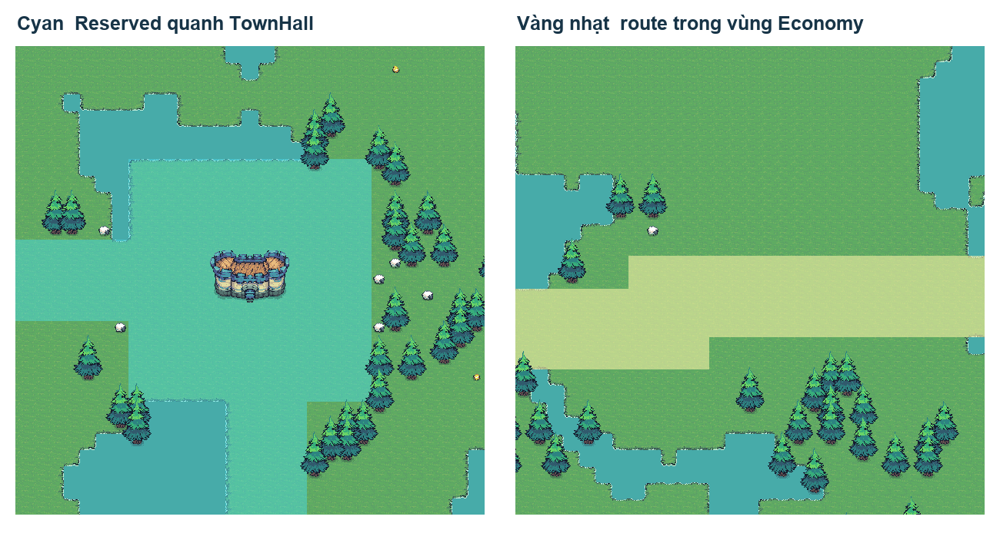

Reserved ngăn tài nguyên chiếm pad của căn cứ, pad landmark và đường được bảo vệ. Hình TownHall chỉ minh họa vị trí căn cứ; Reserved không phải bán kính sprite của tòa nhà.

## 4  Loại đất cô lập bằng BFS bốn hướng

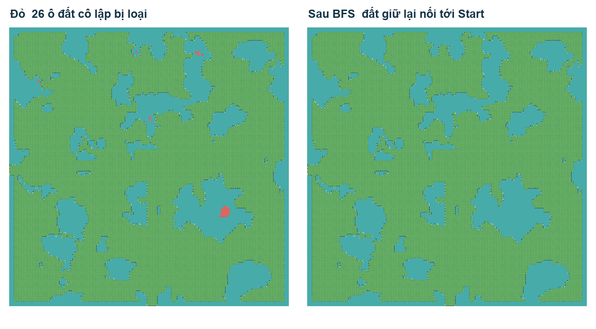

Hãy hình dung đổ mực từ Start: mực chỉ lan sang trên, dưới, trái, phải trên ô cỏ. Các ô đất không nhận mực là đất cô lập. Core đổi chúng thành nước để tránh giữ lại đảo không thể đi tới.

- Ảnh trái lấy terrain sau carve, trước RemoveUnreachableLand; màu đỏ đánh dấu chính các ô đất biến mất. Ảnh phải lấy terrain sau hàm này từ MapData cuối.
- BFS đồng thời tạo distance field: mỗi ô có số bước từ Start. Khoảng này phù hợp chọn tài nguyên đầu game hơn khoảng cách thẳng xuyên qua hồ.
- Hai ô cỏ chỉ chạm góc không được coi là liền nhau. Quy tắc bốn hướng khớp với phép kiểm lưới của module, giúp tránh map trông thông nhưng đường thực tế bị đứt.
Đây mới là kiểm kết nối trên terrain. Sau khi đặt cây và mỏ vàng, hệ thống phải kiểm lại với footprint tài nguyên; một bãi cỏ thông trước placement vẫn có thể bị tài nguyên chặn sau đó.

## 5  Đặt tài nguyên gần trước rồi phân bổ theo vùng

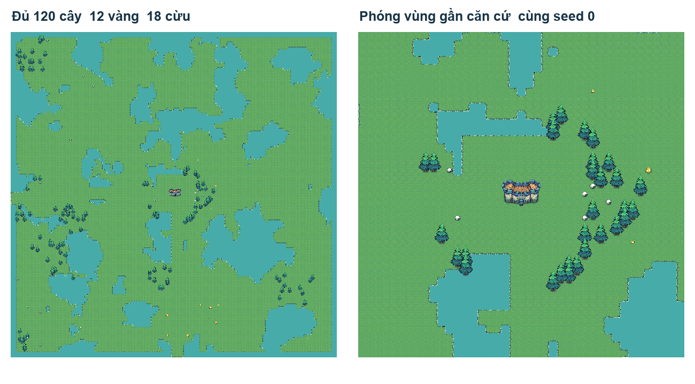

Core đặt quota khởi đầu trước: 30 cây, 3 mỏ vàng, 6 cừu. Chúng được chọn theo khoảng BFS quanh căn cứ; không buộc mọi node khởi đầu phải mang nhãn vùng Start. Sau đó mới đặt phần còn lại theo vai trò vùng.

- Tổng map: 120 cây, 12 mỏ vàng, 18 cừu. Ngoài quota khởi đầu, Economy nhận 68 cây và 9 cừu; GoldFrontier nhận 22 cây, 9 vàng và 3 cừu.
- Ba mỏ vàng quanh landmark nằm trong tổng 12 mỏ. Các VariantId chọn hình Gold Stone 1–6; tất cả cùng loại tài nguyên Gold.
- Cây/vàng xa được lấy mẫu quanh các tâm cụm; cừu lấy mẫu trên đất mở. Occupancy và Reserved loại vị trí chồng lấn hoặc chắn chỗ đã dành trước.
Con số quota nói về số đối tượng được đặt, không tự chứng minh nguồn tài nguyên sẽ cạn hoặc game đã cân bằng. Mức lợi ích của mở rộng còn phụ thuộc quãng vận chuyển, depot và thời điểm wave.

## 6  Sprite và footprint là hai thứ khác nhau

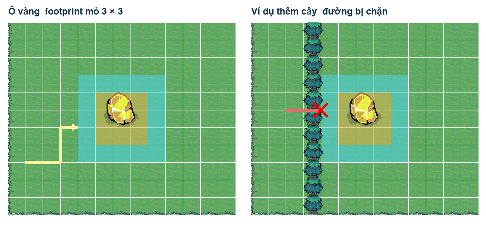

Các ô vàng biểu diễn footprint 3 × 3 của mỏ, không phải hình dạng chính xác của sprite. Vòng cyan là các ô tương tác ứng viên phía ngoài. Dân cần đứng được ở một ô hợp lệ trên vòng này để khai thác.

- Cây chặn 1 ô trong validator Core. Vàng chặn 3 × 3 ô. Cừu không chặn đường trong phép kiểm topology tĩnh nhưng vẫn được kiểm vị trí và overlap khi placement.
- Sprite có phần trang trí và khoảng trong suốt; hình trông nhỏ hoặc lớn không tự thay đổi footprint lưới. Collider và offset thật được đối chiếu ở Integration.
- Hình bên phải cố tình thêm hàng cây chạy hết chiều cao khu vực minh họa: lối đi từ phía trái tới mỏ bị chia cắt. Ví dụ xét khu vực đóng trong hình; nếu có đường vòng ngoài khung thì phải kiểm cả đường đó. Đây là fixture để đọc luật, không phải kết quả hợp lệ của generator.
Sau placement, hệ thống kiểm tất cả tài nguyên: nằm trên đất, không đè Reserved, không trùng footprint và có ít nhất một ô tương tác tới được. Chỉ kiểm “tâm mỏ nằm trên cỏ” là chưa đủ.

## 7  Đường phải vừa nối được vừa đủ rộng

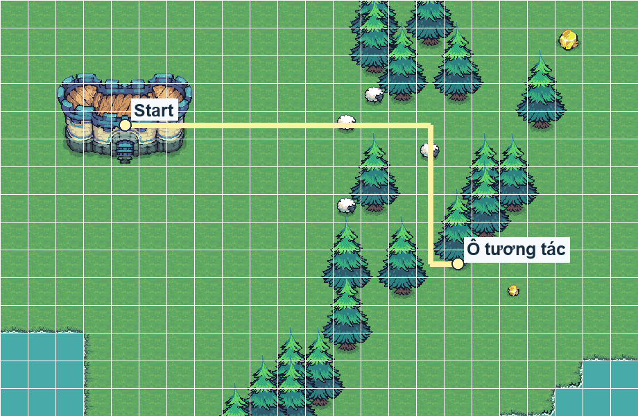

Đường vàng được dựng bằng BFS bốn hướng trên terrain thật cộng vật cản cây/vàng. Đường kết thúc ở ô tương tác ngoài mỏ, không chạy xuyên qua tâm mỏ. Đây là phép minh họa validator, không phải lệnh di chuyển cho một Unit đang chạy.

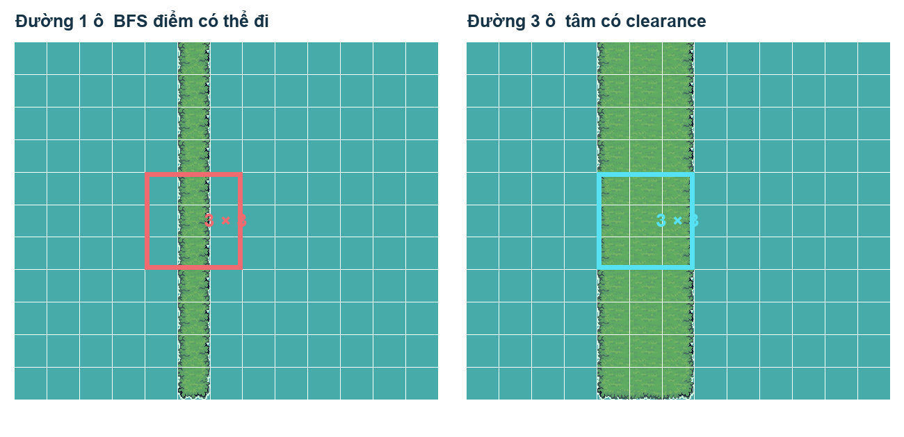

Đường 1 ô có thể nối được nếu xem nhân vật như một điểm. Phép kiểm clearance dùng footprint 3 × 3, tương đương cần 1 ô trống xung quanh tâm; lối hẹp bên trái không đạt. Hệ thống co vùng đi được rồi kiểm tới hai gateway và landmark. Ô biên được xử lý theo quy tắc gateway.

## 8  Vì sao cần seed attempt và validation

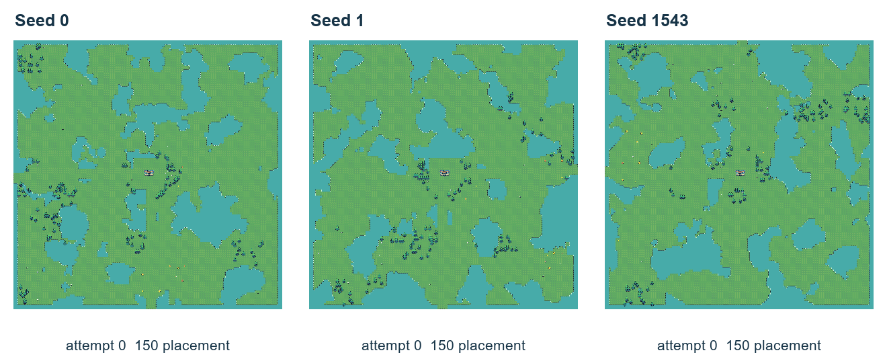

Ba seed 0, 1, 1543 ở đợt xuất hình này đều được chấp nhận tại attempt 0 và đủ 150 placement. Đây là kiểm tra phục vụ minh họa, không phải một đợt benchmark hoặc chứng nhận mọi seed đều hợp lệ.

- Validation cuối kiểm quota, ô tương tác, footprint, pad, clearance và gateway. Mọi cửa biên đi tới được phải thuộc vùng gateway được khai báo.
- Nếu một attempt không đạt, Core thử attempt tiếp theo. Mặc định tối đa 8 attempt; từng lời gọi PlaceQuota có giới hạn phép thử. Hết giới hạn thì trả lỗi, không tự giảm quota để báo thành công.
- Terrain, layout và resource có stream seed riêng được suy ra từ seed gốc, mã phase và attempt. Một lần UI gọi random không được làm xê dịch bố trí map.
Cùng seed chỉ đủ để tái lập khi cấu hình và phiên bản generator cũng phù hợp. Nếu đổi thuật toán hoặc quota, kết quả có thể đổi. Khi debug cần giữ seed, settings, version, attempt và nguyên nhân validator.

Các bài kiểm lịch sử: S5 quét 1.000 strategic và 1.000 legacy, có sinh lại để so dữ liệu; SL4 có 18/18 procedural tests đạt. Không dùng các kết quả đó để kết luận thời gian scene đến Ready hay cân bằng kinh tế đã đạt.

## 9  Từ bản đồ dữ liệu tới màn hình chơi

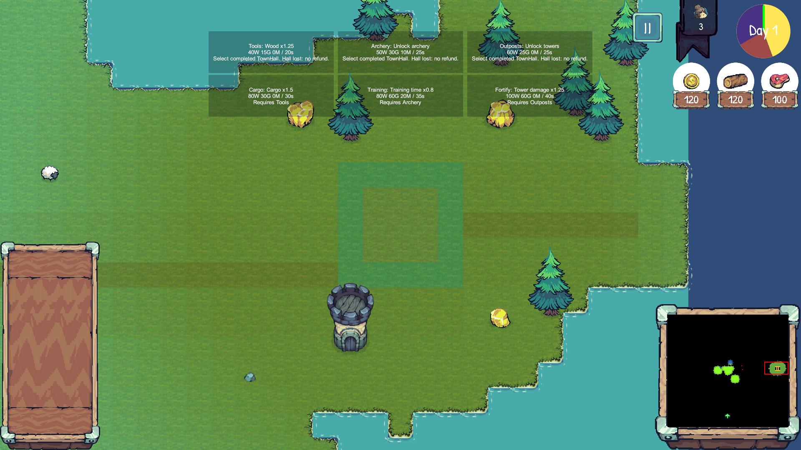

Ảnh trên là evidence Unity có sẵn, không phải ảnh chụp mới của candidate E10. Nó cho thấy RuleTile, bờ nước, tài nguyên và lớp presentation được áp vào scene. Hình tái dựng ở các trang trước chủ động lược bỏ các lớp này để thấy từng bước logic.

- Core tạo MapData. ProceduralMapAuthoring ghi Tilemap theo batch, tạo prefab đúng placement, tắt spawner cũ để tránh sinh trùng, rồi đồng bộ Physics2D và dựng lại pathfinding.
- Root và bridge kết nối dependency, đăng ký thực thể/tài nguyên vào ECS. Đồng hồ và wave chờ quá trình chuẩn bị; map chưa hợp lệ không được coi là sinh thành công.
- Gateway là dữ liệu tuyến tiếp cận. Điểm spawn thực tế được chọn trên tuyến ở bán kính khởi đầu phù hợp; không mặc định quái luôn sinh đúng mép map.
New Game chạy generator. Load Game SL4 áp snapshot terrain/topology và khôi phục đối tượng bằng ID, không sinh map và tài nguyên lần nữa. Vì vậy tài nguyên đã mất không mọc lại chỉ nhờ còn seed. SL4 vẫn chỉ nhận lát cắt đầu ngày không có công việc đang chạy.

Cách xem thử: RTS → Procedural Generation → Preview Regions → StrategicRegions → nhập seed → Sinh preview. Muốn chơi dùng ProceduralGame. Đọc asset được gán thực tế ở authoring; không suy preset gameplay từ asset DefaultProceduralMapSettings riêng.

## 10  Tham khảo từ game nào và học điều gì

Có hai loại nguồn: tài liệu/công trình giải thích thuật toán và game cho thấy cách áp dụng luật sinh vào trải nghiệm. Không có bằng chứng rằng RTSgame2026 sao chép nguyên bộ sinh map của một game thương mại.

## 0 A D là tham khảo đã có trong nghiên cứu ban đầu

Research.md ngày 26/10/2026 đã dẫn mã nguồn 0 A.D. File rmgen-common/player.js tách các bước đặt căn cứ, cây, mỏ và động vật khởi đầu, đồng thời dùng constraints và khoảng cách. Điểm học cho dự án là tách tài nguyên quanh căn cứ khỏi phần ngẫu nhiên xa hơn. Không lấy quota hay thông số cân bằng của 0 A.D. làm thông số của game này.

[Nguồn 1  0 A D  rmgen common player js](https://github.com/0ad/0ad/blob/master/binaries/data/mods/public/maps/random/rmgen-common/player.js)

## Factorio là nguồn bổ sung ở lần cập nhật này

Friday Facts 258 giải thích việc làm tài nguyên đầu game dễ dự đoán hơn, tránh chồng lấn và nước che tài nguyên. Friday Facts 390 minh họa cách kết hợp trường noise với biểu thức hình học để quyết định tile và vị trí đối tượng. Liên hệ với dự án là “nền tự nhiên + vùng bắt buộc + tài nguyên có luật”; đây là đối chiếu thiết kế, không khẳng định hai game dùng cùng thuật toán hoặc mã nguồn.

[Nguồn 2  Factorio Friday Facts 258  New autoplace](https://www.factorio.com/blog/post/fff-258)

[Nguồn 3  Factorio Friday Facts 390  Noise expressions 2 0](https://www.factorio.com/blog/post/fff-390)

## Các nguồn khác và giới hạn diễn giải

Crown Siege được dùng tham khảo giao diện tech tree nền tối, node và điều hướng; không có bằng chứng về thuật toán sinh map của Crown Siege trong nghiên cứu hiện có. They Are Billions và Age of Darkness xuất hiện trong đề cương như bối cảnh RTS sinh tồn, không phải nguồn chứng minh cách generator hiện tại được cài đặt.

Nền tảng noise tham khảo Red Blob Games và API Unity.Mathematics. WFC, Cellular Automata, Poisson disk và multiobjective generation có được khảo sát; Core hiện tại không triển khai đầy đủ các kỹ thuật đó. Tài nguyên theo cụm không được gọi là Bridson Poisson disk hoàn chỉnh.

[Nguồn 4  Red Blob Games  Making maps with noise functions](https://www.redblobgames.com/maps/terrain-from-noise/)

Asset: Tiny Swords đã có trong project. Hình tái dựng bằng tile gốc, dữ liệu Core xuất riêng và lớp chú giải; không thay đổi asset, scene hay gameplay. Source đối chiếu: ProceduralMapGenerator.cs, StrategicLayout.cs, StrategicResources.cs, DeterministicRandom.cs, ProceduralMapAuthoring.cs; các báo cáo S4, S5, S6 và SaveLoad SL4.

