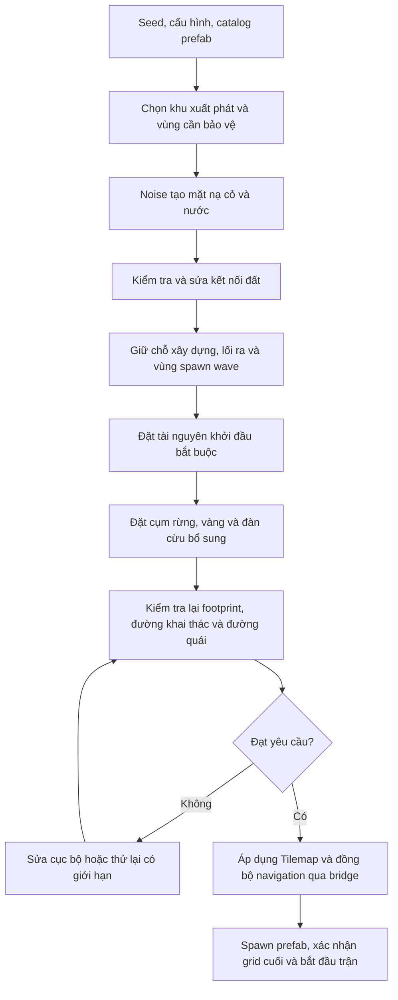

# Nghiên cứu sinh địa hình và phân bố tài nguyên cho RTSgame2026

Ngày đối chiếu code và tra cứu nguồn: **26/10/2026**.

Kế hoạch thực hiện từ nghiên cứu này: [Implementation Plan, ngày 27/10/2026](ImplementationPlan.md).

**Trạng thái: nghiên cứu và đề xuất thiết kế. Chưa triển khai generator, chưa chạy thử seed trong Unity, chưa có kết quả cân bằng hoặc benchmark của module này.** Những con số bên dưới là cấu hình thử nghiệm đề xuất, cần điều chỉnh qua kiểm thử.

## 1. Mục tiêu và phạm vi

Tạo bản đồ Tilemap 2D chỉ cần hai loại địa hình gameplay: **cỏ đi được và nước không đi được**. Phân bố cây thành rừng, vàng thành cụm mỏ, cừu thành đàn; bảo đảm khu khởi đầu có thể xây dựng, khai thác và phòng thủ, đồng thời có vùng để khám phá.

Ưu tiên một bản đồ hữu hạn, sinh một lần trước khi bắt đầu trận. Dựa trên `EnemyWaveManager` và cơ chế bảo vệ TownHall hiện có, đề xuất ban đầu phục vụ **PvE chống wave**. Đây là giả định thiết kế từ code, không phải xác nhận dự án chỉ có một chế độ. Phần cân bằng nhiều người chơi được tách thành hướng mở rộng.

Không cần thêm biome, địa hình 3D, tàu, cầu, machine learning, thay Unity Editor hoặc render pipeline để giải quyết phạm vi này. Đảo tách rời không được chứa tài nguyên bắt buộc khi chưa có phương tiện vượt nước.

## 2. Hiện trạng đã kiểm tra trong repository

| Thành phần | Điều quan sát được | Hệ quả đối với generator |
|---|---|---|
| `TilemapManager` | Có walkable, water, overlay và unreachable Tilemap; `NavigationVersion` thay đổi qua API cập nhật pathfinding | Phải cập nhật dữ liệu di chuyển cùng với hình ảnh |
| `ResourceSpawner` | Sinh ở `Awake`, chọn điểm ngẫu nhiên trong BoxCollider2D, kiểm tra `CanPlaceTiles`, có giới hạn số lần thử; phím P sinh lại tài nguyên | Đã có random placement nhưng chưa có terrain generation, phân vùng kinh tế hay kiểm tra kết nối |
| `SampleScene` | Spawner đang khai báo 30 cây, 20 mỏ, 18 cừu; chỉ một trường `m_GoldStonePrefab` | Đây là số lượng yêu cầu của scene, không chứng minh số lượng thực sinh hoặc mức cân bằng |
| Prefab vàng | Có `GoldStone1` đến `GoldStone6`; cùng class `GoldStone`, cùng `ResourceType.Gold`, cùng `m_MaxWorkers = 4` | Là sáu biến thể prefab của cùng loại tài nguyên theo logic hiện tại; chưa có sáu cấp độ vàng |
| Khác biệt giữa prefab vàng | Capsule collider, offset và `m_InteractionRadius` khác nhau; radius lần lượt 0.6, 0.6, 0.7, 0.9, 0.9, 0.9 | Chọn biến thể trước khi kiểm tra chỗ đặt; sprite lớn không đồng nghĩa có nhiều vàng hơn |
| `GameplayResource` | Giữ loại hàng, vị trí, bán kính, claims, capacity và `RequiresKill`; chưa có trường trữ lượng còn lại | `Capacity` ở đây là chỗ khai thác đồng thời, không phải số vàng/gỗ/thịt còn trong node |
| `GameplayEconomyJob` | Tăng hàng mang theo theo gathering profile; chưa trừ trữ lượng node mỗi lần thu | Chưa thể ép người chơi mở rộng bằng lý do “mỏ gần nhà sẽ cạn” |
| `SheepUnit` và bridge | Cừu là actor ECS kiêm resource, capacity 1, cần giết trước khi lấy thịt; có hành vi chạy trốn | Đặt đàn trên bãi cỏ có khoảng trống, không coi cừu là vật cản tĩnh |
| Đường đi | `GameplayPathJob` dùng A* với 4 hướng; cost integration của `FlowFieldJob` cũng lan 4 hướng | Dùng BFS 4 hướng cho kiểm tra kết nối cơ bản; tính cả kích thước actor |
| DOTS bridge | `RefreshNavigation` cấu hình cả Gameplay và Swarm; phương thức hiện là private, kiểm tra version trong `Update` theo nhịp tối thiểu 0.25 giây giữa các lần refresh | Không giả định một lần đổi tile đã làm grid mới sẵn sàng tức thì |
| Spawn wave | `EnemyWaveManager` thử điểm trên vòng quanh TownHall, bán kính tăng theo khu công trình; kiểm tra ô đi được | Generator cần kiểm tra thêm đường từ vùng spawn đến căn cứ, không chỉ để trống mép map |

Các file đối chiếu chính:

- [TilemapManager.cs](../../../Assets/Game/Scripts/Managers/TilemapManager.cs), [ResourceSpawner.cs](../../../Assets/Game/Scripts/Resources/Services/ResourceSpawner.cs).
- [GoldStone.cs](../../../Assets/Game/Scripts/Utils/GoldStone.cs), [ResourceNodeBase.cs](../../../Assets/Game/Scripts/Resources/ResourceNodeBase.cs), [prefab vàng](../../../Assets/Game/Prefabs/TerrainObjects/GoldStone/).
- [GameplayComponents.cs](../../../Assets/Game/DOTS/Runtime/GameplayComponents.cs), [GameplayEconomyJob.cs](../../../Assets/Game/DOTS/Runtime/GameplayEconomyJob.cs).
- [GameplayActorJobs.cs](../../../Assets/Game/DOTS/Runtime/GameplayActorJobs.cs), [FlowFieldJob.cs](../../../Assets/Game/DOTS/Runtime/FlowFieldJob.cs), [SwarmMath.cs](../../../Assets/Game/DOTS/Runtime/SwarmMath.cs).
- [SwarmGameBridge.cs](../../../Assets/Game/DOTS/Integration/SwarmGameBridge.cs), [GameplayGameBridge.cs](../../../Assets/Game/DOTS/Integration/GameplayGameBridge.cs), [EnemyWaveManager.cs](../../../Assets/Game/Scripts/Managers/EnemyWaveManager.cs).
- [DOTS Development Guide](../DOTS/DevelopmentGuide.md), [Swarm Architecture](../DOTS/Architecture.md), [Gameplay Architecture](../DOTSGameplay/Architecture.md).

## 3. So sánh hướng thuật toán

Đây là đánh giá thiết kế cho phạm vi dự án, không phải bảng benchmark giữa các thuật toán.

| Hướng | Vai trò phù hợp | Hạn chế đối với bài toán này | Quyết định đề xuất |
|---|---|---|---|
| Uniform random từng ô/từng vật thể | Baseline để so sánh | Khó điều khiển hình khối, cụm và đường khai thác | Giữ làm baseline, không dùng làm toàn bộ pipeline |
| Perlin/Simplex noise kết hợp nhiều octave | Tạo hình hồ, bờ nước và vùng ưu tiên rừng | Ngưỡng noise không tự bảo đảm đường đi hoặc kinh tế | Dùng làm nền địa hình |
| Cellular Automata | Làm sạch ô đơn lẻ hoặc tạo vùng liên tục theo luật láng giềng | Có thể xóa eo đất, khu khởi đầu hoặc làm map giống hang nếu lạm dụng | Chỉ thử như bước làm sạch tùy chọn, luôn kiểm tra lại kết nối |
| Voronoi hoặc graph vùng | Phân vùng chiến lược, điểm mở rộng, kết nối giữa các khu | Chưa cần thiết cho bản đồ nhỏ chỉ cỏ/nước | Dùng khi cần kiểm soát nhiều khu và tuyến tiến quân |
| Wave Function Collapse | Ghép tile có luật tiếp giáp phức tạp | Bộ luật cục bộ vẫn cần ràng buộc gameplay bổ sung | Chưa chọn cho phiên bản đầu |
| Poisson disk sampling | Giữ khoảng cách tối thiểu giữa các tâm cụm | Không tự bảo đảm đủ số cụm, vị trí có đường tới hoặc không chắn đường | Dùng ở tầng phân bố tâm tài nguyên |
| Generate–validate–repair | Loại hoặc sửa map không đáp ứng điều kiện chơi | Cần giới hạn retry và ghi rõ nguyên nhân thất bại | Bắt buộc cho pipeline đề xuất |
| Multiobjective evolutionary generation | Tìm nhiều phương án đánh đổi giữa các tiêu chí map | Tăng phạm vi thuật toán, tuning và chi phí đánh giá | Hướng nghiên cứu tiếp sau khi có generator và validator cơ bản |

Nguồn nền tảng: [Red Blob Games](https://www.redblobgames.com/maps/terrain-from-noise/) trình bày cách ghép noise nhiều tần số và phân loại địa hình bằng ngưỡng. [WFC của Maxim Gumin](https://github.com/mxgmn/WaveFunctionCollapse) tập trung luật mẫu/tiếp giáp và cho phép kết hợp thêm constraints. Nghiên cứu [Togelius, Preuss và Yannakakis, 2010](https://www.pcgworkshop.com/archive/togelius2010multiobjective.pdf) coi sinh map chiến thuật là bài toán nhiều mục tiêu. Từ đó, đề xuất của dự án là tách **hình địa hình**, **bố trí kinh tế** và **điều kiện chơi được** thành các bước có thể kiểm chứng riêng.

## 4. Pipeline đề xuất



Sơ đồ mô tả thiết kế tương lai. Các tên bước và kiểu dữ liệu ở phần sau chưa phải API hiện có.

### 4.1. Tái lập bằng seed

Lưu `Seed`, `GeneratorVersion`, cấu hình map và phiên bản catalog prefab. Tách luồng RNG cho terrain, tâm rừng, vàng, cừu và chọn biến thể. Đề xuất sinh seed con bằng một hash số nguyên xác định từ seed gốc, mã phase và chỉ số retry; không dùng `string.GetHashCode()` làm định danh bền vững.

Không phụ thuộc `UnityEngine.Random` toàn cục, vì wave/AI cũng có thể tiêu thụ RNG. Với `Unity.Mathematics.Random`, xử lý seed 0 theo quy tắc cố định. Thứ tự duyệt ô, danh sách ứng viên, giải quyết điểm số bằng nhau và catalog phải ổn định; `FindObjectsByType` không phải thứ tự sinh dữ liệu đáng tin để tái lập.

Cùng seed chỉ cam kết tái lập trong cấu hình và phiên bản generator đã ghi nhận. Không mặc định kết quả float giống hệt trên mọi nền tảng. Nếu cần khôi phục chính xác sau khi đổi thuật toán hoặc asset, lưu cả `MapData` và placements thay vì chỉ seed.

### 4.2. Sinh cỏ/nước

Đề xuất dùng `Unity.Mathematics.noise.snoise(float2)` vì Mathematics đã có trong project; `cnoise` cũng có thể dùng cho phương án Perlin. API được mô tả tại [Unity Mathematics noise](https://docs.unity3d.com/Packages/com.unity.mathematics@1.3/api/Unity.Mathematics.noise.html) và có implementation trong PackageCache hiện tại. Không cần thêm thư viện noise ở phiên bản đầu.

Mặt nạ địa hình đề xuất cho dự án:

```text
N(p) = sum(amplitude[k] * snoise(frequency[k] * p + offset[k]))
       / sum(amplitude[k])

Water(p) = N(p) < waterThreshold
Grass(p) = !Water(p)
```

`p` lấy từ tọa độ ô và một noise scale được định nghĩa rõ. Offset mỗi octave được tạo từ seed. Dùng noise làm trường phân loại 2D, không cần tạo độ cao 3D. Ngưỡng chỉ là tham số đầu vào; validator phải đo tỷ lệ nước thực tế sau các bước bảo vệ/sửa map.

Cấu hình để thử trước: map 128 × 128 ô, 3–4 octave, persistence 0.5, lacunarity 2, tỷ lệ nước mục tiêu 15–25%. Đây là lựa chọn khởi điểm của dự án, chưa có bằng chứng là tối ưu. Có thể tìm ngưỡng theo phân vị của các mẫu noise để tiệm cận tỷ lệ nước, rồi kiểm tra lại sau repair.

Chọn trước vùng xuất phát dự kiến, giữ footprint TownHall và khoảng mở rộng thành cỏ. Với preset đầu, ưu tiên một khối đất chính có hồ; chưa tạo sông chia đôi map hoặc quần đảo. Falloff viền là tùy chọn theo preset, cần đối chiếu bán kính spawn wave trước khi biến viền thành nước.

### 4.3. Kiểm tra kết nối và độ rộng đường

1. Chạy connected-component labeling bằng BFS 4 hướng trên mặt nạ đất. Bắt đầu từ các ô ngoài footprint TownHall mà dân có thể đi ra, không bắt đầu ngay giữa công trình đang chặn đường.
2. Loại đảo nhỏ không có vai trò, hoặc chuyển chúng thành nước. Không xóa một vùng chứa điểm bắt buộc chỉ vì nó không phải component lớn nhất.
3. Nếu các khu bắt buộc chưa nối nhau, dùng đường có chi phí sửa địa hình để tìm hành lang nối; chuyển một dải ô nước thành cỏ. Đây là dải đất liền, chưa phải hệ thống cầu.
4. Nới hành lang theo kích thước actor và khoảng trống mong muốn, giữ lại bằng `ReservedMask` để tài nguyên không lấp vào.
5. Kiểm tra kết nối lại sau mỗi thay đổi hình học và sau khi đặt tài nguyên.

BFS trên ô đất chỉ chứng minh tâm ô liên thông. Dùng thêm mặt nạ clearance cho từng nhóm kích thước actor, tương thích với kiểm tra `SwarmMath.Fits`; đường rộng một ô có thể không đủ cho collider thực. Số ô mở rộng phải tính từ `cellSize`, bán kính/collider và biên an toàn, không gán một số cố định cho mọi prefab.

Với wave hiện tại, phải kiểm tra các điểm hợp lệ trên **vòng spawn thực tế quanh TownHall**, đường tới vùng tiếp cận TownHall và chỗ xuất hiện đủ rộng. Do vòng spawn giãn theo công trình, cần thêm kịch bản sau mở rộng căn cứ. Một island preset chỉ có thể dùng nếu vẫn đáp ứng được quy tắc wave hoặc có thiết kế spawn khác được triển khai rõ ràng.

## 5. Phân bố tài nguyên

### 5.1. Quy tắc chung

Tách hai nhóm: **tài nguyên khởi đầu có bảo đảm** và **tài nguyên bổ sung có biến thiên**. Đặt nhóm bắt buộc trước; noise chỉ hướng dẫn hình dáng/mật độ bổ sung, không quyết định người chơi có được nguồn gỗ hoặc vàng ban đầu hay không.

Mỗi placement phải đạt:

- Đặt trên cỏ; toàn bộ footprint vật lý hợp lệ, không chỉ pivot hoặc ô giữa.
- Không chồng footprint nhà, tài nguyên khác, lối ra, vùng xây ban đầu hoặc vùng spawn đã giữ chỗ.
- Có ô đứng khai thác và đường từ đó về depot phù hợp. Kiểm tra vùng tương tác, không bắt buộc dân đi vào tâm mỏ đang bị chặn.
- Không làm đứt hành lang bắt buộc. Kiểm tra map với cây/mỏ ở trạng thái chưa được claim vì collider có thể bật lại khi người khai thác rời đi.
- Đếm chỗ khai thác thực sự tiếp cận được. `m_MaxWorkers = 4` không tự chứng minh có bốn vị trí đứng sử dụng được trong một cụm sát nước.

Tính `PathDistance` từ các ô đi ra của căn cứ/depot bằng BFS cho lưới 4 hướng, cost đồng nhất. Nếu sau này cost địa hình khác nhau thì dùng Dijkstra. Khoảng cách đường chim bay chỉ dùng lọc nhanh; không dùng để kết luận mỏ “gần nhà” khi có hồ chắn giữa.

### 5.2. Tâm cụm và khoảng cách

Đề xuất dùng [Poisson disk sampling của Bridson, 2007](https://www.cs.ubc.ca/~rbridson/docs/bridson-siggraph07-poissondisk.pdf) để tạo các tâm cụm có khoảng cách tối thiểu. Thuật toán gốc dùng background grid và active list; trong 2D, kích thước ô lưới không vượt `r / sqrt(2)`, thường thử tối đa 30 ứng viên quanh một điểm active.

Áp dụng cho dự án: tạo tâm trên vùng đất hợp lệ, rồi chọn theo khoảng đường đi, chỗ xây và nguy cơ chắn lối. Sau khi snap về ô, phải kiểm tra lại khoảng cách và footprint. Với cụm kích thước khác nhau, kiểm tra thêm `distance >= radiusA + radiusB + gap`; không coi khoảng cách tâm cố định là đủ.

Poisson sampling không bảo đảm đủ số cụm trên vùng bị chia cắt. Nếu thiếu cụm bắt buộc, duyệt một danh sách ô hợp lệ theo thứ tự xác định để tìm vị trí khác; hết chỗ thì sửa map hoặc báo seed không hợp lệ. Không âm thầm giảm quota khởi đầu. Không suy ra toàn bộ pipeline có độ phức tạp tuyến tính từ thuật toán sampling gốc.

### 5.3. Cây

- Chọn vài tâm rừng lớn, phát triển mảng cây bằng region growth có giới hạn số cây và bán kính. Dùng một trường density độc lập để biến thiên biên rừng; không dùng lại nguyên trường terrain làm mọi tài nguyên bám cùng một đường đồng mức.
- Tạo rừng có mép khai thác hướng về khu đi lại; giữ các khe/lối ra được đánh dấu. Một cụm dày cần kiểm tra cả cây phía trong: nếu bị cây khác bao kín và cây không cạn, cây đó có thể mãi không tiếp cận được.
- Gần căn cứ có ít nhất một mảng rừng sử dụng được ngay. Các rừng xa giúp tăng lựa chọn vị trí kho, số dân làm việc và hình dạng chiến trường; hiện chưa có cơ chế hết gỗ để bắt buộc chuyển rừng.
- Sử dụng footprint gốc cây làm navigation; tán cây/click trigger là dữ liệu kiểm tra hình ảnh và thao tác riêng. Không cấm mọi overlap của tán cây như thể đó là overlap collider vật lý.

### 5.4. Vàng và sáu prefab

Thay trường một prefab trong thiết kế generator tương lai bằng catalog gồm prefab, weight, footprint và thông số tương tác. Chọn biến thể trước khi kiểm tra placement. Có thể bắt đầu với trọng số bằng nhau để đánh giá hình ảnh; chưa gán `GoldStone6` nhiều vàng hơn `GoldStone1`.

Đặt một cụm vàng khởi đầu trong tầm đường đi cho phép. Cụm bổ sung nằm ở khu xa hơn hoặc hướng khó phòng thủ hơn. Xen kẽ biến thể trong cụm nếu footprint cho phép, có lối tiếp cận và không che mất điểm click cần thiết. Nếu muốn mọi map có đủ sáu hình, cần thêm quota biến thể khi tổng số mỏ đủ lớn; random có trọng số không bảo đảm điều này.

Khi so sánh hai khu xuất phát, dùng cùng cơ cấu biến thể cho tài nguyên khởi đầu hoặc kiểm tra tương đương về chỗ đứng và quãng đường. Hai bên có cùng số sprite chưa đủ để kết luận cân bằng.

**Hệ quả của tài nguyên chưa cạn:** một mỏ với bốn chỗ làm việc có thể phục vụ lâu dài. Giá trị mỏ xa nằm ở năng lực tăng sản lượng/giảm ùn tắc hoặc vị trí chiến thuật. Nếu mục tiêu gameplay là buộc người chơi tìm mỏ mới, cần một thay đổi kinh tế riêng như `RemainingAmount`, depletion, dọn claim và phản ứng của worker. Không đưa thay đổi đó vào generator như một giả định ngầm.

### 5.5. Cừu

Đặt theo đàn nhỏ trên bãi cỏ mở; có khoảng cách giữa các con và vùng đệm với nước, cây, mỏ, nhà. Không cần dựng thêm tile “đồng cỏ”: đây là vùng chức năng trên tile cỏ hiện tại.

Gần căn cứ có đàn khởi đầu; đàn bổ sung ở các khoảng trống xa hơn. Điểm spawn phải cho phép cừu đứng/chạy với body radius hiện có, đồng thời dân có thể tới đánh và khai thác xác. Sau spawn, cừu tiếp tục chạy theo ECS; generator không thể bảo đảm đàn giữ nguyên bố trí khi bị đánh. Muốn có lãnh thổ đàn hoặc quay về bãi thì phải bổ sung hành vi actor riêng.

### 5.6. Cấu hình thử đầu tiên

Các khoảng dưới đây tính bằng **số bước đường đi trên lưới 4 hướng** từ lối ra căn cứ; không phải số giây hay số mét cố định. Chỉ dành cho cấu hình thử 128 × 128, cell size dự kiến 1; cần đối chiếu footprint thật và tốc độ dân.

| Vùng | Đề xuất thử | Điều kiện phải kiểm tra |
|---|---|---|
| Khoảng xây quanh TownHall | Footprint nhà cộng khoảng trống ban đầu khoảng 4–6 ô, chừa lối sinh/đi ra của dân | Không đặt nước, cây hoặc mỏ trong vùng giữ chỗ; vẫn đủ nền cho vài công trình ban đầu |
| Đàn khởi đầu | 4–6 cừu, cách theo đường đi khoảng 6–12 bước | Có bãi mở và đường đánh/khai thác xác |
| Rừng khởi đầu | Khoảng 20–30 cây, mép rừng cách khoảng 8–16 bước | Có nhiều điểm khai thác tiếp cận được; không vây kín căn cứ |
| Vàng khởi đầu | 2–3 node, vùng tương tác cách khoảng 12–22 bước | Khoảng cách vận chuyển và chỗ đứng khai thác hợp lý |
| Khu bổ sung | Cụm ở khoảng 25–45 bước và xa hơn tùy phần đất thực có | Có đường về depot, chỗ đặt kho mới và đánh giá tiếp xúc với hướng wave |

Không dùng các khoảng trên làm ngưỡng từ chối map trước khi hiệu chỉnh. Chúng là giả thuyết playtest. Nếu vùng khởi đầu rộng hơn hoặc map nhỏ hơn, các khoảng có thể không khả thi. Tổng cây/mỏ/cừu toàn map cũng phải có budget riêng, không nhân mật độ tùy ý cho đầy mọi ô đất.

## 6. Đo tính hợp lý và cân bằng

### 6.1. Điều kiện bắt buộc

- Khu xuất phát, lối ra và vị trí các actor ban đầu hợp lệ theo footprint.
- Đủ quota khởi đầu của từng tài nguyên và có đường vận chuyển đến depot tương ứng.
- Tất cả node được tính vào budget có ít nhất một vùng tương tác tiếp cận được; chỗ khai thác bắt buộc đạt quota đã đặt.
- Đường từ các điểm spawn wave được chấp nhận đến vùng tiếp cận TownHall tồn tại với kích thước quái tương ứng.
- Không tài nguyên tĩnh nào chặn hành lang bắt buộc; không placement vật lý nào chồng nhau hoặc nằm trên nước.
- Sinh thất bại phải có lý do, số lần thử và seed; không lặp vô hạn.

### 6.2. Chỉ số đánh giá mềm

Ghi tỷ lệ đất/nước sau repair, số component, diện tích đất đi tới được, khoảng xây trống, độ rộng/chiều dài tuyến quái, số lối vào căn cứ, số chỗ khai thác tiếp cận được và khoảng đường đi tới tài nguyên/depot. Các chỉ số này là dữ liệu đánh giá; chúng không thay thế playtest.

Với kinh tế hiện tại, có thể ước lượng sản lượng một dân để so sánh các bố trí:

```text
gatherTicks = ceil(CarryCapacity / ResourcePerTick)
cycleTime ~= gatherTicks * GatherTickTime
             + outboundPathLength / speed
             + returnPathLength / speed
             + interactionAndCongestionTime
ratePerWorker ~= CarryCapacity / cycleTime
```

Chỉ áp dụng khi tham số dương và worker làm đủ một chuyến; đây là mô hình gần đúng do đề xuất thiết kế, chưa phải số đo. Cần tính điểm tương tác, đường về kho phù hợp, thời gian giết cừu của chuyến đầu và giới hạn claims. Đo hàng thực nộp theo thời gian trong Unity để kiểm tra lại mô hình, vì collider/ùn tắc/AI có thể làm khác dự tính.

Trong PvE, ưu tiên hạn chế độ lệch độ khó giữa các seed: tài nguyên đầu game, thời gian chuẩn bị, thời gian quái tới và số hướng phải phòng thủ. Không cần đối xứng hình học.

Nếu thêm PvP, dùng quota khởi đầu và cơ cấu biến thể tương đương; so sánh đường vận chuyển, khoảng xây và chỗ tiếp cận tài nguyên. Có thể theo dõi `abs(metricA - metricB) / max(metricA, metricB, epsilon)` cho từng chỉ số, nhưng ngưỡng chấp nhận phải hiệu chỉnh. Đối xứng hoặc khoảng cách bằng nhau vẫn chưa chứng minh cân bằng chiến thuật.

## 7. Dữ liệu và ranh giới tích hợp đề xuất

| Kiểu dự kiến | Nội dung |
|---|---|
| `MapGenerationSettings` | Kích thước, seed, noise, tỷ lệ nước mục tiêu, quota tài nguyên, clearance, retry budget, preset/difficulty |
| `ResourceVariantCatalog` | Stable variant ID, prefab ở tầng Integration, weight, collider footprint/offset, thông số tương tác |
| `MapData` | Origin cell, width, height, cell size, `TerrainMask`, component/clearance, vùng giữ chỗ, danh sách placements |
| `ResourcePlacement` | Resource type, variant ID, cell/world anchor, cluster ID, thông số dùng để tái lập |
| `MapValidationReport` | Seed, phiên bản, quota thực đạt, lỗi, repairs, đường đi, độ rộng, chỉ số kinh tế và timing từng stage |

Generator dữ liệu nên độc lập với Unity scene để có thể kiểm tra nhiều seed mà không instantiate prefab. Phần core không tham chiếu `Unit` hoặc `GameManager`; adapter ở Integration chuyển stable variant ID thành prefab rồi gọi API hiện có. Chưa cần biến từng tile thành Entity để tạo map một lần.

Trình tự tích hợp cần thực hiện khi bắt đầu implementation:

1. Dừng trạng thái bắt đầu trận/wave trong lúc tạo map. Giữ quyền sở hữu tài nguyên rõ ràng: khi generator mới hoạt động, spawner `Awake` và phím P cũ không đồng thời sinh/xóa tài nguyên của generator. Không xóa prefab mẫu hoặc nội dung ngoài container được quản lý.
2. Sinh và validate dữ liệu đầy đủ, gồm footprint tài nguyên dự kiến, trước khi chỉnh scene. Thử lại có giới hạn, ví dụ tối đa 8 attempt terrain; không đủ thì trả báo cáo hoặc dùng preset dự phòng đã được kiểm tra. Số 8 là tham số thử, chưa phải yêu cầu hiệu năng.
3. Áp dụng tile trên main thread bằng batch. Unity có [`Tilemap.SetTilesBlock`](https://docs.unity3d.com/6000.3/Documentation/ScriptReference/Tilemaps.Tilemap.SetTilesBlock.html) cho vùng ô và mảng tile tương ứng. Giữ `MapData` làm dữ liệu địa hình logic; chọn sprite bờ từ RuleTile/asset hiện có sau khi xác minh bộ luật hiển thị.
4. Bảo đảm ô nước thực sự không đi được. `CamWalkAtTile` kiểm tra walkable/unreachable và vật cản, **không trực tiếp lấy `WaterTilemap` để loại đường đi**. Vì thế không được để cỏ walkable trên nước logic nếu không có mask chặn tương ứng. Water background nằm dưới cỏ để trang trí có thể vẫn tồn tại; phân biệt nền vẽ và mặt nạ nước gameplay.
5. Gọi API cập nhật pathfinding/`NavigationVersion` phù hợp của `TilemapManager`. Cần bổ sung một điểm đồng bộ public rõ ràng ở bridge nếu đòi hỏi rebuild ngay; hiện chưa có API public như vậy. Điểm này phải cập nhật cả hai system và xử lý dependency/grid/path cũ đúng quyền sở hữu.
6. Khi grid địa hình sẵn sàng, spawn tài nguyên/actor bằng `SwarmGameBridge.SpawnGameplay`. Dữ liệu placements đã được kiểm tra từ trước; runtime vẫn cần kiểm tra việc instantiate, đăng ký resource/entity và vị trí collider sau offset.
7. Đồng bộ Physics2D, xác nhận navigation cuối đã bao gồm collider tĩnh mới sinh; kiểm tra lại vùng tiếp cận, đăng ký depot, mục tiêu TownHall và lối ra. Chỉ sau đó mở wave/input gameplay. Không trông chờ một lần tăng version trước spawn tự cập nhật cả các vật cản sinh sau đó.
8. Cập nhật hoặc khởi tạo lại bounds của fog, minimap và camera theo map mới; xác nhận dữ liệu đang được các manager cache. Với sinh lại giữa trận còn phải giải phóng Entity, claims, công việc, depot/shelter và đường đi cũ. Đề xuất chưa hỗ trợ thao tác này trong phiên bản đầu.

Chi tiết DOTS cần giữ theo [Development Guide](../DOTS/DevelopmentGuide.md). Không thêm AI cừu, worker hoặc logic khai thác vào `MonoBehaviour.Update` để phục vụ generator.

## 8. Cách kiểm thử và đo hiệu năng khi triển khai

Implementation đầu tiên đã được bổ sung sau giai đoạn nghiên cứu này. Xem [Usage](Usage.md) để chạy chức năng hiện có và [Validation](Validation.md) để phân biệt kết quả đã đo với phần chưa kiểm chứng.

### 8.1. Kiểm thử dữ liệu

Tạo các case có ý nghĩa: cùng seed/cấu hình cho cùng kết quả; hồ cắt đường tới vàng; hai vùng đất chỉ chạm góc; lối hẹp không vừa actor; prefab vàng có offset sát bờ; tài nguyên bao kín node phía trong; thiếu chỗ đạt quota; map gần toàn nước; seed 0; map không đủ chỗ cho footprint TownHall. Với mỗi trường hợp, kiểm tra điều kiện chơi thực tế và báo cáo thất bại tương ứng.

Đề xuất quét 1.000 seed cho preset đầu; kiểm tra nhiều kích thước và quota cực trị. Lưu tập seed lỗi, nguyên nhân, số repair/retry và hash `MapData` để tái lập. Không loại seed lỗi khỏi thống kê rồi chỉ báo kết quả của seed thành công.

So sánh theo các cấu hình có cùng budget tài nguyên:

1. Baseline địa hình/spawner ngẫu nhiên đơn giản.
2. Noise có sửa kết nối, tài nguyên vẫn đặt ngẫu nhiên có kiểm tra chỗ.
3. Pipeline có quota khởi đầu, tài nguyên theo cụm và validator sau placement.

Các cấu hình so sánh chưa được cài đặt. Cần đo tỷ lệ đạt điều kiện, mức biến thiên kinh tế và chi phí sinh để xác định bước nào tạo cải thiện.

### 8.2. Xác nhận trong Unity

Khi có implementation, thử trong scene riêng hoặc bản sao SampleScene: dân đi ra khỏi TownHall, chọn/chặt cây, đào từng biến thể vàng, giết cừu và lấy thịt, nộp đúng kho; xây công trình, sinh quân, nhận wave và kiểm tra fog/minimap/camera. Kiểm tra resource khi đang claim và sau release, vì trạng thái collider thay đổi.

Thử ít nhất một lần mở rộng căn cứ làm vòng spawn quái lớn hơn. Nếu map có đường hợp lệ về mặt dữ liệu nhưng quái/dân vẫn kẹt, giữ seed và kiểm tra offset collider, clearance, capture navigation và hành vi runtime. Chạy EditMode/smoke hiện có theo phạm vi thay đổi, không dùng kết quả DOTS lịch sử để chứng nhận generator mới.

### 8.3. Đo hiệu năng

Tách thời gian noise, component/clearance, chọn placement, validate/repair, ghi Tilemap, instantiate prefab, đồng bộ physics, rebuild navigation và tổng thời gian tới trạng thái sẵn sàng chơi. Ghi allocation, bộ nhớ đỉnh và độ khựng frame khi áp dụng scene; sau đó đo gameplay ở số lượng cây/cừu/mỏ đã sinh.

Với `V = width * height`, noise có `K` octave tốn O(KV); một lượt BFS cost đồng nhất tốn O(V). Kiểm tra nhiều nhóm clearance, repair và nhiều attempt làm tăng tổng chi phí. Tránh chạy A* cho mọi cặp tài nguyên bằng cách dùng distance field từ các lối ra/depot khi có thể. Batch Tilemap và kiểm tra occupancy trên dữ liệu giúp giảm số truy vấn scene dự kiến, nhưng mức cải thiện phải đo.

Ghi median/p95 của nhiều seed, phần cứng, Editor/Player, build, độ phân giải, rendering, số lượng từng prefab và số lần retry. Không chỉ đo core noise rồi gọi đó là thời gian tạo map hoàn chỉnh. Chỉ thêm Jobs/Burst cho phần dữ liệu sau profiling; chi phí GameObject/Animator/collider của tài nguyên vẫn cần đo riêng.

## 9. Giới hạn và bước phát triển tiếp

- Thiết kế hiện chưa có bằng chứng đạt cân bằng, thời gian sinh hoặc tải thực thể cụ thể.
- Hai loại tile đủ để xây pipeline đầu tiên; hình bờ đẹp còn phụ thuộc asset/RuleTile và sorting đang dùng, cần xác nhận trong Editor.
- Kinh tế không cạn làm thay đổi động lực mở rộng; số lượng node chỉ là một phần của năng lực khai thác.
- Vòng spawn wave thay đổi theo căn cứ có thể khiến preset nhiều nước khó dùng; cần kiểm chứng trên vòng spawn thực, kể cả sau xây thêm.
- Quota và các khoảng đường đi đề xuất chỉ là khởi điểm; quyết định độ khó cần playtest theo nhịp ngày/đêm và chi phí xây/huấn luyện hiện có.
- Những hướng sau gồm nhiều preset địa hình, graph vùng chiến lược, lưu MapData, PvP, tài nguyên hữu hạn và multiobjective search. Mỗi hướng phải có yêu cầu và kiểm chứng riêng.

Thứ tự triển khai đề xuất: **core dữ liệu + validator → terrain Tilemap → tài nguyên khởi đầu và cụm → bootstrap DOTS → Unity integration/playtest → đo nhiều seed**. Khi bắt đầu implementation, bổ sung `Architecture.md`, `Usage.md`, `Validation.md` và evidence thực thi; giữ tài liệu nghiên cứu này làm căn cứ lựa chọn ban đầu.

## 10. Nguồn tham khảo

1. Amit Patel, [Making maps with noise functions](https://www.redblobgames.com/maps/terrain-from-noise/) — noise, octave, phân loại địa hình và tạo hình đảo.
2. Robert Bridson, 2007, [Fast Poisson Disk Sampling in Arbitrary Dimensions](https://www.cs.ubc.ca/~rbridson/docs/bridson-siggraph07-poissondisk.pdf), ACM SIGGRAPH Sketches, DOI `10.1145/1278780.1278807` — thuật toán khoảng cách mẫu tối thiểu.
3. Julian Togelius, Mike Preuss, Georgios N. Yannakakis, 2010, [Towards multiobjective procedural map generation](https://www.pcgworkshop.com/archive/togelius2010multiobjective.pdf), DOI `10.1145/1814256.1814259` — sinh map chiến thuật với nhiều mục tiêu đánh giá.
4. Maxim Gumin, [WaveFunctionCollapse](https://github.com/mxgmn/WaveFunctionCollapse) — implementation gốc và thảo luận constraints.
5. Wildfire Games, [0 A.D. — rmgen-common/player.js](https://github.com/0ad/0ad/blob/master/binaries/data/mods/public/maps/random/rmgen-common/player.js) — ví dụ mã nguồn thực tế tách bố trí tài nguyên quanh căn cứ và ràng buộc khoảng cách. Đây là tham khảo cấu trúc; không sao chép các giá trị mặc định sang RTSgame2026.
6. Unity, [Unity.Mathematics.noise](https://docs.unity3d.com/Packages/com.unity.mathematics@1.3/api/Unity.Mathematics.noise.html) — API noise; đối chiếu phiên bản thực tế bằng manifest/PackageCache của dự án.
7. Unity 6.3, [Tilemap.SetTilesBlock](https://docs.unity3d.com/6000.3/Documentation/ScriptReference/Tilemaps.Tilemap.SetTilesBlock.html) — ghi tile theo batch.

Các cấu hình số, quota, mặt nạ bảo vệ, pipeline tích hợp và tiêu chí kiểm thử trong tài liệu là đề xuất cho RTSgame2026 sau khi đối chiếu code. Chúng không phải thông số cân bằng được chứng minh bởi các nguồn trên.
