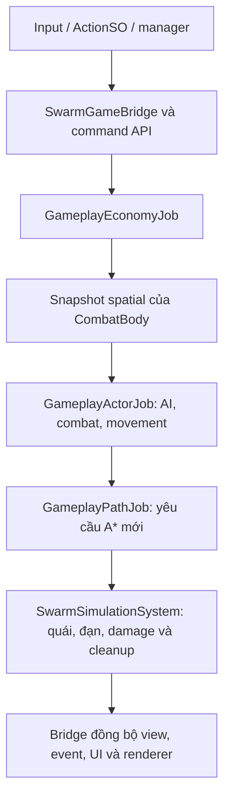

# Tech docs — tổng quan và bàn giao RTSgame2026

Đối chiếu mã nguồn ngày **26/10/2026**. Đây là trang bắt đầu đọc khi quay lại phát triển dự án. Các chi tiết thuật toán và bằng chứng thực thi nằm trong tài liệu module được liên kết bên dưới.

## 1. Trạng thái kiến trúc hiện tại

**Dự án đã triển khai DOTS cho logic thực thể gameplay.** Trong `SampleScene` có bridge và navigation grid được cấu hình, ECS quản lý quái, đạn, dân, lính, cung thủ, cừu, công trình và trạng thái khai thác tài nguyên. Các chức năng kinh tế gồm khai thác, mang/nộp hàng, ví tài nguyên, xây dựng, huấn luyện và trú nhà.

Kiến trúc là **ECS simulation kết hợp GameObject presentation**. Việc còn thấy `WorkerUnit`, `WarriorUnit`, `StructureUnit`, `SheepUnit`, Animator hoặc SpriteRenderer trong Hierarchy là chủ đích của thiết kế. Khi một Unit đã bind Entity, AI và di chuyển cũ của nó được bỏ qua; view đọc kết quả từ ECS. Quái và đạn dùng renderer instancing riêng.

UI, camera, chọn quân, fog, lịch ngày/đêm, lịch wave và thao tác placement vẫn được điều phối bằng MonoBehaviour. Không phải mọi script trong dự án đều đã chuyển thành ECS system. Các nhánh legacy còn trong code hỗ trợ đường chạy khi không có bridge; chỉ đọc các lớp Unit cũ không đủ để xác định hành vi trong scene DOTS.

## 2. Môi trường và điểm chạy

| Mục | Vị trí/giá trị đang khai báo |
|---|---|
| Unity Editor | `6000.3.11f1`, xem `ProjectSettings/ProjectVersion.txt` |
| Render pipeline | URP 2D; dependency Universal RP `17.3.0` |
| Package DOTS | Entities `1.4.8`, Physics `1.4.7`, Burst `1.8.29`, Collections `2.6.8`, Mathematics `1.3.3` |
| Scene gameplay | `Assets/Scenes/SampleScene.unity` |
| Scene mô phỏng tải | `Assets/Scenes/SwarmSimulation.unity` |
| Cấu hình dependency | `Packages/manifest.json`, `Packages/packages-lock.json` |

Các phiên bản trên được đọc từ project, không phải đề xuất nâng cấp. Giữ Editor/render pipeline hiện tại khi phát triển tính năng không đòi hỏi thay đổi chúng.

## 3. Bản đồ mã nguồn

Các đường dẫn trong bảng tính từ thư mục gốc repository.

| Khu vực | Trách nhiệm và file nên đọc trước |
|---|---|
| `Assets/Game/DOTS/Runtime/` | Assembly `RTS.DOTS`: component, simulation system, Burst jobs, renderer, demo và benchmark recorder |
| `.../Runtime/GameplayComponents.cs` | Dữ liệu actor, worker, resource, construction, production queue và wallet |
| `.../Runtime/GameplaySimulationSystem.cs` | Command API, vòng tick gameplay, điều phối job và lifecycle dữ liệu |
| `.../Runtime/GameplayActorJobs.cs` | A*, movement, chiến đấu quân người chơi, ăn cỏ/chạy trốn của cừu |
| `.../Runtime/GameplayEconomyJob.cs` | Khai thác/nộp kho, claims, xây, huấn luyện, trú nhà |
| `.../Runtime/SwarmSimulationSystem.cs` | Vòng tick quái/đạn, spawn, tổng hợp damage, collider cache và cleanup |
| `.../Runtime/SwarmJobs.cs`, `FlowFieldJob.cs`, `SwarmMath.cs` | AI quái, spatial hash, flow field, di chuyển và collision queries |
| `Assets/Game/DOTS/Integration/` | Assembly-CSharp: cầu nối với prefab, Unit, GameManager và UI |
| `.../Integration/SwarmGameBridge.cs` | Bootstrap scene, navigation capture, quái/đạn, fog và mục tiêu chính |
| `.../Integration/GameplayGameBridge.cs` | **Phần partial của cùng class `SwarmGameBridge`**: bind view, resource registry, command adapter và event UI |
| `Assets/Game/DOTS/Editor/SwarmEditorTools.cs` | Menu tạo asset/scene, mở demo và build Windows |
| `Assets/Game/DOTS/Tests/Editor/` | `GameplaySimulationTests`, `SwarmSimulationTests`, assembly `RTS.DOTS.Tests` |
| `Assets/Game/Scripts/Units/` | Prefab configuration, API của Unit và presentation; `WarrirorUnit.cs` chứa class `WarriorUnit` |
| `Assets/Game/Scripts/Managers/` | Input, selection, Tilemap, fog, ngày/đêm và wave orchestration |
| `Assets/Game/Scripts/Resources/`, `Utils/BuildingProcess.cs` | Adapter nguồn tài nguyên, placement/xây và tích hợp sản xuất |
| `Docs/Modules/`, `Tools/` | Tài liệu từng module, bằng chứng và script thu thập kết quả |

`RTS.DOTS` không tham chiếu các class gameplay như `Unit` hoặc `GameManager`. Các tham chiếu đó thuộc `Integration`. Thư mục Runtime vẫn có MonoBehaviour cho renderer/demo/benchmark và có `SystemBase` điều phối managed; không suy ra rằng toàn bộ assembly chỉ chứa Burst code.

## 4. Dữ liệu nào là nguồn chính?

| Dữ liệu | Nguồn trong scene DOTS | Phần còn lại đọc/ghi thế nào? |
|---|---|---|
| Vị trí, máu, faction, targetable | `CombatBody` | Bridge phản chiếu về view; command thay đổi dữ liệu mô phỏng |
| AI quân, mục tiêu, cooldown, stance | `GameplayActor` | Unit/UI gửi command; Animator nhận snapshot/sequence |
| AI quái | `SwarmAgent` cùng `CombatBody` | Wave gửi yêu cầu spawn/retreat; renderer đọc snapshot |
| Quỹ đạo, lifetime và va chạm đạn | `SwarmProjectile` | Job cập nhật; renderer vẽ; damage đi qua bộ tổng hợp chung |
| Đường đi riêng | `GameplayWaypoint` | A* tạo đường, movement job sử dụng |
| Công việc, hàng mang, chỗ khai thác | `GameplayWorker`, `GameplayResource`, `GatheringProfileData` | Worker/resource MonoBehaviour làm adapter và hiệu ứng |
| Tiến độ xây, FIFO huấn luyện | `GameplayConstruction`, `GameplayProducer`, `TrainingRequest` | Bridge phát event đổi sprite, spawn view và cập nhật queue UI |
| Gỗ, vàng, thịt của người chơi | `PlayerWallet` | GameManager chuyển lệnh và phản chiếu ra HUD |
| Icon, sprite, clip, tham số authoring | Prefab, ScriptableObject, visual library | Được đọc/sao chép sang dữ liệu runtime tại bước tích hợp |

Không tạo thêm một timer AI/kinh tế độc lập trong `MonoBehaviour.Update` cho Unit đã bind. Không cập nhật `transform.position` hoặc trừ máu trên view như nguồn dữ liệu gameplay; snapshot ECS có thể ghi đè chúng.

## 5. Luồng khởi động và mô phỏng

`SwarmGameBridge` đăng ký callback tải scene và tự gắn vào GameObject có `GameManager`. Bridge lấy hai simulation system từ default World, chụp navigation grid từ Tilemap và đăng ký Unit/resource. Scene gameplay cần Tilemap/grid hợp lệ; một scene trống hoặc prefab mở riêng không tự có đầy đủ điều kiện chạy DOTS.

Unit người chơi/cừu/công trình được gắn Entity qua `RegisterGameplayUnit` rồi `Unit.BindDots`; `AIPawn` được tắt. Quái đặt sẵn hoặc tạo trực tiếp được chuyển qua `TryConvertEnemy`, sau đó view nguồn được tắt và trả pool/hủy. `Unit.Start` và đăng ký runtime nối các đối tượng sinh sau thời điểm bridge khởi động. Khi hủy/trả pool, lifecycle gọi unregister/remove để dọn Entity và công việc liên quan.

Hai simulation system thuộc `FixedStepSimulationSystemGroup`; `GameplaySimulationSystem` được đặt trước `SwarmSimulationSystem`. Bridge nhận command và đồng bộ presentation trong vòng frame MonoBehaviour; sơ đồ mô tả luồng dữ liệu, không khẳng định tất cả command có hiệu lực ngay trong cùng frame.

AI/movement/spatial/collision có Burst jobs. Kinh tế dùng một writer để quản lý giao dịch và claims; A* dùng ngân sách request cùng vùng nhớ scratch dùng lại. Có các điểm `Complete()` giữa các stage để chuyển quyền truy cập dữ liệu. Đây không phải pipeline hoàn toàn bất đồng bộ.

## 6. Những quyết định cần giữ khi phát triển tiếp

| Quyết định đã áp dụng | Ý nghĩa khi sửa code |
|---|---|
| Flow field chung cho quái, A* riêng cho actor người chơi/cừu | Sửa đúng thuật toán của đúng nhóm; không thêm A* mỗi frame cho từng quái |
| Spatial hash giới hạn tìm hàng xóm/ứng viên collision | Không đưa lại vòng quét toàn bộ danh sách cho từng actor trong đường chạy tải lớn |
| Grid movement và Unity Physics collider queries | Không mặc định đang chạy đầy đủ PhysicsWorld/rigidbody solver; Collider2D chủ yếu phục vụ view, chọn/đặt và capture grid |
| Damage được tổng hợp một nơi | `QueueDamage` cập nhật máu ECS; không gọi tiếp damage legacy để trừ lại trên view |
| Prefab được giữ làm authoring/presentation | Thêm loại quân cần ánh xạ dữ liệu và hành vi ECS; thêm prefab đơn thuần chưa tạo AI mới |
| Renderer quái/đạn dùng `Graphics.DrawMeshInstanced` | Đây là renderer riêng; chưa dùng Entities Graphics cho toàn bộ project |
| `Entity`/`GetInstanceID()` là handle runtime | Save/load cần thiết kế ID bền vững và khôi phục quan hệ; chưa có module này |

Xem [hướng dẫn phát triển DOTS](Modules/DOTS/DevelopmentGuide.md) để biết API nên gọi, file cần sửa và cách nối procedural generation.

## 7. Chạy và kiểm chứng

Để thử gameplay: mở `SampleScene`, đợi compile rồi Play. Để thử tải quái/đạn: mở `SwarmSimulation` hoặc menu `RTS/DOTS/Open swarm simulation`. Các menu và cờ smoke được mô tả trong [Swarm Usage](Modules/DOTS/Usage.md) và [Gameplay Usage](Modules/DOTSGameplay/Usage.md).

Chạy EditMode trong Test Runner với assembly `RTS.DOTS.Tests` khi thay đổi simulation. Với thay đổi bridge/prefab/command, bổ sung kiểm tra tích hợp Player bằng `--gameplay-smoke` và kiểm tra thủ công phần UI liên quan.

| Bằng chứng đã lưu | Phạm vi được xác nhận |
|---|---|
| [Gameplay, ngày 16/10/2026](Modules/DOTSGameplay/Validation.md) | 32 case EditMode, 18 check tích hợp Player; có artifact XML/JSON |
| [Swarm, ngày 15/10/2026](Modules/DOTS/Validation.md) | Capture quái/đạn 5.000 và 10.000 với điều kiện offscreen được ghi riêng |

Lần cập nhật tài liệu ngày 26/10 chỉ đối chiếu code, link và artifact đã lưu; không chạy lại Unity/test/benchmark. Kết quả lịch sử không chứng nhận mọi thay đổi sau đó hoặc mọi thao tác UI. Counter quái cuối smoke là snapshot, có thể thay đổi theo bài chạy.

Khi đo mới, ghi số lượng từng loại thực thể, phần cứng, build, rendering, độ phân giải, seed và thời gian capture. `SwarmSimulationSystem.LastTickMilliseconds` chỉ đo tick Swarm; không dùng riêng counter này làm tổng thời gian mô phỏng RTS vì còn `GameplaySimulationSystem`, bridge và presentation.

## 8. Phần chưa triển khai và tài liệu liên quan

Chưa có module procedural generation hoàn chỉnh, save/load Entity, networking, baking/SubScene cho toàn bộ prefab hoặc instanced rendering cho toàn bộ quân người chơi. Ba layout của Swarm demo là kịch bản dựng sẵn. Presentation của dân/quân/cừu/công trình vẫn chịu chi phí GameObject/Animator/Collider2D; benchmark quái không chứng minh hiệu năng hàng nghìn worker.

- [Danh mục tài liệu](README.md): điểm vào từng module.
- [Swarm Architecture](Modules/DOTS/Architecture.md): flow field, spatial hash, collision và renderer.
- [Gameplay Architecture](Modules/DOTSGameplay/Architecture.md): dữ liệu và luồng kinh tế/chiến đấu/xây/huấn luyện.
- [DOTS Development Guide](Modules/DOTS/DevelopmentGuide.md): quy trình mở rộng và chẩn đoán lỗi.
- [Procedural Generation](Modules/ProceduralGeneration/Architecture.md): Core sinh cỏ/nước và phân bố cây/vàng/cừu đã có; xem [Validation](Modules/ProceduralGeneration/Validation.md) cho kết quả quét seed và các bước Unity còn chưa kiểm chứng.
- [Quy ước dự án](../AGENTS.md): mỗi module lớn cần docs, validation và nguồn tham khảo riêng.

Các file code được nêu ở mục 3 và manifest là căn cứ mô tả implementation. Nguồn API/thuật toán bên ngoài nằm tại mục tham khảo của từng tài liệu Architecture; tài liệu tổng quan này không thay thế chúng.
